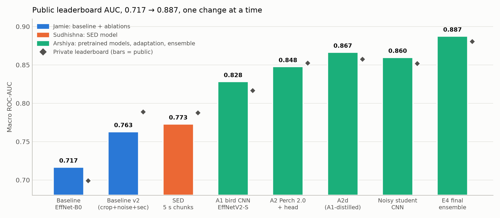
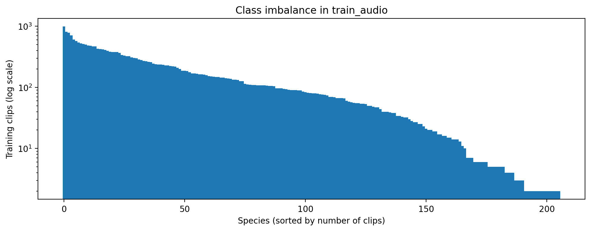
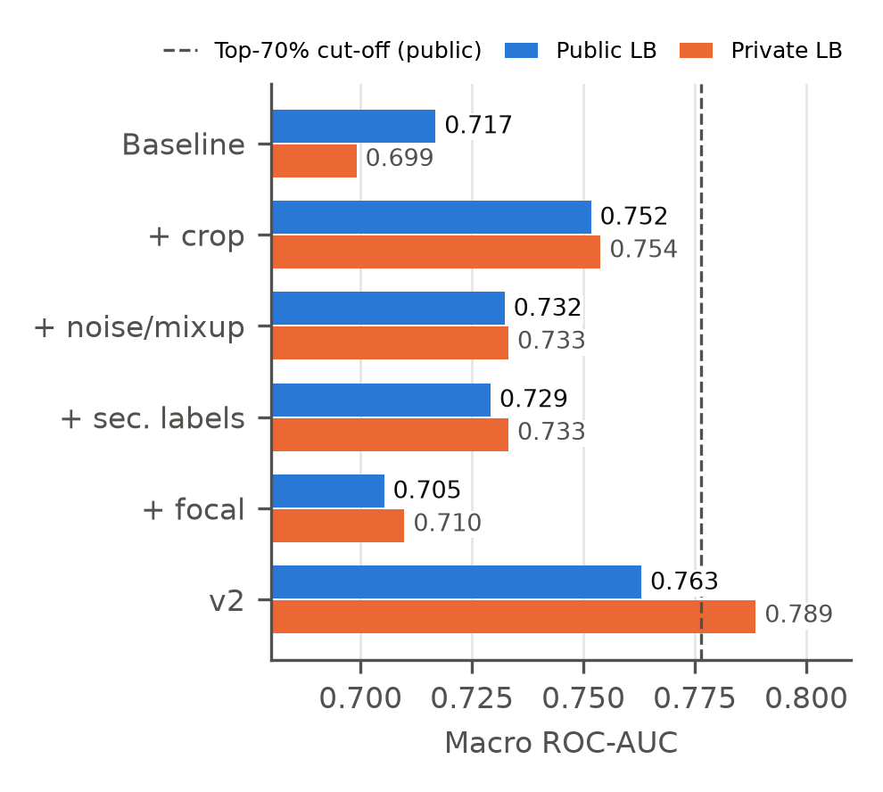
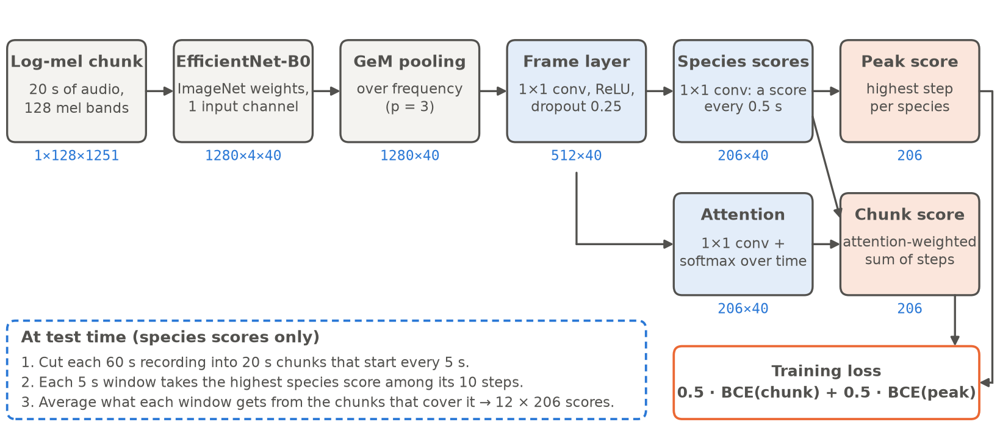
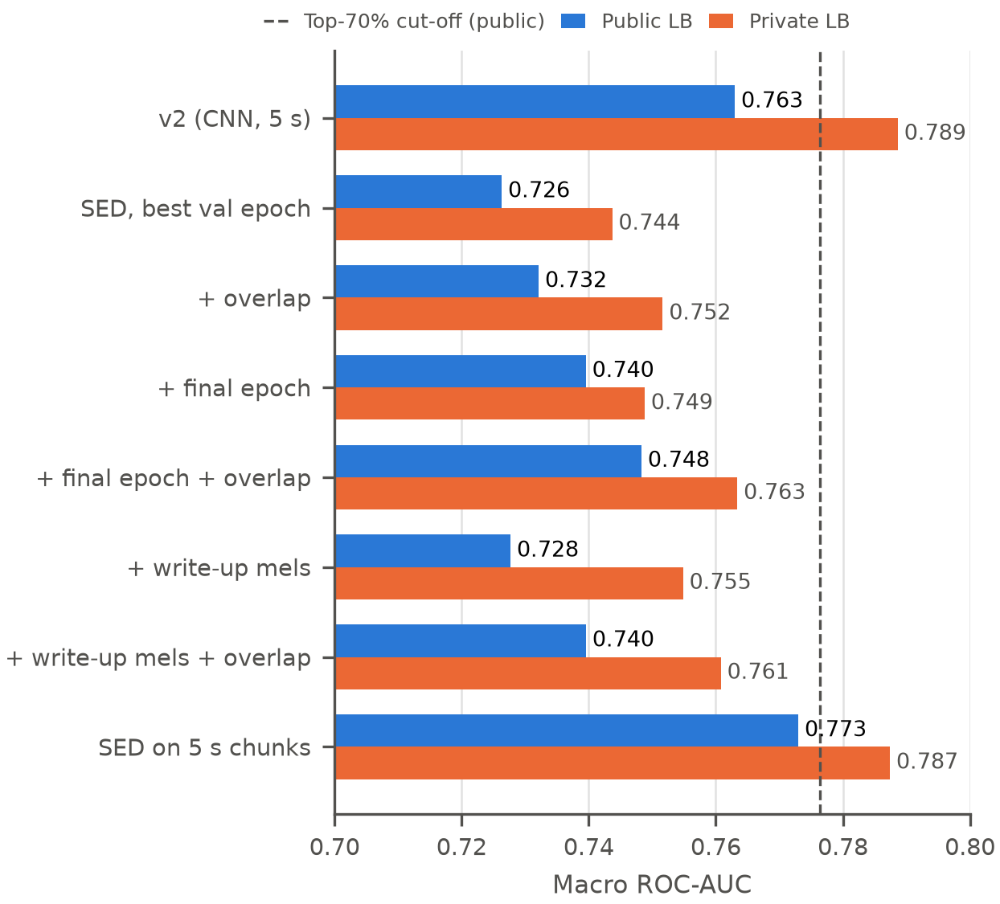
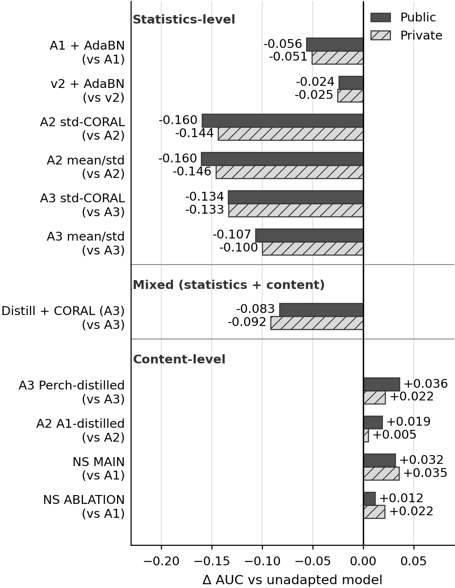
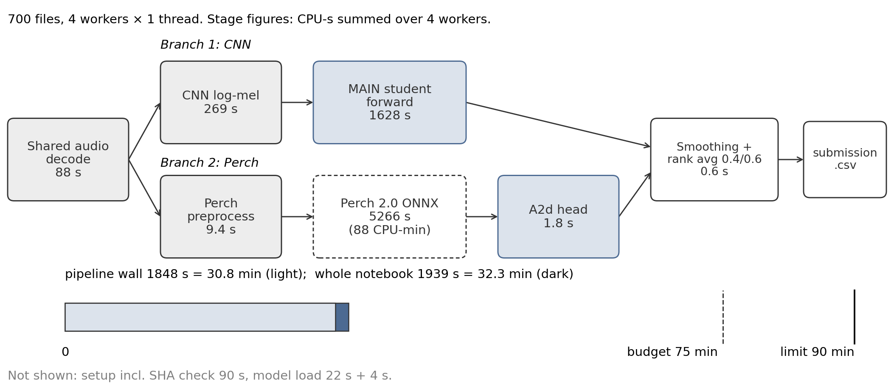
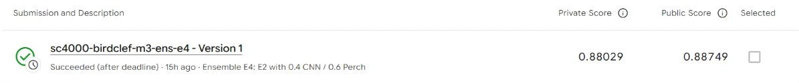
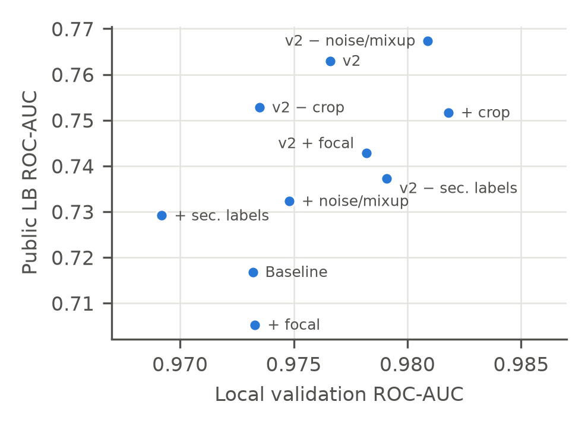

# From a Spectrogram CNN to Pseudo-Labelled Ensembles

**Closing the focal-to-soundscape gap in BirdCLEF+ 2025** · SC4000 Machine Learning, NTU · Group 48

> **Private repo.** The course rules say not to release project code publicly. Keep this repository private.

Our solution to the Kaggle competition [BirdCLEF+ 2025](https://www.kaggle.com/competitions/birdclef-2025/): find which of 206 species (birds, amphibians, insects and mammals) are calling in every 5-second window of one-minute rainforest soundscapes from El Silencio Natural Reserve, Colombia.

| | |
|---|---|
| **Final submission** | E4: noisy-student CNN (0.4) + distilled Perch 2.0 head (0.6), rank-averaged and temporally smoothed |
| **Score** | **0.88749 public / 0.88029 private** macro ROC-AUC (first baseline: 0.717 / 0.699) |
| **Runtime** | 32.3 CPU minutes for about 700 soundscapes (limit 90 min, CPU only, internet off) |
| **Position** | Would place 73rd of 2,032 teams on the public leaderboard (top 3.6%). Not an official rank: the submissions are late, and Perch 2.0 was released after the competition closed. |



## Team

| Member | Contribution | Where to look |
|---|---|---|
| **Jamie Gonzales Esguerra** | Exploratory data analysis, EfficientNet-B0 baseline, baseline ablations → baseline v2 (Stage 1) | [Stage 1](#stage-1-baseline-and-data-driven-fixes-jamie), [Jamie: ablation details](#jamie-baseline-ablations), `notebooks/jamie_*` |
| **Dhanapalan Swaminathan Sudhishna Janavi** | Sound event detection (SED) model (Stage 2) | [Stage 2](#stage-2-sound-event-detection-sudhishna), `notebooks/sudhishna_*`, `report/sections/` |
| **Arshiya Jawahar Ali Sirajudeen** | Pretrained backbones, CPU inference speed, label-free adaptation, distillation, noisy student, final ensemble and submission (Stages 3–4) | [Stages 3–4](#stage-3-pretrained-backbones-arshiya), [Arshiya: details](#arshiya-pretrained-models-adaptation-and-the-final-ensemble), `notebooks/arshiya_*`, `report/arshiya_pretrained_ensemble/` |
| **Modi Khushi** | Presentation slides | |

## The problem

- **Training data:** 28,564 clean, close-up focal recordings, each with one weak label for the whole clip.
- **Test data:** noisy soundscapes from field recorders. No labelled soundscapes are available, so there is nothing in-domain to validate on.
- **Metric:** macro ROC-AUC, so a rare species counts as much as a common one.

Our data analysis found four difficulties, and each one motivated a change:

| Difficulty | Evidence | What we tried |
|---|---|---|
| Class imbalance | 990 clips for the most common species, 2 for the rarest; 30 species have five or fewer | Focal loss |
| Weak labels | Median clip is 20.5 s, but one label covers the whole clip, so a fixed 5 s crop may hold no call | Random 5 s crops |
| Domain shift | Clean focal calls in training; rain, insects and overlapping calls in the test soundscapes | Soundscape noise + mixup |
| Incomplete labels | Only 9.3% of clips list secondary species | Secondary labels as soft targets (0.5) |



## Approach and results

Every stage changes **one thing at a time** against a fixed recipe, split (seed 42, stratified 80/20) and inference protocol, so each gain can be attributed. Public-score differences below 0.01 are treated as noise.

### Stage 1: baseline and data-driven fixes (Jamie)

An ImageNet EfficientNet-B0 on 5 s log-mel spectrograms (public 0.717) was improved by adding one fix per difficulty. Random crops gave the largest gain (+0.035), soundscape noise with mixup (+0.016) and secondary labels (+0.012) also helped, and focal loss did not (−0.012), so it was dropped. Combining the three helpful fixes gives **baseline v2: 0.763 public / 0.789 private**, the recipe every later model starts from. Remove-one ablations confirmed that each fix contributes on the private board.



### Stage 2: sound event detection (Sudhishna)

The baseline scores a window as a whole, so it cannot tell *when* a species calls. The SED model (re-implemented from the description in the 1st-place write-up) predicts 206 scores every 0.5 s and pools them into a clip score for training, with loss 0.5·BCE(attention) + 0.5·BCE(peak). It learns call timing from clip-level labels alone.

The key setting was **chunk length**: on 20 s chunks, as in the write-up, SED stayed below v2; on **5 s chunks it gained +0.033 and reached 0.773 public**, level with v2. A likely, untested reason is that 47.9% of the clips are shorter than 20 s, so long chunks are mostly padding. Using the final epoch instead of the best-validation epoch and overlapping chunks at inference both helped; the 1st-place write-up's spectrogram settings did not.





### Stage 3: pretrained backbones (Arshiya)

Keeping v2's recipe, only the pretrained model was changed: **A1** a bird-pretrained EfficientNetV2-S (0.828 public), **A2** frozen Perch 2.0 with a small head (**0.848**, the best transfer), and **A3** frozen Bird-MAE (0.776, and the slowest on CPU, so it was left out of the final system). Every model kept a gap of about 0.14–0.2 between clean validation and the leaderboard, which motivated Stage 4.

### Stage 4: label-free adaptation and the final ensemble (Arshiya)

Using 9,726 unlabelled soundscapes from the same recorders as the test set, two families were tested:

- **Statistics-level** (AdaBN, CORAL, mean/std matching) change how features are scaled. **All 7 submissions got worse** (−0.024 to −0.161 public). Diagnosis showed no bug: these methods barely moved validation but scrambled the per-species ranking of windows, which is exactly what ROC-AUC scores.
- **Content-level** (head distillation, noisy student) change what the model is trained on. **All 4 submissions improved** (+0.012 to +0.036). A Perch head distilled from the CNN (A2d, 0.867) became the best single model, and a noisy-student CNN trained on pseudo-labels for 116,712 soundscape windows went from 0.816 to 0.852 private.



The CNN and Perch make different errors (Spearman 0.31), so the final system rank-averages them and smooths each window with its neighbours. Four ensemble variants were fixed before any was scored; **E4 (CNN 0.4 + A2d 0.6, smoothed) was selected: 0.88749 public / 0.88029 private in 32.3 CPU minutes**.





### Main lesson: clean validation did not predict the leaderboard

- In the Stage 1 ablations, v2 without noise had the highest validation AUC and the lowest private score.
- For SED, choosing the epoch by validation cost up to 0.016 public.
- AdaBN and CORAL barely changed validation but lost up to 0.16 on the leaderboard.

So models were selected by public score, with differences below 0.01 treated as noise.



### Limitations and future work

- One data split, and each CNN was trained only once; the 0.01 noise level was not measured directly.
- Perch 2.0 post-dates the competition and may overlap with the training data.
- With no labelled soundscapes, our explanations could not be tested directly.
- Next steps: a small labelled soundscape set for validation, more noisy-student rounds with pseudo-label filtering, SED models inside the ensemble, and separating teacher quality from label density.

## Repository guide

### Layout

```
configs/       experiment configs (yaml)
data/          competition data (gitignored — download with scripts/download_data.sh)
datasets/      metadata and small files for the private Kaggle datasets (large files are on Kaggle)
m1/            copies of the baseline v2 notebooks used as the starting point by Arshiya
models/        trained weights (gitignored)
notebooks/     one folder per Kaggle notebook (notebook + kernel-metadata.json)
notes/         research notes (papers, model formats, licences, CLI, citations)
report/        everything for the written report and the video
  jamie_AAAI_*.docx                              Jamie: report drafts
  figures/, sections/, slides/                   Jamie & Sudhishna: figures (jamie_*, sudhishna_*), report sections and slides
  arshiya_pretrained_ensemble/                   Arshiya: paper, presentations, documentation, run logs
    results/                                     results_table, timing_table, ensemble_handoff, pretrained_models_section
scripts/       helper scripts (kaggle_run.sh, jamie_experiments.py, sudhishna_experiments.py, make_team_progress_figure.py)
src/           reusable code (dataset, features, models, training)
submissions/   generated submission CSVs (gitignored)
```

### Setup

```bash
python3 -m venv .venv
source .venv/bin/activate
pip install -r requirements.txt
bash scripts/download_data.sh
```

### Running on Kaggle (no local data or GPU needed)

Write code in VS Code, then run it on Kaggle where the data is already attached.
Each notebook lives in its own folder under `notebooks/` with a `kernel-metadata.json`.

```bash
source .venv/bin/activate
bash scripts/kaggle_run.sh notebooks/jamie_eda
```

This pushes the notebook as a **private** Kaggle kernel, waits for it to finish, and
downloads the outputs (figures, CSVs, models) to `outputs/jamie_eda/` (gitignored).

To make a new notebook: copy `notebooks/jamie_eda/kernel-metadata.json` into a new folder, then change
`id`, `title` and `code_file`. Set `"enable_gpu": true` for training. Kaggle gives about 30 GPU hours a week.
The script refuses to push if `"is_private"` is not `true`.

Requires the Kaggle CLI token at `~/.kaggle/access_token`.

## Experiment log

Every leaderboard submission by Jamie and Sudhishna, in order.

| Date | Who | Experiment | Local CV AUC | Public LB | Notes |
|------|-----|------------|--------------|-----------|-------|
| 2026-11-01 | Jamie | Baseline: EfficientNet-B0 (ImageNet), first 5 s log-mel, primary label only, BCE, no augmentation, 15 epochs (best = epoch 7) | 0.9732 | 0.71681 (private 0.69908) | Rank ~1600/2032 (top 79%). Overfits after epoch 7; large gap between local CV and LB because training clips differ from soundscapes |
| 2026-11-07 | Jamie | Ablation `crop`: baseline + random 5 s crops from whole clip (m1-train-crop v1, m1-infer-crop v1) | 0.9818 (epoch 15) | 0.75169 (private 0.75384) | Δ vs baseline LB: +0.0349. No overfitting; still improving at epoch 15 |
| 2026-11-07 | Jamie | Ablation `noise`: baseline + soundscape noise (p 0.5, −20 to −3 dB) + mixup (p 0.5) (m1-train-noise v1, m1-infer-noise v1) | 0.9748 (epoch 14) | 0.73232 (private 0.73318) | Δ vs baseline LB: +0.0155. Small local gain, larger LB gain (domain shift) |
| 2026-11-07 | Jamie | Ablation `seclabel`: baseline + secondary labels as soft targets 0.5 (m1-train-seclabel v1, m1-infer-seclabel v1) | 0.9692 (epoch 6) | 0.72916 (private 0.73318) | Δ vs baseline LB: +0.0124. No local gain (val scores primary label only), but helps on LB; still overfits after epoch 6 |
| 2026-11-07 | Jamie | Ablation `focal`: baseline + focal loss γ = 2 instead of BCE (m1-train-focal v1, m1-infer-focal v1) | 0.9733 (epoch 5) | 0.70528 (private 0.70984) | Δ vs baseline LB: −0.0115 (private +0.0108), i.e. no clear effect. Learns faster but peaks at epoch 5 and overfits |
| 2026-11-07 | Jamie | **Baseline v2**: crop + noise/mixup + secondary labels, BCE (m1-train-v2 v1, m1-infer-v2 v1) | 0.9766 (epoch 14) | **0.76299 (private 0.78864)** | Δ vs baseline LB: +0.0462 (private +0.0896). Best private score; 0.014 below top-70% cut-off |
| 2026-11-07 | Jamie | Remove-one `v2-nocrop`: v2 without random crop (m1-train-v2-nocrop v1) | 0.9735 (epoch 12) | 0.75280 (private 0.77176) | Δ vs v2: −0.0102 (private −0.0169) |
| 2026-11-07 | Jamie | Remove-one `v2-nonoise`: v2 without noise + mixup (m1-train-v2-nonoise v1) | 0.9809 (epoch 10) | 0.76740 (private 0.76030) | Δ vs v2: +0.0044 (private −0.0283). Public and private disagree; noise helps on private |
| 2026-11-07 | Jamie | Remove-one `v2-nosec`: v2 without secondary labels (m1-train-v2-nosec v1) | 0.9791 (epoch 15) | 0.73731 (private 0.77243) | Δ vs v2: −0.0257 (private −0.0162). Largest drop |
| 2026-11-07 | Jamie | Add-one `v2-focal`: v2 with focal loss γ = 2 instead of BCE (m1-train-v2-focal v1) | 0.9782 (epoch 15) | 0.74281 (private 0.78241) | Δ vs v2: −0.0202 (private −0.0062). Focal still does not help |
| 2026-11-08 | Sudhishna | SED `sed20`: EfficientNet-B0 + GeM + frame and attention heads, 20 s chunks on Jamie's 128-band mels, v2 recipe, 0.5 attention + 0.5 peak BCE, no overlap at inference (m2-train-sed20 v1, m2-infer-sed20 v1) | 0.9699 first 5 s; 0.9860 peak over 20 s (epoch 7) | 0.72631 (private 0.74369) | Δ vs v2: −0.0367 (private −0.0450). Below v2. Weights saved at epoch 7, when the learning rate was still about 0.64 × peak |
| 2026-11-08 | Sudhishna | SED `sed20-overlap`: same weights as `sed20`, chunks every 5 s instead of every 20 s, predictions averaged (m2-infer-sed20-overlap v1) | same as `sed20` | 0.73212 (private 0.75164) | Δ vs `sed20`: +0.0058 (private +0.0080). Both up but under 0.01, so treated as a tie. Δ vs v2: −0.0309 (private −0.0370) |
| 2026-11-08 | Sudhishna | SED `sed20-last`: same training as `sed20` (history matches to 4 decimals), but saves the final epoch instead of the highest peak score (m2-train-sed20-last v1, m2-infer-sed20-last v1) | 0.9736 first 5 s; 0.9850 peak over 20 s (epoch 15) | 0.73954 (private 0.74880) | Δ vs `sed20`: +0.0132 (private +0.0051). Δ vs v2: −0.0235 (private −0.0398) |
| 2026-11-08 | Sudhishna | SED `sed20-last-overlap`: `sed20-last` weights with chunks every 5 s (m2-infer-sed20-last-overlap v1) | same as `sed20-last` | 0.74830 (private 0.76338) | Δ vs `sed20-last`: +0.0088 (private +0.0146). Δ vs `sed20`: +0.0220 (private +0.0197). Δ vs v2: −0.0147 (private −0.0253) |
| 2026-11-08 | Sudhishna | SED `sed20-hires`: `sed20-last` on spectrograms with the 1st-place write-up's settings (224 bands, n_fft 4096, hop 1252, 0–16 kHz; m2-make-mels-224 v1, m2-train-sed20-hires v1, m2-infer-sed20-hires v1) | 0.9723 first 5 s; 0.9835 peak over 20 s (epoch 15) | 0.72769 (private 0.75484) | Δ vs `sed20-last`: −0.0119 (private +0.0060). Public and private disagree; no gain |
| 2026-11-08 | Sudhishna | SED `sed20-hires-overlap`: `sed20-hires` weights with chunks every 5 s (m2-infer-sed20-hires-overlap v1) | same as `sed20-hires` | 0.73957 (private 0.76079) | Δ vs `sed20-last-overlap`: −0.0087 (private −0.0026). No gain from the write-up's spectrogram settings |
| 2026-11-08 | Sudhishna | SED `sed5`: `sed20-last` on 5 s chunks (10 time steps of 0.5 s), one chunk per 5 s window, so no overlap (m2-train-sed5 v1, m2-infer-sed5 v1) | 0.9798 (epoch 15; first 5 s and peak are the same for 5 s chunks) | **0.77298 (private 0.78740)** | Δ vs v2: +0.0100 (private −0.0012), i.e. level with v2; best public score so far. Δ vs `sed20-last` (also no overlap): +0.0334 (private +0.0386), so the 20 s chunk, not the SED head, held SED back. CPU estimate 16 min |

Leaderboard band cut-offs (public): top 10% ≥ 0.8808, top 30% ≥ 0.8731, top 50% ≥ 0.8102, top 70% ≥ 0.7764. Best: 0.9338.

Arshiya's 19 submissions are logged separately: see [Results summary](#results-summary) below and `report/arshiya_pretrained_ensemble/DOCUMENTATION.md`, section 16.

## Details by member

### Jamie: baseline ablations

Each experiment is the baseline with **one** switch turned on, so a change in score comes from
that switch alone. Everything else is identical: EfficientNet-B0, AdamW 1e-3 + one-cycle,
batch 64, 15 epochs, best epoch kept, same 80/20 split (seed 42). Local CV is always scored
on the first 5 s of each hold-out clip with the primary label only, so the numbers are comparable.

**Shared input:** `jmemei/sc4000-birdclef-m1-make-mels`, whole-clip log-mels (≤ 30 s,
stored as uint8 over 120 dB) plus 1,000 unlabelled soundscapes for noise.
Code: `notebooks/jamie_train/train.ipynb` (master), copied into the per-experiment folders by
`python3 scripts/jamie_experiments.py`.

| Experiment | Switch (vs baseline) | Problem targeted | Training kernel | Inference kernel |
|---|---|---|---|---|
| `base` | none: new data pipeline only; should match baseline CV ≈ 0.973 | (sanity check) | `m1-train-base` | `m1-infer-base` |
| `crop` | random 5 s crop from the whole clip instead of the first 5 s | weak labels | `m1-train-crop` | `m1-infer-crop` |
| `noise` | add soundscape noise (p = 0.5, −20 to −3 dB) + mixup (p = 0.5, Beta(0.4, 0.4), targets = max) | domain shift, overfitting | `m1-train-noise` | `m1-infer-noise` |
| `seclabel` | secondary labels as soft targets (0.5) | label noise | `m1-train-seclabel` | `m1-infer-seclabel` |
| `focal` | focal loss (γ = 2) instead of BCE | class imbalance | `m1-train-focal` | `m1-infer-focal` |
| `v2` | crop + noise/mixup + seclabel (the switches that improved the public LB), BCE | all | `m1-train-v2` | `m1-infer-v2` |
| `v2-nocrop` / `v2-nonoise` / `v2-nosec` | v2 with one switch removed (remove-one ablation) | — | `m1-train-v2-…` | `m1-infer-v2-…` |
| `v2-focal` | v2 with focal loss instead of BCE | — | `m1-train-v2-focal` | `m1-infer-v2-focal` |

Kernel names are short for `jmemei/sc4000-birdclef-<name>`.

**Running one experiment** (e.g. `crop`):

```bash
bash scripts/kaggle_run.sh notebooks/jamie_train_crop    # GPU training, ~20 min
bash scripts/kaggle_run.sh notebooks/jamie_infer_crop    # CPU inference dry run
kaggle competitions submit birdclef-2025 -k jmemei/sc4000-birdclef-m1-infer-crop -v <version> \
  -f submission.csv -m "M1 crop" --wait
```

The local CV is printed at the end of the training log
(`[crop] best val macro ROC-AUC: ...`) and saved in `outputs/jamie_train_crop/cfg.json`
as `best_val_auc`.

**Row template** to append to the experiment log above after each submission:

```
| YYYY-MM-DD | Jamie | Ablation `crop`: baseline + random 5 s crops (kernel m1-train-crop vN) | 0.9xxx (epoch N) | 0.xxxxx (private 0.xxxxx) | Δ vs baseline LB: +0.0xxx |
```

### Arshiya: pretrained models, adaptation and the final ensemble

#### Overview

Late-submission work for the NTU SC4000 team project on Kaggle BirdCLEF+ 2025. The task is to predict 206 classes (birds, amphibians, insects, mammals) for every 5 s window of about 700 one-minute test soundscapes; the metric is macro ROC-AUC, and the submission notebook must run on CPU in at most 90 min with internet off. Every experiment follows a "v2 + one change" protocol: our team's baseline v2 recipe, split (seed 42, stratified 80/20) and inference protocol stay fixed, and only one component changes.

We compare three pretraining paradigms: a bird-pretrained CNN backbone (A1), Perch 2.0 frozen embeddings (A2) and Bird-MAE-Base frozen features (A3). Label-free statistics-level alignment (AdaBN, CORAL, mean/std matching) hurt every model it was applied to, whereas content-level adaptation (distillation and noisy student on unlabelled soundscapes) helped. The final ensemble E4 scores 0.88749 public / 0.88029 private, against 0.763 / 0.789 for v2.

#### Scope of this repository

This repository covers our pretrained-model and inference-speed work: pretrained models A1, A2 and A3, CPU inference speed (profiling and a faster pipeline), the adaptation study (AdaBN, CORAL), distillation and noisy student round 1. It also contains the final ensemble, E1 to E4.

Everything builds on our team's baseline model (v2): [`sc4000-birdclef-m1-make-mels`](https://www.kaggle.com/code/jmemei/sc4000-birdclef-m1-make-mels) (spectrogram cache and split) and [`sc4000-birdclef-m1-train-v2`](https://www.kaggle.com/code/jmemei/sc4000-birdclef-m1-train-v2) (trained EfficientNet-B0), plus the inference notebook [`sc4000-birdclef-m1-infer-v2`](https://www.kaggle.com/code/jmemei/sc4000-birdclef-m1-infer-v2). Local copies are in `m1/`.

#### Status (as of 10 Nov 2026)

**Experiments done.** We made 19 late submissions, all scored, from 40 Kaggle notebooks, all COMPLETE and all private.

**Deliverables:**

- `report/arshiya_pretrained_ensemble/NOTEBOOKS.md`: catalogue of the 40 notebooks, 2 private datasets and the upstream inputs.
- `report/arshiya_pretrained_ensemble/DOCUMENTATION.md`: technical documentation (17 sections; section 16 lists all submissions, section 17 the compute and limitations).
- `report/arshiya_pretrained_ensemble/paper/`: AAAI-27 paper (`main.tex`, `references.bib`, `paper.docx`, `figures/`), plus `report/arshiya_pretrained_ensemble/paper_overleaf.zip` for Overleaf.
- `report/arshiya_pretrained_ensemble/results/`: `results_table.md`, `timing_table.md`, `ensemble_handoff.md`, `pretrained_models_section.md`.

**Not done.** We did not export the CNN to ONNX/OpenVINO (the submitted CNNs run with torch on CPU; E4 takes 32.3 min measured). The paper has not been compiled locally (no LaTeX on the laptop), so it should be compiled on Overleaf. Sharing the private Kaggle notebooks and datasets with teammates has to be done by hand in the Kaggle UI (steps in `report/arshiya_pretrained_ensemble/results/ensemble_handoff.md`).

#### Results summary

Reference: v2 public 0.763 / private 0.789; grading cut-off 0.776 public; team goal 0.810. CPU minutes are for 700 one-minute soundscapes; "measured" is a full 700-file run, "projected" is scaled up from a 20-file dry run.

| System | Ref | Public | Private | Δ public vs v2 | CPU min / 700 files |
|---|---|---|---|---|---|
| v2 baseline (team baseline, EfficientNet-B0) | n/a | 0.763 | 0.789 | 0 | 11.1 measured (5.5 with the fast pipeline) |
| A1 bird-pretrained EfficientNetV2-S | 58120958 | 0.82822 | 0.81642 | +0.0652 | about 37 projected (8.0 measured, fast pipeline) |
| A2 Perch 2.0 + MLP head | 58122219 | 0.84774 | 0.85226 | +0.0847 | 25.0 projected |
| A3 Bird-MAE-Base + MLP head | 58127656 | 0.77640 | 0.78016 | +0.0134 | 61.6 projected |
| A3 + Perch-distilled | 58161782 | 0.81238 | 0.80208 | +0.0494 | 67.5 projected |
| A2 + A1-distilled (A2d, best single model) | 58164973 | 0.86651 | 0.85737 | +0.1035 | 26.5 projected |
| Noisy student MAIN | 58181262 | 0.85985 | 0.85185 | +0.0968 | 9.9 measured |
| Noisy student ABLATION | 58181267 | 0.84003 | 0.83794 | +0.0770 | 10.0 measured |
| E1 MAIN + A2d, rank average | 58196484 | 0.88352 | 0.87203 | +0.1205 | 28.3 measured |
| E2 = E1 + temporal smoothing | 58196486 | 0.88662 | 0.88008 | +0.1236 | 30.4 measured |
| E3 = E2 + ABLATION, 1/3 each | 58198886 | 0.88058 | 0.87522 | +0.1176 | 39.9 measured |
| **E4 = MAIN 0.4 + A2d 0.6, smoothed (selected by public LB; E2 is within noise)** | 58198889 | **0.88749** | **0.88029** | **+0.1245** | **32.3 measured** |

All 19 submissions (including the AdaBN and CORAL variants, which all scored below their unadapted parents) are in `report/arshiya_pretrained_ensemble/DOCUMENTATION.md`, section 16. Public differences below 0.01 are treated as noise.

#### Folder structure

```
README.md
datasets/            metadata and small files for the private Kaggle datasets (large files are on Kaggle)
  perch-onnx/  ns-pseudo-labels/
report/arshiya_pretrained_ensemble/
  NOTEBOOKS.md             catalogue of the 40 Kaggle notebooks, datasets, upstream inputs
  DOCUMENTATION.md         technical documentation, sections 1-17
  LOG.md                   chronological run log
  paper/                   AAAI-27 paper: main.tex, references.bib, paper.docx, figures/, UNVERIFIED_REFS.md
  paper_overleaf.zip       paper upload for Overleaf
  presentation/            Beamer slides and speaker scripts (earlier version)
  archive/                 old versions, do not edit: paper_v2/, presentation_v2/, paper_v2_overleaf.zip, IMPLEMENTATION_GUIDE.md
  _kaggle_logs/            downloaded run logs and CLI output used as evidence
  results/                 results_table.md, timing_table.md, ensemble_handoff.md, pretrained_models_section.md
m1/                  our team's baseline v2 notebooks
notebooks/           40 folders, one per Kaggle notebook (notebook + kernel-metadata.json)
notes/               research notes (papers, model formats, licences, CLI, citations)
```

#### How to reproduce

Requirements: a Kaggle account that has accepted the BirdCLEF+ 2025 competition rules, and read access to the private items under `strippedbanana` (all notebooks and datasets are private). Each notebook's inputs are listed in `report/arshiya_pretrained_ensemble/NOTEBOOKS.md` and in its `kernel-metadata.json` under `notebooks/<folder>/`. GPU notebooks need a T4 and print or raise a GPU guard if none is available. All inference notebooks are CPU-only with internet off.

Private datasets to attach (both under `strippedbanana`):

- [`sc4000-birdclef-m3-perch-onnx`](https://www.kaggle.com/datasets/strippedbanana/sc4000-birdclef-m3-perch-onnx): community ONNX conversion of Perch 2.0.
- [`sc4000-birdclef-m3-birdmae-base`](https://www.kaggle.com/datasets/strippedbanana/sc4000-birdclef-m3-birdmae-base): Bird-MAE-Base weights (not needed for E4).

Large files are not stored in this repository. Get them from these private Kaggle datasets:

- `datasets/perch-onnx/perch_v2.onnx` (390 MB): [`sc4000-birdclef-m3-perch-onnx`](https://www.kaggle.com/datasets/strippedbanana/sc4000-birdclef-m3-perch-onnx).
- Bird-MAE-Base weights and config, including `model.safetensors` (326 MB): [`sc4000-birdclef-m3-birdmae-base`](https://www.kaggle.com/datasets/strippedbanana/sc4000-birdclef-m3-birdmae-base).
- `datasets/ns-pseudo-labels/pseudo_main.npy` and `pseudo_ablation.npy` (92 MB each): [`sc4000-birdclef-m3-ns-pseudo-labels`](https://www.kaggle.com/datasets/strippedbanana/sc4000-birdclef-m3-ns-pseudo-labels).

Upstream: our team's baseline notebooks `make-mels` and `train-v2` notebooks, and the public dataset [`vladimirsydor/bird-clef-2025-all-pretrained-models`](https://www.kaggle.com/datasets/vladimirsydor/bird-clef-2025-all-pretrained-models).

Run order by phase (notebook names omit the prefix `sc4000-birdclef-m3-`; the accelerator is in brackets):

| Phase | Notebooks in order |
|---|---|
| 1. Pretrained models and speed | [`a1-v2s-train`](https://www.kaggle.com/code/strippedbanana/sc4000-birdclef-m3-a1-v2s-train) (T4); [`a1-v2s-infer`](https://www.kaggle.com/code/strippedbanana/sc4000-birdclef-m3-a1-v2s-infer) (CPU); [`a2-perch-embed`](https://www.kaggle.com/code/strippedbanana/sc4000-birdclef-m3-a2-perch-embed) (T4); [`a2-perch-infer`](https://www.kaggle.com/code/strippedbanana/sc4000-birdclef-m3-a2-perch-infer) (CPU); [`a3-birdmae-embed`](https://www.kaggle.com/code/strippedbanana/sc4000-birdclef-m3-a3-birdmae-embed) (T4); [`a3-probe-retry`](https://www.kaggle.com/code/strippedbanana/sc4000-birdclef-m3-a3-probe-retry) (CPU); [`a3-mlp-head`](https://www.kaggle.com/code/strippedbanana/sc4000-birdclef-m3-a3-mlp-head) (CPU); [`a3-birdmae-infer`](https://www.kaggle.com/code/strippedbanana/sc4000-birdclef-m3-a3-birdmae-infer) (CPU); [`profile-infer-v2`](https://www.kaggle.com/code/strippedbanana/sc4000-birdclef-m3-profile-infer-v2) (CPU); [`fast-infer`](https://www.kaggle.com/code/strippedbanana/sc4000-birdclef-m3-fast-infer) (CPU) |
| 2. Adaptation (AdaBN, CORAL) | [`a1-adabn`](https://www.kaggle.com/code/strippedbanana/sc4000-birdclef-m3-a1-adabn) (T4); [`a1-adabn-fast-infer`](https://www.kaggle.com/code/strippedbanana/sc4000-birdclef-m3-a1-adabn-fast-infer) (CPU); [`v2-adabn`](https://www.kaggle.com/code/strippedbanana/sc4000-birdclef-m3-v2-adabn) (T4); [`v2-adabn-fast-infer`](https://www.kaggle.com/code/strippedbanana/sc4000-birdclef-m3-v2-adabn-fast-infer) (CPU); [`soundscape-embed`](https://www.kaggle.com/code/strippedbanana/sc4000-birdclef-m3-soundscape-embed) (T4); [`coral-heads`](https://www.kaggle.com/code/strippedbanana/sc4000-birdclef-m3-coral-heads) (CPU); [`a2-coral-std-infer`](https://www.kaggle.com/code/strippedbanana/sc4000-birdclef-m3-a2-coral-std-infer) (CPU); [`a2-meanstd-infer`](https://www.kaggle.com/code/strippedbanana/sc4000-birdclef-m3-a2-meanstd-infer) (CPU); [`a3-coral-std-infer`](https://www.kaggle.com/code/strippedbanana/sc4000-birdclef-m3-a3-coral-std-infer) (CPU); [`a3-meanstd-infer`](https://www.kaggle.com/code/strippedbanana/sc4000-birdclef-m3-a3-meanstd-infer) (CPU); [`coral-diag`](https://www.kaggle.com/code/strippedbanana/sc4000-birdclef-m3-coral-diag) (CPU); [`head-seed-repeats`](https://www.kaggle.com/code/strippedbanana/sc4000-birdclef-m3-head-seed-repeats) (CPU) |
| 3. Distillation | [`a3-distill`](https://www.kaggle.com/code/strippedbanana/sc4000-birdclef-m3-a3-distill) (CPU); [`a3-distill-infer`](https://www.kaggle.com/code/strippedbanana/sc4000-birdclef-m3-a3-distill-infer) (CPU); [`a3-distill-coral-infer`](https://www.kaggle.com/code/strippedbanana/sc4000-birdclef-m3-a3-distill-coral-infer) (CPU); [`a2-a1distill`](https://www.kaggle.com/code/strippedbanana/sc4000-birdclef-m3-a2-a1distill) (T4); [`a2-a1distill-infer`](https://www.kaggle.com/code/strippedbanana/sc4000-birdclef-m3-a2-a1distill-infer) (CPU) |
| 4. Noisy student | [`ns-perch-all`](https://www.kaggle.com/code/strippedbanana/sc4000-birdclef-m3-ns-perch-all) (T4); [`ns-a1-all`](https://www.kaggle.com/code/strippedbanana/sc4000-birdclef-m3-ns-a1-all) (T4); [`ns-pseudo-labels`](https://www.kaggle.com/code/strippedbanana/sc4000-birdclef-m3-ns-pseudo-labels) (CPU); [`ns-mel-check`](https://www.kaggle.com/code/strippedbanana/sc4000-birdclef-m3-ns-mel-check) (T4); [`ns-student-main`](https://www.kaggle.com/code/strippedbanana/sc4000-birdclef-m3-ns-student-main) (T4); [`ns-student-ablation`](https://www.kaggle.com/code/strippedbanana/sc4000-birdclef-m3-ns-student-ablation) (T4); [`ns-student-main-infer`](https://www.kaggle.com/code/strippedbanana/sc4000-birdclef-m3-ns-student-main-infer) (CPU); [`ns-student-ablation-infer`](https://www.kaggle.com/code/strippedbanana/sc4000-birdclef-m3-ns-student-ablation-infer) (CPU); [`ns-head-seeds`](https://www.kaggle.com/code/strippedbanana/sc4000-birdclef-m3-ns-head-seeds) (CPU) |
| 5. Final ensemble | [`ens-e1`](https://www.kaggle.com/code/strippedbanana/sc4000-birdclef-m3-ens-e1) (CPU); [`ens-e2`](https://www.kaggle.com/code/strippedbanana/sc4000-birdclef-m3-ens-e2) (CPU); [`ens-e3`](https://www.kaggle.com/code/strippedbanana/sc4000-birdclef-m3-ens-e3) (CPU); [`ens-e4`](https://www.kaggle.com/code/strippedbanana/sc4000-birdclef-m3-ens-e4) (CPU) |

Approximate GPU use (all on a T4, from `report/arshiya_pretrained_ensemble/DOCUMENTATION.md` section 17): about 5.6 h in total against a 30 h weekly quota. The largest runs are `ns-student-main` (1.18 h), `ns-student-ablation` (1.10 h), `ns-perch-all` (0.91 h) and `a2-perch-embed` (about 0.9 h); `a1-v2s-train` took about 0.5 h and `a3-birdmae-embed` about 0.3 h. Everything else ran on Kaggle CPU.


##### Shortest path to the final submission (E4)

Retraining is not needed: the weights that scored are the kernel outputs listed below.

1. Open [`ens-e4`](https://www.kaggle.com/code/strippedbanana/sc4000-birdclef-m3-ens-e4), choose Copy & Edit, and attach the inputs listed in `report/arshiya_pretrained_ensemble/results/ensemble_handoff.md`:
   - competition data `birdclef-2025`;
   - kernel output `ns-student-main` (CNN weights);
   - kernel output `a2-a1distill` (Perch head);
   - dataset `sc4000-birdclef-m3-perch-onnx`;
   - kernel output `a2-perch-embed` (ONNX Runtime CPU wheels, since internet is off);
   - kernel output `ns-student-ablation` is also attached to the original notebook because E3 needs it; E4 does not load it, so it can be removed from a copy.
2. Settings: CPU (no accelerator), internet off. Save Version, then Save & Run All. On the public (empty) test folder it runs as a dry run on 700 `train_soundscapes` and prints the projected time and a sanity-check result; on the hidden test set it produces the real `submission.csv`.
3. Runtime is about 32.3 min for 700 files (measured), within the 75 min budget and the 90 min limit.
4. Submit from the competition page (Late Submission, Notebook). `ens-e2` is an equally good fallback.

The four ensemble notebooks differ only in the line `VARIANT = "E..."`.

#### Known issues / limitations

- Single validation split (seed 42), inherited from v2; local validation did not predict the leaderboard.
- Seeds were repeated for the small heads only; the CNNs (A1 and the students) were trained once.
- Public and private scores disagree on close calls; differences below 0.01 are treated as noise (E4 vs E2 is +0.0009 public / +0.0002 private).
- Perch 2.0 was released on 6 Aug 2025, after BirdCLEF 2025 closed on 5 Jun 2025, so A2 and everything built on it are late-submission results. The ONNX file is a community conversion. Perch was trained on Xeno-canto and iNaturalist, which `train_audio` also draws from, so A2's validation AUC may be inflated (overlap not checked).
- Bird-MAE declares no licence for its weights, so its dataset stays private; Bird-MAE is not part of the final ensemble.
- The MAIN teacher was chosen after the A2d score was known.
- MAIN and ABLATION differ in both teacher and label density (2.50% vs 0.74% non-zero), so their difference cannot be attributed to the teacher alone.
- The kernel version of the A1 control (ref 58159079, `fast-infer`) was not recorded.
- The v2 runtime of about 25 min reported for our team's baseline was not reproduced (11.1 min measured here); the cause is unknown.
- "Projected" CPU times scale a 20-file dry run and may be pessimistic; the scored runtime is not available from the Kaggle CLI.
- A1 is a backbone change from B0 to EfficientNetV2-S, not a weights-only swap.
- ONNX Runtime / OpenVINO export of the CNN was not done.
- Some references could be only partly verified; see `report/arshiya_pretrained_ensemble/paper/UNVERIFIED_REFS.md`.

#### Other docs

- [`report/arshiya_pretrained_ensemble/NOTEBOOKS.md`](report/arshiya_pretrained_ensemble/NOTEBOOKS.md): the 40 notebooks, with links, inputs, results and paste-ready descriptions.
- [`report/arshiya_pretrained_ensemble/DOCUMENTATION.md`](report/arshiya_pretrained_ensemble/DOCUMENTATION.md): full technical documentation.
- [`report/arshiya_pretrained_ensemble/paper/`](report/arshiya_pretrained_ensemble/paper/): AAAI-27 paper source, `paper.docx`, figures and [`UNVERIFIED_REFS.md`](report/arshiya_pretrained_ensemble/paper/UNVERIFIED_REFS.md); [`report/arshiya_pretrained_ensemble/paper_overleaf.zip`](report/arshiya_pretrained_ensemble/paper_overleaf.zip) for Overleaf.
- [`report/arshiya_pretrained_ensemble/archive/IMPLEMENTATION_GUIDE.md`](report/arshiya_pretrained_ensemble/archive/IMPLEMENTATION_GUIDE.md): the earlier 8 Nov guide, superseded by `DOCUMENTATION.md`.
- [`report/arshiya_pretrained_ensemble/LOG.md`](report/arshiya_pretrained_ensemble/LOG.md): chronological log.
- [`report/arshiya_pretrained_ensemble/results/results_table.md`](report/arshiya_pretrained_ensemble/results/results_table.md), [`report/arshiya_pretrained_ensemble/results/timing_table.md`](report/arshiya_pretrained_ensemble/results/timing_table.md), [`report/arshiya_pretrained_ensemble/results/ensemble_handoff.md`](report/arshiya_pretrained_ensemble/results/ensemble_handoff.md), [`report/arshiya_pretrained_ensemble/results/pretrained_models_section.md`](report/arshiya_pretrained_ensemble/results/pretrained_models_section.md).
- Earlier versions: `report/arshiya_pretrained_ensemble/archive/paper_v2/` (a Bird-MAE-centred reframing of the same results), `report/arshiya_pretrained_ensemble/presentation/`, `report/arshiya_pretrained_ensemble/archive/presentation_v2/`.

## References

1. Cañas, J. S. et al. Overview of BirdCLEF+ 2025: Multi-Taxonomic Sound Identification in the Middle Magdalena, Colombia. CLEF 2025 Working Notes.
2. Sydorskyi, V. and Gonçalves, F. Tackling Domain Shift in Bird Audio Classification via Transfer Learning and Semi-Supervised Distillation: A Case Study on BirdCLEF+ 2025. CLEF 2025 Working Notes.
3. van Merriënboer, B. et al. Perch 2.0: The Bittern Lesson for Bioacoustics. 2025.
4. Rauch, L. et al. Can Masked Autoencoders Also Listen to Birds? 2025.
5. Tan, M. and Le, Q. EfficientNetV2: Smaller Models and Faster Training. ICML 2021.
6. Xie, Q., Luong, M.-T., Hovy, E. and Le, Q. V. Self-Training With Noisy Student Improves ImageNet Classification. CVPR 2020.
7. Li, Y., Wang, N., Shi, J., Hou, X. and Liu, J. Adaptive Batch Normalization for Practical Domain Adaptation. 2018.
8. Sun, B., Feng, J. and Saenko, K. Return of Frustratingly Easy Domain Adaptation. AAAI 2016.
9. Hinton, G., Vinyals, O. and Dean, J. Distilling the Knowledge in a Neural Network. 2015.
10. Zhang, H., Cissé, M., Dauphin, Y. N. and Lopez-Paz, D. mixup: Beyond Empirical Risk Minimization. ICLR 2018.

The SED model was re-implemented from the written description of the BirdCLEF+ 2025 1st-place solution, without using its code. Pretrained bird-audio CNN weights came from the public Kaggle dataset [`vladimirsydor/bird-clef-2025-all-pretrained-models`](https://www.kaggle.com/datasets/vladimirsydor/bird-clef-2025-all-pretrained-models).
