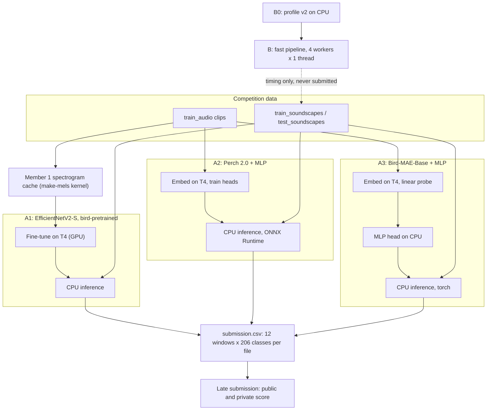
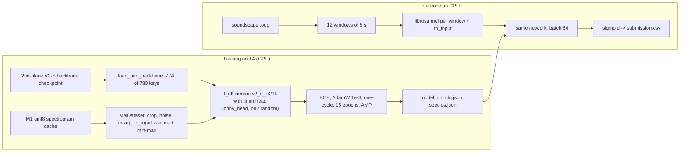
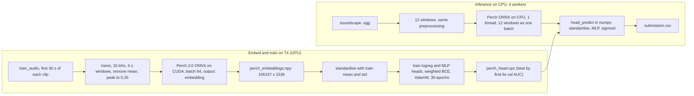
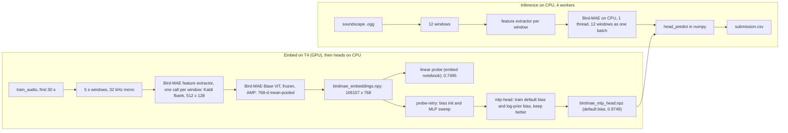
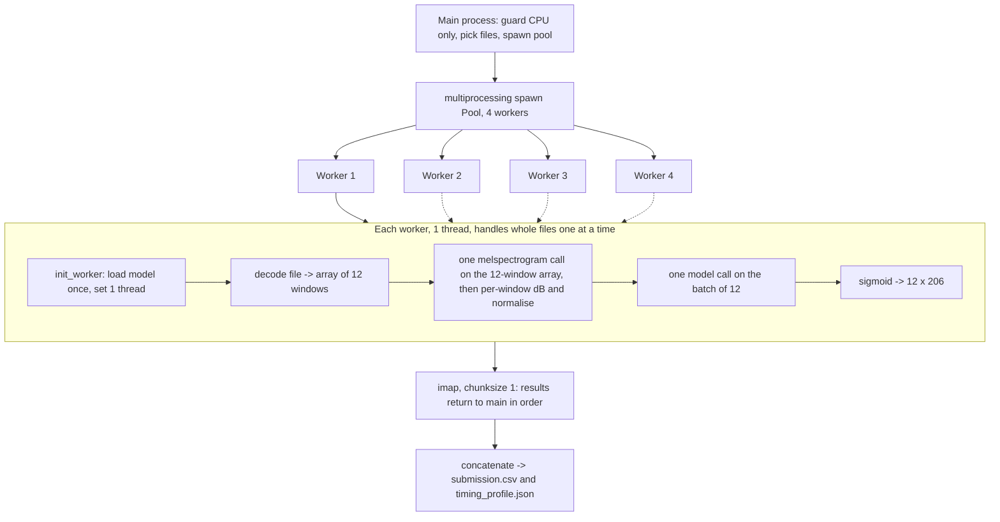

# Implementation guide: pretrained models and fast inference (Member 3)

First draft, 8 Nov 2026. Audience: the Member 3 student, who must understand and explain what was built.

This guide covers the BirdCLEF+ 2025 late-submission work for NTU SC4000: three pretrained-model experiments (A1, A2, A3), a profiling run and a faster CPU inference pipeline (B). Every number below comes from `STATE.md`, `report/arshiya_pretrained_ensemble/LOG.md`, `report/arshiya_pretrained_ensemble/results/*.md`, `notes/*.md`, the notebooks in `notebooks/`, or the downloaded Kaggle logs in `report/arshiya_pretrained_ensemble/_kaggle_logs/`. Where a number is not in a source, the text says so.

Conventions used for timings, as in `report/arshiya_pretrained_ensemble/results/timing_table.md`:
- **Measured**: taken from a log or JSON file of a run on the full 700 `train_soundscapes` files.
- **Projected**: scaled up from a 20-file dry run of a submitted notebook. The scored (leaderboard) runtime is not available through the Kaggle CLI, so no submitted notebook has a scored-run time.

Scores (public / private): v2 0.763 / 0.789; A1 0.82822 / 0.81642; A2 0.84774 / 0.85226; A3 0.77640 / 0.78016.

---

## 1. Glossary

Read this first. Terms are listed in the order they become useful, not alphabetically.

**Soundscape.** A long field recording (here one minute, `.ogg`) with many species calling at different times. The test set is about 700 soundscapes; for every 5-second window the model predicts a probability for each of 206 classes. It differs from the training clips in `train_audio`, which are short recordings of one focal species (the primary label, sometimes with secondary labels for other species heard).

**Window.** A 5-second slice of audio. At 32,000 samples per second, a window is 160,000 samples. A one-minute soundscape gives 12 windows. The submission has one row per window, with `row_id = <file stem>_<end second>`, for example `soundscape_8358733_5`.

**Macro ROC-AUC.** The competition metric. For each class, ROC-AUC measures how well the predicted probabilities rank windows that contain the class above windows that do not (1.0 is perfect, 0.5 is chance). "Macro" means the per-class values are averaged with equal weight, so a rare frog counts as much as a common bird. Classes with no positive example are skipped, because AUC is undefined for them. In the validation code this is `keep = y_true.sum(axis=0) > 0`. In our validation split, 191 of the 206 classes have positives.

**Log-mel spectrogram.** A picture of sound: time on one axis, frequency on the other, brightness is loudness. It is built in steps. (1) Cut the waveform into short overlapping frames and compute the Fourier transform of each (the STFT). (2) Square the magnitudes to get power. (3) Group the frequency bins into 128 "mel" bands, which are spaced the way human hearing spaces pitch (finer at low frequencies). (4) Convert power to decibels (dB), a logarithmic scale. The "log" is what makes quiet calls visible next to loud ones.

**n_fft.** The length, in samples, of each frame fed to the Fourier transform. v2 uses 2048, which is 64 ms at 32 kHz. A longer frame separates frequencies more finely but blurs timing.

**hop (hop_length).** How many samples the frame moves between consecutive frames. v2 uses 512, which is 16 ms. A 5-second window is 160,000 / 512 = 312.5 hops; the cached spectrograms use 313 frames per 5 s (`frames_per_5s` in M1's `mels_cfg.json`). This fractional number is why you cannot cut a 5-second window out of a whole-file spectrogram without changing the input (see section 9).

**Embedding.** A fixed-length vector of numbers that a pretrained network produces for an input, here one vector per 5-second window. Windows that sound alike get nearby vectors. Perch 2.0 gives 1536 numbers; Bird-MAE-Base gives 768.

**Frozen backbone.** A pretrained network whose weights are never updated by our training. We only run it forward to get embeddings, store them, and train a small model on top. A2 and A3 are frozen. A1 is not frozen: its backbone is fine-tuned.

**Linear probe.** The simplest model on top of frozen embeddings: one linear layer, `logit = W x + b`, one output per class, followed by a sigmoid. "Probe" means the point is to test how much the embedding already contains. A linear probe on 206 classes is 206 separate logistic regressions that share the input.

**MLP head.** A small neural network on top of embeddings: linear layer, ReLU, dropout, linear layer. In A2 the hidden width is 512, with 30% dropout; in A3, 512 with 20%. It can combine embedding dimensions, which a linear probe cannot.

**BCE (binary cross-entropy).** The loss used for multi-label problems. Each class is treated as its own yes/no question; the loss penalises confident wrong answers heavily. `BCEWithLogitsLoss` applies the sigmoid inside the loss for numerical stability. Because the labels are soft here (secondary labels = 0.5), the target is not strictly 0 or 1.

**Mixup.** A data augmentation that blends two training examples: `x = lam * x1 + (1 - lam) * x2`, with `lam` drawn from a Beta distribution. In v2 the blended target is the element-wise maximum of the two label vectors (both species are present in the mixed sound), not a weighted average. It is applied with probability 0.5, with Beta(0.4, 0.4).

**One-cycle LR.** A learning-rate schedule with one rise and one fall. The rate starts low, climbs to a maximum over the first `pct_start` of the steps (0.1, so 10%), then decays smoothly to near zero. All heads and the A1 fine-tune use PyTorch's `OneCycleLR` with AdamW and a maximum of 1e-3, except the A3 MLP head, whose maximum is 3e-3.

**Bias initialisation.** Every output unit of a linear layer has a bias `b`, a number added to its logit. PyTorch starts it close to 0 (measured mean -0.0021 in the A3 default run). "Default bias" means this. "Log-prior bias" means setting `b` at the start to `log(p / (1 - p))`, where `p` is the fraction of training rows that contain that class, so the model begins by predicting each class's base rate. See section 7.

**MAE (masked autoencoder).** A self-supervised pretraining method. Most of the spectrogram patches are hidden and a vision transformer learns to reconstruct them, so it learns structure without labels. Bird-MAE is such a model trained on bird audio. Afterwards its patch features are pooled into an embedding.

**ONNX.** An open file format for neural networks that many runtimes can load, independent of the framework that trained them. ONNX Runtime is Microsoft's runtime for such files. A2 uses it to run Perch on CPU (and on GPU in the embedding step).

**OpenVINO.** Intel's inference toolkit for CPUs. It converts a model (here from ONNX) and can store weights in 16-bit floats (FP16) to halve the file size. Whether it also speeds things up depends on the CPU; this was not shown here (section 9).

**Public / private leaderboard.** Kaggle scores a submission on two disjoint parts of the hidden test set. The public part is shown during the competition; the private part decides the final ranking. Public differences below 0.01 are treated as noise. Always report both. Member 1 found that local validation does not predict the leaderboard, so models are chosen by leaderboard.

**Late submission.** A submission made after the competition closed. It is scored on the same public and private split, so scores are comparable with the real leaderboard, but it does not count for prizes.

**Val AUC "first-5s".** Validation macro ROC-AUC computed on the first 5 seconds of each validation clip, with only the primary label as the target. This is Member 1's protocol; every experiment here uses the same stratified 80/20 split (seed 42; 22,851 train and 5,713 validation clips in the A1 log).

**Val AUC "clip-max".** Validation macro ROC-AUC where, for each validation clip, the predictions of all its windows (up to 30 s) are reduced to one vector by taking the maximum per class. It rewards finding the species anywhere in the clip. Recorded for A2 and A3 heads.

**T4.** The NVIDIA Tesla T4, the Kaggle GPU used for all training and embedding. Kaggle gives a limited weekly GPU quota (30 hours per week, as stated by the user), and at most 2 GPU sessions may run at the same time.

**AMP (automatic mixed precision).** Running most of the forward pass in 16-bit floats on the GPU, which is faster and uses less memory. `torch.autocast` and `GradScaler` are the tools.

---

## 2. Overall pipeline



Every experiment follows the rule "v2 plus one change": v2's recipe, split and inference protocol stay fixed, and only the pretrained model changes. The split is the same `train_test_split(..., stratify=y_idx, random_state=42)` call in every notebook, applied to Member 1's `train_index.csv`.

---

## 3. v2 recap (Member 1's baseline)

### Purpose
The reference point. Everything else is compared against it: public 0.763, private 0.789. Member 3 did not retrain it. The notebooks are copied into `m1/` for reference (`m1/train-v2/sc4000-birdclef-m1-train-v2.ipynb`, `m1/sc4000-birdclef-m1-infer-v2.ipynb`).

### Inputs and outputs
- Training input: Member 1's cached spectrograms (`train_mels.npy`, one uint8 array of all clips up to 30 s, plus `train_index.csv`, `mels_cfg.json`, `noise_mels.npy` for the noise augmentation). Output: `model.pth`, `cfg.json`, `species.json`, `history.csv`.
- Inference input: `.ogg` soundscapes. Output: `submission.csv` with 206 probability columns.

### Code
Training step: the cache stores each clip's log-mel as uint8 over a 120 dB range below the clip's peak. Each sample is converted back to dB, optionally mixed with noise, then rescaled to [0, 1] relative to its own 5-second window.

```python
def to_db(u8):
    """uint8 from make_mels -> dB relative to the clip's loudest point."""
    return u8.T.astype(np.float32) / 255.0 * STORE_DB - STORE_DB

def to_input(db):
    """Same as inference: 0 dB = this window's loudest point, keep 80 dB below it, scale to [0, 1]."""
    return ((np.maximum(db - db.max(), -TOP_DB) + TOP_DB) / TOP_DB).astype(np.float32)
```

Line by line: `to_db` takes the uint8 values (0 to 255), divides by 255 to get 0 to 1, multiplies by `STORE_DB` (120) and subtracts 120, giving dB values from -120 up to 0 relative to the clip's loudest point; `.T` flips the stored (frames, 128) layout to (128, frames). `to_input` subtracts the window's own maximum so the loudest point is 0 dB, clips everything quieter than -80 dB to -80 (`np.maximum(..., -TOP_DB)`), adds 80 and divides by 80, which maps -80..0 dB to 0..1.

Mixup and the loss:

```python
def mixup(xb, yb):
    lam = float(np.random.beta(CFG["mixup_alpha"], CFG["mixup_alpha"]))
    perm = torch.randperm(xb.size(0), device=xb.device)
    return lam * xb + (1 - lam) * xb[perm], torch.maximum(yb, yb[perm])
```

`lam` is one number per batch from Beta(0.4, 0.4), which is U-shaped, so most batches are mostly one sound with a little of another. `perm` shuffles the batch to pick each example's partner. The image is the weighted blend; the label is the element-wise maximum of the two label vectors.

Inference computes the same mel with librosa, one 5-second window at a time:

```python
def to_mel(y):
    m = librosa.feature.melspectrogram(
        y=y, sr=CFG["sr"], n_fft=CFG["n_fft"], hop_length=CFG["hop_length"],
        n_mels=CFG["n_mels"], fmin=CFG["fmin"], fmax=CFG["fmax"])
    db = librosa.power_to_db(m, ref=np.max, top_db=80)
    return ((db + 80) / 80).astype(np.float32)
```

`melspectrogram` returns a power mel spectrogram. `power_to_db(..., ref=np.max, top_db=80)` converts to dB relative to the window maximum and floors at 80 dB below it, so training (`to_input`) and inference agree.

### Hyperparameters and why

| Setting | Value | Why |
|---|---|---|
| Model | `efficientnet_b0`, ImageNet weights, `in_chans=1` | Reason not recorded here (Member 1's choice) |
| Mel | sr 32,000; n_fft 2048; hop 512; 128 mels; 50 to 14,000 Hz | Reason not recorded |
| Window normalisation | dB relative to window max, 80 dB range, scaled to [0, 1] | Same function in training and inference |
| Crop | random 5 s crop | In `SWITCHES`, "crop +0.035" public gain when tested alone |
| Noise | p 0.5, -20 to -3 dB, plus mixup p 0.5, Beta(0.4, 0.4) | "noise +0.016" public gain alone |
| Secondary labels | weight 0.5 | "seclabel +0.012" public gain alone |
| Focal loss | off | "focal -0.012", left out |
| Optimiser | AdamW, lr 1e-3, weight decay 1e-2, one-cycle `pct_start=0.1` | Reason not recorded |
| Batch / epochs | 64 / 15 | Reason not recorded |
| Split | stratified 80/20, seed 42 | Fixed so all experiments are comparable |

### How to rerun
Do not rerun. Kaggle train: `jmemei/sc4000-birdclef-m1-train-v2` (T4, internet on, uses the kernel output of `jmemei/sc4000-birdclef-m1-make-mels`). Kaggle infer: `jmemei/sc4000-birdclef-m1-infer-v2`. These are Member 1's items, not under `strippedbanana`.

### Pitfalls
- The cache normalises each clip against its own peak with 120 dB of range, then training re-normalises each 5 s window to 80 dB. A model pretrained elsewhere sees inputs prepared differently from its pretraining (section 4).
- v2's CPU time is not settled: Member 1's figure is about 25 min; the profile with Member 1's own pool measured 11.1 min for the whole notebook (10.4 min pipeline) on 700 `train_soundscapes`. The cause of the difference is unknown (Member 1's figure may come from the scored run).

---

## 4. A1: bird-pretrained EfficientNetV2-S

### Purpose
Test whether a backbone already pretrained on bird sound (from the BirdCLEF 2025 2nd-place solution, Sydorskyi and Goncalves) beats v2's ImageNet EfficientNet-B0 when everything else stays the same.

**This is a backbone change, not a weights-only swap.** The dataset `vladimirsydor/bird-clef-2025-all-pretrained-models` contains no EfficientNet-B0 (file list verified; `notes/R1_pretrained_backbones.md`). It holds `tf_efficientnetv2_s_in21k` and `eca_nfnet_l0` checkpoints. We used `models_2025/tf_efficientnetv2_s_in21k_pretrain_from_bigXCV2Ext_swa.ckpt`. The architecture therefore changes from B0 to V2-S (about 3.5 times B0's cost per window, a risk noted before inference).

### Inputs and outputs
- Training inputs: the competition data; the 2nd-place dataset; Member 1's `make-mels` kernel output (spectrogram cache and index).
- Training outputs: `model.pth` (best validation epoch), `cfg.json`, `species.json`, `history.csv`.
- Inference inputs: the `a1-v2s-train` kernel output and the competition data. Output: `submission.csv`.

### Pipeline



### Code
Loading the backbone. The notebook builds the network with `pretrained=False` and then copies matching tensors from the checkpoint. It inspects the key names at run time instead of assuming a layout:

```python
    target = model.state_dict()
    backbone = {k for k in target if not k.startswith("classifier.")}

    # choose the prefix under which the most keys match the timm model
    def strip(prefix):
        return {k[len(prefix):]: v for k, v in sd.items() if k.startswith(prefix)}
    def score(prefix):
        return sum(k in backbone and v.shape == target[k].shape for k, v in strip(prefix).items())
    prefixes = ["model.backbone.", "backbone.", "module.model.backbone.", "module.backbone.",
                "model.", "module.", ""]
    prefix = max(prefixes, key=score)
```

Line by line: `target` is the new model's own tensor dictionary. `backbone` is the set of its keys that are not the final classifier, which are the keys we hope to fill. `strip(prefix)` removes a name prefix from every checkpoint key that starts with it (training frameworks often wrap the model, adding `model.backbone.` or `module.`). `score(prefix)` counts how many stripped keys exist in the new model and have the same tensor shape. `prefixes` lists the plausible wrappers, and `max(..., key=score)` picks the one that matches the most. The log shows the empty prefix won with 774 matching keys.

The model is then built and loaded:

```python
if CFG["backbone_ckpt"] is None:      # M1's ImageNet B0
    model = timm.create_model(CFG["model"], pretrained=not os.environ.get("M1_NO_PRETRAINED"),
                              in_chans=1, num_classes=len(species))
else:
    model = timm.create_model(CFG["model"], pretrained=False, in_chans=1, num_classes=len(species))
    load_bird_backbone(model, find_ckpt(CFG["backbone_ckpt"]))
model = model.to(DEVICE)
```

With `backbone_ckpt` set (the V2-S case) the else branch runs. `pretrained=False` means no ImageNet or in21k weights are downloaded; `in_chans=1` gives a 1-channel stem, which matches the checkpoint's stem, so no conversion is needed; `num_classes=len(species)` gives a new, randomly initialised 206-way classifier.

Normalisation. The 2nd-place front end applies a per-window z-score followed by min-max scaling. A1 reproduces that on top of v2's 80 dB floor:

```python
    db = np.maximum(db - db.max(), -TOP_DB)
    if CFG["norm"] == "zscore_minmax":
        x = (db - db.mean()) / (db.std() + 1e-6)
        return ((x - x.min()) / (x.max() - x.min() + 1e-6)).astype(np.float32)
    return ((db + TOP_DB) / TOP_DB).astype(np.float32)
```

The first line is v2's floor (0 dB at the window's loudest point, nothing below -80). The z-score subtracts the window mean and divides by its standard deviation (the `1e-6` avoids dividing by zero on silence). The final line stretches the result so its minimum is 0 and its maximum is 1. Training and inference use identical copies of this function; the docstring says to keep them identical.

### What is and is not faithful to the pretraining
- The backbone keeps v2's timm head. The V2-S model in timm has a `conv_head` (1x1 convolution) and `bn2` (batch norm) before global pooling and the classifier. The 2nd-place code builds its backbone with `features_only=True`, which does not contain those layers, and puts its own attention head on top. So the checkpoint has no `conv_head` or `bn2` weights. They are randomly initialised and trained in A1. The log reports "loaded 774/780 backbone keys (99.2%)" and names five missing keys: `conv_head.weight`, `bn2.weight`, `bn2.bias`, `bn2.running_mean`, `bn2.running_var`. The log does not name a sixth missing key. The effect of this on the score was not measured. The source for the 2nd-place code behaviour is a summarising fetch, not a line-by-line read (`notes/R1b_conv_head.md`).
- Normalisation is only partly faithful: the cache is clip-relative, so A1 applies an 80 dB window floor that the 2nd-place front end does not; fmax is 14 kHz against 16 kHz; fmin is 50 Hz against 20 Hz; the mel scale may differ (Slaney versus HTK, unchecked).
- Step 2 (re-cache with their mel config) was planned only if step 1 gained less than 0.01 public. It gained 0.065, so step 2 was not run.

### Hyperparameters and why

| Setting | Value | Why |
|---|---|---|
| Backbone | `tf_efficientnetv2_s_in21k`, 2025 SWA checkpoint | No B0 exists in the dataset; user chose this checkpoint |
| `norm` | `zscore_minmax` | Matches the 2nd-place front end where possible |
| Recipe | v2: random crop, noise p 0.5, mixup p 0.5, secondary 0.5 | Project rule: v2 recipe fixed |
| Epochs, batch, lr, weight decay | 15, 64, 1e-3, 1e-2 (same as v2) | Project rule: v2 recipe fixed |
| Scheduler | `OneCycleLR`, `pct_start=0.1` | Same as v2 |
| AMP | on (CUDA only) | Project rule: speed up GPU runs |
| DataLoader | `num_workers=4`, `pin_memory` on CUDA | Project rule: speed up GPU runs |
| `weights_only` checkpoint load | on (`M3_CKPT_WEIGHTS_ONLY=1`) | Code comment: refuses to unpickle arbitrary objects from a third-party file |
| Minimum matching keys | 90% (`min_frac=0.9`) | Reason not recorded |
| Model selection | best validation epoch | Same as v2 |

Result: best val AUC 0.9832 at epoch 9 (0.9830 at epoch 15). About 109 s per epoch (`history.csv`), 0.45 h for the epochs, about 0.5 GPU hours recorded. Leaderboard: public 0.82822, private 0.81642 (submission 58120958). CPU inference of the submitted notebook: about 37 min projected (about 35 min from the 20-file dry run plus about 2 min startup), likely pessimistic because pool startup is spread over only 20 files.

### How to rerun
- Train: kernel `strippedbanana/sc4000-birdclef-m3-a1-v2s-train`. Attached: competition `birdclef-2025`; dataset `vladimirsydor/bird-clef-2025-all-pretrained-models`; kernel `jmemei/sc4000-birdclef-m1-make-mels`. Accelerator: T4 (`enable_gpu` true, `machine_shape` NvidiaTeslaT4), internet on. Pushed with `-t 8100` (2.25 h cap) because the CLI has no cancel command.
- Infer: kernel `strippedbanana/sc4000-birdclef-m3-a1-v2s-infer`. Attached: competition `birdclef-2025`; kernel `strippedbanana/sc4000-birdclef-m3-a1-v2s-train` (its `model.pth` and `cfg.json`). CPU only, internet off. With an empty `test_soundscapes` folder it runs a dry run on 20 `train_soundscapes` files.
- Before any `kaggle kernels push`, `kaggle competitions submit` or dataset creation, ask the project owner for approval (project rule).

### Pitfalls
- Setting `M3_BACKBONE=b0` selects Member 1's B0 with ImageNet weights, and `M3_NORM=v2` selects v2's scaling. Leave both at their defaults for A1.
- The inference notebook reads `norm` from `cfg.json`. Member 1's `cfg.json` has no `norm`, which is why `CFG.setdefault("norm", "v2")` exists.
- timm warns "Mapping deprecated model name tf_efficientnetv2_s_in21k to current tf_efficientnetv2_s.in21k". It is harmless; the `cfg.json` still stores the old name.
- Do not use the dataset `bird-clef-2025-models`: those are the 2nd-place finished models, not pretrained backbones.
- Val AUC 0.9832 is not a prediction of the leaderboard.

---

## 5. A2: Perch 2.0 embeddings + MLP head

### Purpose
Test a frozen, strong bird-sound embedding model. Perch 2.0 (Google, arXiv 2508.04665) turns each 5 s window into a 1536-number embedding. We train only a small head on those embeddings.

Facts to state when explaining A2:
- Perch 2.0 was released after the 2025 competition closed. This is a late submission, so A2 uses a model that was not available to competitors.
- The ONNX file is a community conversion (Hugging Face `Calotriton/perch-v2-onnx`, pinned to a commit and a sha256 checksum), not an official Kaggle artefact.
- Perch was trained on Xeno-canto and iNaturalist recordings. `train_audio` also comes from Xeno-canto, so the model may have seen those clips, and A2's val AUC (0.9916) may be inflated. The leaderboard is the fair test.
- Perch's own classification logits were not used. The notebook requests only the `embedding` output. Perch's label space overlaps only partly with the 206 classes, and distilling its logits was ruled out in the plan.

### Inputs and outputs
- Embed notebook inputs: competition data (`train_audio`), Member 1's `train_index.csv` (for the split), the Perch ONNX file (downloaded with internet on, then sha256-checked). Outputs: `perch_embeddings.npy` (106,157 windows x 1536), `perch_windows.csv`, `perch_cache_meta.json`, `perch_head.npz`, `species.json`, `head_cfg.json`, and CPU wheels of `onnxruntime` in `ort_cpu_wheels/`.
- Infer notebook inputs: the private dataset `strippedbanana/sc4000-birdclef-m3-perch-onnx`, and the embed notebook's output (head and wheels). Output: `submission.csv`.

### Pipeline



### Code
Preprocessing and the head. These two functions are shared word for word between the embed and infer notebooks, so training and inference see identical inputs:

```python
def preprocess_windows(x):
    """Perch preprocessing, per window: remove the mean, scale the peak to 0.25.
    Shared with the other A2 notebook, keep both copies identical."""
    x = x - x.mean(axis=1, keepdims=True)
    peak = np.abs(x).max(axis=1, keepdims=True)
    return (x * (0.25 / np.maximum(peak, 1e-8))).astype(np.float32)

def head_predict(head, emb):
    """Sigmoid probabilities from saved head arrays. Shared with the other A2 notebook."""
    x = (emb - head["mean"]) / head["std"]
    n_layers = int(head["n_layers"])
    for i in range(n_layers):
        x = x @ head[f"W{i}"].T + head[f"b{i}"]
        if i < n_layers - 1:
            x = np.maximum(x, 0.0)       # ReLU
    return 1.0 / (1.0 + np.exp(-x))
```

Line by line: `x` has shape (windows, 160000). Subtracting each window's mean removes any constant offset (DC). `peak` is the largest absolute sample per window; multiplying by `0.25 / peak` rescales every window so its loudest sample is 0.25, which makes the input independent of recording gain (`1e-8` guards against all-zero audio). `head_predict` standardises the embedding with the training mean and standard deviation stored in the file, then loops over the saved linear layers; between layers it applies ReLU (`np.maximum(x, 0)`), and after the last layer the sigmoid `1 / (1 + e^-x)`. Using numpy means CPU inference does not need torch to run the head. The training notebook asserts this numpy path matches the torch head to within 1e-4.

Getting embeddings from the ONNX model:

```python
    def run_batches(x):
        global t_gpu
        for i in range(0, len(x), BATCH):
            t = time.time()
            embs.append(sess.run(["embedding"], {"inputs": x[i:i + BATCH]})[0])
            t_gpu += time.time() - t
```

`sess` is an ONNX Runtime session on the CUDA provider. `sess.run(["embedding"], {"inputs": batch})` asks for only the output called `embedding` and feeds the model's input called `inputs` (shape batch x 160000, float32). `BATCH` is 64. `t_gpu` accumulates model time separately from audio loading, which runs in 4 DataLoader workers.

The training loss weights each window so that each clip counts once, however many windows it has:

```python
                bce = nn.functional.binary_cross_entropy_with_logits(model(Z_dev[b]).float(), Y_dev[b], reduction="none")
                loss = (bce.mean(1) * W_dev[b]).sum() / W_dev[b].sum()
```

`reduction="none"` keeps the loss per window per class. `.mean(1)` averages over the 206 classes. `W_dev` holds `1 / (windows in that clip)`, so multiplying and then dividing by the sum of weights gives a weighted mean. Without this, long clips (up to six 5 s windows) would count more than short ones. Targets: primary label 1.0, secondary labels 0.5.

### GPU placement check
`check_gpu_placement` runs the model twice with ONNX Runtime profiling on and sums node time per provider. It raises if less than half the node time is on CUDA. Reason: `get_providers()` can list CUDA while the graph really runs on CPU. The recorded result was "CUDA share of node time: 74.5%" and "Active providers: ['CUDAExecutionProvider', 'CPUExecutionProvider']"; the rest ran on CPU ops.

### Hyperparameters and why

| Setting | Value | Why |
|---|---|---|
| Audio per clip | first 30 s, 5 s non-overlapping windows; clips under 5 s are padded | Project plan: embed at most 30 s per clip |
| Labels | primary 1.0, secondary 0.5 | Same as v2 |
| Split | v2's stratified 80/20, seed 42 | Project rule |
| Embedding batch | 64 | Reason not recorded |
| Head optimiser | AdamW, lr 1e-3, weight decay 1e-2, one-cycle `pct_start=0.1` | Same family as v2; exact choice reason not recorded |
| Head batch / epochs | 1024 / 30 | Reason not recorded |
| MLP | 1536 -> 512 -> ReLU -> dropout 0.3 -> 206 | Reason not recorded |
| Standardisation | train-set mean and std per embedding dimension | Reason not recorded |
| Head chosen | best first-5s val AUC; MLP won | Logistic regression 0.9071 (epoch 28), MLP 0.9916 (epoch 16) |
| ONNX Runtime | 1.31.1, intra-op and inter-op threads 1 in inference | Each of the 4 workers uses one core (project plan) |

Results: MLP first-5s val AUC 0.9916, clip-max 0.9921; logistic regression 0.9071 / 0.9113. Embedding wall 3,024 s (model 2,884 s, 35 windows per s) for 106,157 windows from 28,564 clips, zero failed decodes; recorded about 0.9 to 1.0 GPU hours. Leaderboard: public 0.84774, private 0.85226 (submission 58122219). CPU inference: 25.0 min projected (20 files, predict wall 46.5 s, 2.14 s per file, 3.8 s model load per worker). In the dry run, summed over 4 workers: decode 4.0 s, preprocess 0.4 s, Perch 163.4 s, head 1.44 s, so nearly all the time is the Perch network.

### How to rerun
- Embed: kernel `strippedbanana/sc4000-birdclef-m3-a2-perch-embed`. Attached: competition `birdclef-2025`; kernel `jmemei/sc4000-birdclef-m1-make-mels` (for `train_index.csv`). Accelerator T4, internet on (it downloads the ONNX file and `onnxruntime-gpu==1.31.1`). Pushed with `-t 8100`. If the cache fingerprint matches, a rerun reuses the saved embeddings instead of recomputing.
- Infer: kernel `strippedbanana/sc4000-birdclef-m3-a2-perch-infer`. Attached: competition `birdclef-2025`; dataset `strippedbanana/sc4000-birdclef-m3-perch-onnx`; kernel `strippedbanana/sc4000-birdclef-m3-a2-perch-embed`. CPU, internet off. The log showed `onnxruntime image version: None`, so the wheel from the embed output was installed offline.

### Pitfalls
- The logistic-regression head (0.9071) has the bias-initialisation defect described in section 7. It was not rerun, so do not read 0.9071 as the limit of Perch features.
- `train_index.csv` may lack a `filename` column. The notebook then aligns to `train.csv` row by row, and raises if the rows do not match, to avoid mis-pairing audio and labels.
- `onnxruntime` and `onnxruntime-gpu` conflict; the embed notebook uninstalls the CPU build first.
- Validation uses the first window only, whereas inference sees windows of a soundscape anywhere in the minute; the domains differ (clean focal recording versus noisy soundscape).
- Perch val AUC may be inflated (training-data overlap, above).

---

## 6. A3: Bird-MAE-Base embeddings + head

### Purpose
Test a self-supervised audio transformer, `DBD-research-group/Bird-MAE-Base` (arXiv 2504.12880), as a frozen feature extractor with a light head. The plan was a linear probe, then a prototypical probe if time allowed, and fine-tuning only if it beat A2. It did not, and the prototypical probe was skipped.

### Inputs and outputs
- Embed notebook: competition data, Member 1's `train_index.csv`, Bird-MAE files downloaded from Hugging Face at a pinned commit (`6cc416d1a7ae2af29b6b866499b3b047a8f01304`) and sha256-checked. Outputs: `birdmae_embeddings.npy` (106,157 x 768), `birdmae_windows.csv`, `birdmae_cache_meta.json`, `birdmae_head.npz` (linear probe), `head_cfg.json`, `bmae_wheels/` (pinned `transformers`, `tokenizers`, `huggingface_hub` wheels).
- MLP head notebook (CPU): reads those embeddings; outputs `birdmae_mlp_head.npz`, `species.json`, `head_cfg.json`.
- Infer notebook (CPU): private dataset `strippedbanana/sc4000-birdclef-m3-birdmae-base`, the head, and the wheels. Output: `submission.csv`.

### Pipeline



### Code
One feature-extractor call per window, never a batched call:

```python
def windows_to_specs(w):
    """One feature-extractor call per window, never a batched call: the repo pads the ~14 missing frames
    with the minimum of whatever batch it is given, so a batched call would make a window's input depend
    on its neighbours and differ between training and inference."""
    return torch.cat([fe(x) for x in w]).float()      # [n, 1, 512, 128]
```

`fe` is Bird-MAE's own feature extractor (`trust_remote_code`), which computes a Kaldi-style filterbank with 128 mel bins and 512 frames. A 5 s window yields about 14 fewer frames than 512, and the repo pads them with the minimum value of whatever is passed in. If several windows were passed together, the padding value would come from the quietest of them, so a window's input would depend on its neighbours and differ between training (one batch composition) and inference (another). Calling per window removes that dependence. `torch.cat` stacks the per-window tensors into `[n, 1, 512, 128]`.

Loading the model and freezing it:

```python
    fe = AutoFeatureExtractor.from_pretrained(str(model_dir), trust_remote_code=True)
    bird_mae, info = AutoModel.from_pretrained(str(model_dir), trust_remote_code=True, output_loading_info=True)
    if info["missing_keys"] or info["unexpected_keys"]:
        raise RuntimeError(f"Weights did not load cleanly: {info['missing_keys'][:5]} {info['unexpected_keys'][:5]}")
    assert bird_mae.config.global_pool == "mean", bird_mae.config.global_pool
    bird_mae.eval().requires_grad_(False).to(DEVICE)     # frozen: never trained here
```

`from_pretrained` on a local folder loads weights and the model code from the folder (`trust_remote_code=True` runs the repo's Python files, which is why the commit is pinned and file hashes are checked). `output_loading_info=True` returns the lists of missing and unexpected weight names; any mismatch raises, so a partly loaded model cannot slip through. The assert confirms the output is the mean over patch tokens (768 numbers per window). `.eval()` turns off dropout, `.requires_grad_(False)` stops gradient tracking, and `.to(DEVICE)` moves it to the GPU.

The head is stored as plain arrays, so CPU inference reuses the same `head_predict` as A2 (see section 5). The inference notebook also checks inside each worker that a torch rebuild of the head matches the numpy path on random input (the log shows a maximum absolute difference of 3.58e-07).

### The head story (summary; the mechanism is in section 7)
1. The first linear probe on standardised features reached 0.7495 first-5s (clip-max 0.716). Not submitted.
2. A sweep on the cached features (probe-retry v1, CPU; MLP runs had 12 epochs, linear 30): MLP lr 3e-3 dropout 0.2: 0.9700; MLP lr 3e-3 dropout 0.5: 0.9697; linear lr 1e-2: 0.9370; MLP lr 1e-3 dropout 0.2: 0.9305; MLP lr 1e-3 dropout 0.5: 0.9263; linear lr 3e-3: 0.8513; linear lr 1e-3 raw features: 0.8158; linear lr 1e-3 standardised: 0.7498.
3. Probe-retry v2 tested bias initialisation on the linear head. Default bias, lr 1e-3: 0.7498 (clip-max 0.7183, epoch-1 loss 0.6941). Log-prior bias: lr 1e-3 0.9626 (0.9636, epoch-1 loss 0.0285); lr 3e-3 0.9618 (0.9631).
4. `a3-mlp-head` trained the MLP twice from the same seed, once with default bias and once with log-prior bias, and saved the better. Default: first-5s 0.9749, clip-max 0.9748, best epoch 26. Log-prior: 0.9707, 0.9708, best epoch 10. `head_cfg.json` records `winning_bias: default`. So the submitted head is the default-bias MLP; log-prior did not help the MLP, while it was essential for the linear head. Why the MLP did not gain from it is not recorded.

Leaderboard for the submitted default-bias MLP: public 0.77640, private 0.78016 (submission 58127656). Above the 0.776 public cut-off by only 0.0004 (within noise) and below v2 on private. Its val AUC (0.9749) is close to A2's (0.9916), yet its leaderboard scores are much lower: another case of local validation not predicting the leaderboard.

### Hyperparameters and why

| Setting | Value | Why |
|---|---|---|
| Hugging Face commit | `6cc416d1...` | Pin so the code run with `trust_remote_code` cannot change |
| `transformers`, `tokenizers`, `huggingface_hub` | 4.38.0, 0.15.2, 0.21.4, installed to a private folder | `config.json` records 4.38.0, the only version the repo documents (code comment) |
| Input | 5 s at 32 kHz, 512 x 128 Kaldi fbank | Bird-MAE's native length (notes) |
| Pooling | mean of patch tokens -> 768-d | Model default; the paper's linear probe uses average-pooled patch features (notes) |
| Embedding batch | 128 on GPU, AMP on | Project rule: AMP; batch size reason not recorded |
| Audio per clip | first 30 s | Project plan |
| Linear probe | lr 1e-3, 30 epochs, standardised | Same as A2's logreg recipe |
| MLP head | 768 -> 512 -> ReLU -> dropout 0.2 -> 206, AdamW, max lr 3e-3, 30 epochs, batch 1024 | "the sweep's best config, more epochs" (code comment) |
| Log-prior epsilon | 1e-6 clip on the prior | No class needed clipping (`prior_classes_clipped` 0) |
| Workers at inference | 4 x 1 thread | Project plan |

### How to rerun
- Embed: `strippedbanana/sc4000-birdclef-m3-a3-birdmae-embed`. Attached: competition `birdclef-2025`; kernel `jmemei/sc4000-birdclef-m1-make-mels`. T4, internet on. About 0.3 GPU hours (estimated, not measured exactly; log: embedding wall 691 s, model 363 s, 154 windows per s; log wall 0.24 h).
- Probe retry: `strippedbanana/sc4000-birdclef-m3-a3-probe-retry`, CPU, internet off; attached: the embed kernel and the make-mels kernel.
- MLP head: `strippedbanana/sc4000-birdclef-m3-a3-mlp-head`, CPU, internet off; same two attachments.
- Infer: `strippedbanana/sc4000-birdclef-m3-a3-birdmae-infer`, CPU, internet off. Attached: dataset `strippedbanana/sc4000-birdclef-m3-birdmae-base`; kernels `strippedbanana/sc4000-birdclef-m3-a3-mlp-head` and `strippedbanana/sc4000-birdclef-m3-a3-birdmae-embed`.

### Pitfalls
- Bird-MAE's weights have no declared licence (Hugging Face card, GitHub, arXiv listing), so the dataset stays private. Report it as a limitation.
- The head file is named `birdmae_mlp_head.npz`, deliberately not `birdmae_head.npz`, because the embed notebook's linear probe already uses that name and inference attaches both kernels.
- The pinned wheels have no `tokenizers` build for Python 3.13; the notebook raises if the image's Python has none.
- Python files from the model folder are executed by `trust_remote_code`; they were not run locally.
- CPU cost is the highest of the three: 61.6 min projected (20 files; predict wall 122.7 s, 5.25 s per file, 17.6 s model load per worker; mel 100.9 s and model 313.6 s summed over workers). The prototypical probe, which the paper reports as much stronger than linear probing, was not run.

---

## 7. The bias-initialisation finding

### Purpose
Explain why the same A3 features gave 0.7498 with a linear head and 0.9626 after a one-line change, and why this matters for the A2 logistic regression.

### Inputs and outputs
Input: cached Bird-MAE embeddings (106,157 windows x 768) and labels. Output: the table below. No model from this experiment was submitted.

| Head on Bird-MAE features | Bias init | First-5s val AUC | Clip-max val AUC |
|---|---|---|---|
| Linear, lr 1e-3 | default (about 0) | 0.7498 | 0.7183 |
| Linear, lr 1e-3 | log-prior | 0.9626 | 0.9636 |
| Linear, lr 3e-3 | log-prior | 0.9618 | 0.9631 |
| MLP, lr 3e-3 | default (saved, submitted) | 0.9749 | 0.9748 |
| MLP, lr 3e-3 | log-prior | 0.9707 | 0.9708 |

### Explanation
The output layer computes `logit_c = w_c . x + b_c` for class `c`. Most classes are absent from most windows, so the correct prediction for most classes is a very small probability, which means a very negative logit. The average log-prior (the log-odds of a class being present in the training rows) is -6.2008 on these features (`init_bias_mean` in `head_cfg.json`). A freshly initialised layer starts with bias near 0 (measured -0.0021), meaning every class begins at probability 0.5.

The optimiser then has to bring about 206 logits down by about 6. Adam changes each parameter by at most about the learning rate per step, so the total distance a bias can travel is bounded by the sum of the learning rates over all steps. With maximum lr 1e-3 under a one-cycle schedule and about 2,340 steps, a code check (`STATE.md`) estimated that a bias could move only about 1.3 in total. That estimate was computed during review, not measured from a run. The weights `w` can partly compensate by pushing the logits down through the standardised inputs, but a linear head has no free offset other than the bias, so the loss plateaus. The plateau was visible: predicted loss about 0.25 to 0.28 against observed 0.277 and 0.278 for the A2 logreg and the A3 probe. The first-epoch loss makes it vivid: 0.6941 for default bias against 0.0285 for log-prior (the first value is close to `ln 2 = 0.693`, the loss of predicting 0.5 everywhere).

An MLP escapes the problem because its hidden layer can produce a large negative contribution to every logit, so the final bias does not need to travel as far.

The fix is to initialise the final bias to the log-prior: `b_c = log(p_c / (1 - p_c))`, with `p_c` the weighted fraction of training windows in which class `c` has a label (secondary labels count 0.5).

### Code
From the MLP head notebook:

```python
w_tr = W_row[in_train].astype(np.float64)
prior = (Y[in_train].astype(np.float64) * w_tr[:, None]).sum(axis=0) / w_tr.sum()
n_clipped = int(((prior < PRIOR_EPS) | (prior > 1 - PRIOR_EPS)).sum())
prior_clipped = np.clip(prior, PRIOR_EPS, 1 - PRIOR_EPS)
PRIOR_BIAS = torch.from_numpy(np.log(prior_clipped / (1 - prior_clipped)).astype(np.float32))
```

`w_tr` is the per-window weight (1 / windows per clip) for training rows. `prior` is, per class, the weighted mean of the label columns, which is the class's base rate under the same weights as the loss. `np.clip` keeps it away from exactly 0 and 1 so the log is finite. The last line is the logit function `log(p / (1 - p))`, stored as a 206-vector.

```python
    model = make_head()
    if prior_bias:
        with torch.no_grad():
            model[-1].bias.copy_(PRIOR_BIAS)     # no random draw, so the weights and batches match the default run's
```

`model[-1]` is the final linear layer. `copy_` overwrites its bias in place under `no_grad`, without touching the random number generator, so the default and log-prior runs start from the same weights and see the same batches; only the bias differs.

### Hyperparameters and why

| Setting | Value | Why |
|---|---|---|
| Learning rates compared | 1e-3 and 3e-3 (linear) | Sweep; reason for these exact values not recorded |
| Epochs | 30 | Reason not recorded |
| Seed | reset before each run | Both runs share initial weights, batches and dropout draws (code comment) |
| Epsilon | 1e-6 | Reason not recorded |

### How to rerun
Linear test: kernel `strippedbanana/sc4000-birdclef-m3-a3-probe-retry` (version 2), CPU, internet off; attached: the A3 embed kernel and the make-mels kernel. MLP comparison: `strippedbanana/sc4000-birdclef-m3-a3-mlp-head`, CPU.

### Pitfalls
- The A2 logistic regression (0.9071) has the same defect and was not rerun; the A2 MLP is unaffected.
- The linear AUCs for A3 and A2 must not be quoted as the features' limit.
- The retry reproduced the earlier probe within 0.0003 (0.7498 against 0.7495).
- Log-prior did not help the MLP (0.9707 against 0.9749); do not generalise "log-prior is better".

---

## 8. Profiling v2 (B0)

### Purpose
Find where the CPU time of v2's inference goes (decode, mel, model), before changing anything.

### Inputs and outputs
Input: 700 `train_soundscapes` files and Member 1's trained v2 model. Output: `timing_profile.json`.

### Code
Each worker times its two preprocessing stages and returns them:

```python
def soundscape_windows(path):
    t0 = time.perf_counter()
    y, _ = sf.read(path, dtype="float32")
    if y.ndim > 1:
        y = y.mean(axis=1)
    t1 = time.perf_counter()
    n_win = max(1, int(np.ceil(len(y) / WIN)))
    y = np.pad(y, (0, n_win * WIN - len(y)))
    mels = np.stack([to_mel(y[i * WIN:(i + 1) * WIN]) for i in range(n_win)])
    t2 = time.perf_counter()
```

`t0..t1` is decoding the `.ogg` and averaging channels to mono; `t1..t2` is padding to whole windows and computing one mel per 5 s window in a Python loop. The function returns `t1 - t0` and `t2 - t1`, and the main process sums them over all files. Because 4 workers run in parallel, these sums are CPU time, not elapsed time, so they do not add up to wall time. The model stage then runs in the main process in batches of 64, with `MODEL_FORWARD_S` accumulated around each forward call.

### Results (measured, 700 files, 4 CPUs)

| Stage | Total | Per file |
|---|---|---|
| Decode (summed over workers) | 224.1 s | 0.320 s |
| Mel (summed over workers) | 1,078.3 s | 1.540 s |
| Preprocess elapsed (decode + mel over workers) | 333.9 s | 0.477 s |
| Model forward (main process, 4 threads) | 288.2 s | 0.412 s |
| Pipeline wall (excludes setup and model load) | 622.2 s = 10.4 min | 0.889 s |
| Whole notebook | 665.0 s | |

Mel computation is the largest CPU cost (1,078 of 1,590 summed seconds across decode, mel and model).

### Hyperparameters and why

| Setting | Value | Why |
|---|---|---|
| Workers | `Pool(os.cpu_count())` = 4 | Mimic Member 1's real setup (user decision) |
| Torch threads | `os.cpu_count()` | Same as Member 1's notebook |
| Model batch | 64 | Same as Member 1's notebook |

### How to rerun
Kernel `strippedbanana/sc4000-birdclef-m3-profile-infer-v2`. Attached: competition `birdclef-2025`; kernel `jmemei/sc4000-birdclef-m1-train-v2` (for `model.pth` and `cfg.json`). CPU, internet off.

### Pitfalls
- The notebook has no device print and no CUDA references, so the log does not say CPU. The metadata has `enable_gpu` false. The project owner chose not to rerun just for a print.
- This run was done with Member 1's pool, and gave 10.4 min, not Member 1's about 25 min. The difference is unexplained.
- Summed stage times must not be added to compare with wall time.

---

## 9. Fast inference pipeline (B)

### Purpose
Cut CPU time for the CNN models so that ensembles fit in the 75 min budget (hard limit 90 min). The notebook has a model switch (`b0` for v2, `a1_v2s`) and a backend switch (`torch`, `onnx`, `openvino_fp16`).

### Inputs and outputs
Input: 700 `train_soundscapes` files (timing run) or the test soundscapes (auto-detected), plus the chosen model's `model.pth` and `cfg.json`. Outputs: `timing_profile.json`, `submission.csv` (for a timing run it covers training soundscapes and is not submittable), and for non-torch backends the exported model plus a verification line.

### Worker layout



### Code
The shared mel. One `melspectrogram` call receives the whole file as a 2-D array of windows; librosa computes an independent STFT for every row:

```python
def windows_to_inputs(batch):
    # One melspectrogram call for the file. Each row gets its own STFT, as in the per-window loop.
    power = librosa.feature.melspectrogram(
        y=batch, sr=CFG["sr"], n_fft=CFG["n_fft"], hop_length=CFG["hop_length"],
        n_mels=CFG["n_mels"], fmin=CFG["fmin"], fmax=CFG["fmax"])
    # ref=np.max and the normalisation stay per window.
    return np.stack([to_input(librosa.power_to_db(m, ref=np.max, top_db=TOP_DB)) for m in power])
```

"Shared mel" does not mean computing one whole-file spectrogram and cutting it into windows. A 5 s window is 312.5 hops, so cutting at hop boundaries would shift the window edges and change the inputs. Here `batch` has shape (12, 160000); the call handles all rows at once, replacing 12 separate Python calls with one. The decibel conversion and normalisation stay per window (`ref=np.max` is taken per row of `power`), which keeps the output the same as the old per-window code.

Worker setup and the pool:

```python
    ctx = mp.get_context("spawn")
    with ctx.Pool(NUM_WORKERS, initializer=lib.init_worker, initargs=initargs) as pool:
        results = list(pool.imap(lib.predict_file, files, chunksize=1))
```

`spawn` starts clean worker processes (no inherited threads or state). `initializer=lib.init_worker` runs once per worker and loads the model, so model loading is paid 4 times, not once per file. `imap` with `chunksize=1` hands out one file at a time, so a worker that finishes early takes the next file and the load stays balanced. The file-level split replaces v2's approach of parallelising only the mel step.

One thread per process is set before numpy loads (`OMP_NUM_THREADS`, `OPENBLAS_NUM_THREADS`, `MKL_NUM_THREADS`, `NUMEXPR_NUM_THREADS` = 1) and again inside the torch backend (`torch.set_num_threads(1)`), so 4 workers use 4 cores without competing. The library code is written to a file from a string (`LIB_SRC`) so that `spawn` workers can import it.

Export and verification for ONNX:

```python
    torch.onnx.export(net, (dummy,), str(onnx_path), input_names=["mel"], output_names=["logits"],
                      dynamic_axes={"mel": {0: "batch"}, "logits": {0: "batch"}}, opset_version=17,
                      do_constant_folding=True, **kw)
```

`dummy` is a 2-window example input; `dynamic_axes` marks the first axis (batch) as variable so a 12-window file works; `opset_version=17` fixes the ONNX operator set. The notebook then runs the exported model and the torch model on the same windows and raises if the largest logit difference exceeds a tolerance (1e-3 for ONNX, 0.25 for OpenVINO FP16; the FP16 tolerance is unvalidated).

### Results (measured, 700 `train_soundscapes`, CPU)

| Run | Whole notebook (pipeline only) min | s per file | Summed decode / mel / model (s) | Notes |
|---|---|---|---|---|
| Profile v2 B0 (M1's pool) | 11.1 (10.4) | 0.89 | 224 / 1,078 / 288 (model is main-process wall) | torch 4 threads for the model |
| Fast v1, v2 B0, torch | 5.5 (4.0) | 0.34 | 91.6 / 314.4 / 542.2 | setup 70.9 s |
| Fast v2, A1 V2-S, torch | 8.0 (7.2) | 0.61 | 73.5 / 240.0 / 1,402.7 | setup 27.7 s, worker startup 23.8 s |

The fast v1 numbers come from `report/arshiya_pretrained_ensemble/_kaggle_logs/fast-infer-v1/timing_profile.json`. The fast pipeline's 5.5 min is a projection field computed from a 700-file run (setup, startup and per-file time), and the timing table lists it as measured.

Summed mel seconds fell from 1,078 to 314 between the profile and fast v1. The cause was not isolated by an ablation. Candidates the notebook changes together are the single mel call per file, one thread per process, and per-file batching; the guide cannot say which mattered most. For the model stage, the fast pipeline's 542 s is summed over four single-thread workers (about 136 s each), whereas the profile's 288 s is main-process wall time on four threads, so the two numbers are not comparable directly.

### Hyperparameters and why

| Setting | Value | Why |
|---|---|---|
| Workers x threads | 4 x 1 | Project plan: file-level multiprocessing, 4 workers, 1 thread each |
| Batch | all windows of one file (12) | Project plan: batch the 12 windows per file |
| Mel | one call per file | Project plan: one shared mel |
| Budget | 75 min | Project rule (not 90) |
| ONNX tolerance | 1e-3 on logits | Code comment: float32 round-off between runtimes only |
| OpenVINO FP16 tolerance | 0.25 | Code comment: weights are rounded to half precision; unvalidated |
| OpenVINO | latency hint, 1 thread, 1 stream, CPU pinning off | Code comment: pinning off because several single-thread processes would compete for one core |

### How to rerun
Kernel `strippedbanana/sc4000-birdclef-m3-fast-infer`; CPU, internet off; version 1 = v2 B0, version 2 = A1. Attached: competition `birdclef-2025`; kernels `jmemei/sc4000-birdclef-m1-train-v2` and `strippedbanana/sc4000-birdclef-m3-a1-v2s-train`. Choose model and backend with `M3_MODEL` and `M3_BACKEND` (defaults `a1_v2s` and `torch`).

### What was not done
- **ONNX Runtime and OpenVINO were not run on Kaggle for the CNNs.** Only the torch backend has Kaggle timings. Those runs were not approved, and the packages may need a private wheels dataset.
- **OpenVINO FP16 ran as float32 in the local smoke test.** The FP16 setting compresses the stored weights (half the file size); it did not show a speedup. Do not claim OpenVINO FP16 speeds anything up.
- The deliverable "best model exported (ONNX/OpenVINO) in a private Kaggle dataset" is not done. A2 already runs through ONNX Runtime on CPU, but that is the Perch model, not an export.
- The fast pipeline was only timed on `train_soundscapes`; it has never produced a scored submission.

### Pitfalls
- A GPU-visible session raises an error on purpose: the timings are only valid on CPU.
- `find_model_dir` matches on the kernel name, because both model kernels are attached and both contain a `model.pth`.
- Summed stage times are CPU time across workers; use `per_file_elapsed_s` and `projected_700_files_min`.

---

## 10. Private datasets

### Purpose
Kaggle's submission notebook has no internet, so every file a model needs must come from an attached input. Two datasets hold the third-party models that cannot be fetched at inference time. Both are private.

### Inputs and outputs

| Dataset | Contents | Verified by |
|---|---|---|
| `strippedbanana/sc4000-birdclef-m3-perch-onnx` | `perch_v2.onnx` (409 MB), `LICENSE` | sha256 `bf0c8467a924cb074663970ca4a0ab1e143602121930209657d0dff5d5cefa1f` |
| `strippedbanana/sc4000-birdclef-m3-birdmae-base` | `model.safetensors` (342 MB), `config.json`, `preprocessor_config.json`, `configuration_bird_mae.py`, `feature_extractor.py`, `modeling_bird_mae.py`, all at commit `6cc416d1a7ae2af29b6b866499b3b047a8f01304` | sha256 of `model.safetensors` `402103ecc81787ca6317ad78377fb38a912b3548f23a18f424d7a0dc31f754c5`; the other files' hashes are stored in `head_cfg.json` |

Other inputs are kernel outputs, not datasets: A1 weights (`a1-v2s-train` v1), the A2 head and `onnxruntime` wheels (`a2-perch-embed` v1), the A3 MLP head (`a3-mlp-head` v1) and the Bird-MAE wheels (`a3-birdmae-embed` v1). The 2nd-place backbone dataset `vladimirsydor/bird-clef-2025-all-pretrained-models` is a public third-party dataset, attached only to the A1 training kernel.

### Code
Every consumer re-hashes the files before use, so a wrong or tampered upload fails loudly:

```python
    h = hashlib.sha256()
    with open(ONNX_PATH, "rb") as f:
        for block in iter(lambda: f.read(1 << 24), b""):
            h.update(block)
    if h.hexdigest() != "bf0c8467a924cb074663970ca4a0ab1e143602121930209657d0dff5d5cefa1f":
        raise RuntimeError(f"perch_v2.onnx checksum mismatch: {h.hexdigest()}")
```

The loop reads the file in 16 MB blocks (`1 << 24`), so a 409 MB file never has to be in memory at once, feeds each block into a SHA-256 hash, and compares the final digest with the expected value. The Bird-MAE inference notebook does the same for all six files, using the hashes the embed run stored in `head_cfg.json`, so the weights at inference are byte-identical to those that produced the training embeddings.

### Hyperparameters and why

| Setting | Value | Why |
|---|---|---|
| Visibility | private (no `-u` flag on creation) | Bird-MAE has no declared licence; Perch ONNX is a community conversion |
| Dataset licence field | `other` | Reason not recorded beyond "undeclared" for Bird-MAE |
| Hash check | sha256 on every use | Protects against corrupt or changed files |
| Commit pin | Hugging Face commit URL | The remote Python code that runs is fixed |

### How to rerun (create)
Creating a dataset needs approval from the project owner. From inside the dataset folder (`datasets/perch-onnx/` or `datasets/birdmae-base/`), which contains `dataset-metadata.json`: `kaggle datasets create -p .` and wait until the status is ready. Do not pass `-u` (that would make it public). Then add Member 4 as a collaborator on the Kaggle website (not yet done).

### Pitfalls
- `kaggle datasets create -p D:/...` failed once with Errno 2 (the CLI built a temp filename containing the drive path). Running with `-p .` from inside the folder worked; nothing was created by the failed attempt.
- Do not run the downloaded Bird-MAE Python files locally; they execute only on Kaggle via `trust_remote_code`.
- The ONNX file is a community conversion; the dataset does not prove it matches Google's official model beyond the notes' record that the converter reported agreement with TensorFlow within about 7e-6.
- Members cannot attach private items until they are shared.

---

## 11. GPU guard

### Purpose
A training or embedding run on the wrong accelerator wastes limited quota and time. Every GPU notebook starts with a guard that stops immediately if there is no GPU, instead of silently falling back to CPU.

### Inputs and outputs
Input: the session's hardware. Output: printed device name, or a `RuntimeError` that stops the notebook.

### Code
From the A1 training notebook, first cell:

```python
print("torch.cuda.is_available():", torch.cuda.is_available())
if torch.cuda.is_available():
    print("torch.cuda.get_device_name(0):", torch.cuda.get_device_name(0))
elif os.environ.get("SMOKE_TEST") == "1":
    print("SMOKE_TEST=1: no GPU, continuing on CPU for a local smoke test")
else:
    raise RuntimeError("No GPU found. Enable the GPU accelerator (NvidiaTeslaT4); "
                       "this notebook does not fall back to CPU.")
```

The first line prints whether CUDA is usable. If it is, the second prints the device name; the Kaggle log shows `Tesla T4`. If not, and the environment variable `SMOKE_TEST` is `1` (set only for local laptop tests, never on Kaggle), the notebook continues on CPU. Otherwise it raises, so a mis-configured Kaggle session fails in the first seconds.

The same idea appears in other forms: the A2 embed notebook additionally profiles ONNX Runtime and raises if less than half of node time is on CUDA; the fast-infer notebook does the reverse and raises if a GPU is visible, because its timings are only valid on CPU.

### Hyperparameters and why

| Setting | Value | Why |
|---|---|---|
| Accelerator | T4: `enable_gpu` true, `machine_shape` `NvidiaTeslaT4` | P100 is retired on Kaggle (runs on a replacement); T4 chosen (`notes/R4_kaggle_cli.md`) |
| Time cap | `-t 8100` (2.25 h) on the GPU pushes | The CLI has no cancel command, so the cap is the only stop; the project owner's rule was to stop if epoch 1 projected over 2 GPU hours |
| Concurrency | at most 2 GPU sessions | Kaggle limit; two pushes of the A3 embed failed with "Maximum batch GPU session count of 2 reached" |
| Weekly quota | 30 h, plan at most about 25 | User statement |

GPU hours used: about 0.5 (A1), about 0.9 to 1.0 (A2), about 0.3 estimated (A3), about 1.8 h in total of the 30 h quota.

### How to rerun
No separate rerun: the guard is the first cell of the A1 train, A2 embed and A3 embed notebooks. Exempt: CPU inference, profiling and the CPU head notebooks. `a3-mlp-head` sets `DEVICE = "cpu"` by design.

### Pitfalls
- The profile notebook was written before the rule and has no device print.
- The A3 embed push went through after a background job retried when a GPU slot freed. That passed the "if something fails twice, stop and tell me" rule; the project owner was told.
- A guard that passes does not guarantee the work is on the GPU (the ONNX Runtime case above), hence the placement check in A2.

---

## 12. Smoke tests

### Purpose
Catch coding mistakes on the laptop in minutes, before spending Kaggle GPU quota or a submission.

### Inputs and outputs
Inputs: tiny synthetic audio, random weights, a dummy ONNX file or a stub model. Outputs: pass or fail. No smoke test used real competition data or real checkpoints.

### Code
The switch is an environment variable read at the top of each notebook:

```python
SMOKE_TEST = os.environ.get("SMOKE_TEST") == "1"     # local CPU test only, never set on Kaggle
```

When set, notebooks shorten epochs (`epochs=5 if SMOKE_TEST else 30`), use 0 data-loader workers, skip GPU-only installs (`if not SMOKE_TEST:`), skip checksum checks, and use `CPUExecutionProvider`. Paths can be redirected with `M3_*` environment variables (for example `M3_DATA_DIR`, `M3_MODEL_DIR`, `M3_PERCH_ONNX`), and Member 1's code has `M1_EPOCHS`, `M1_MAX_STEPS` and `M1_WORKERS` for the same purpose.

### What each smoke test covered
- A1 train and infer: synthetic data only, not the real checkpoint, cache or GPU.
- A2 embed and infer: a dummy ONNX file and synthetic data.
- A3 embed and infer: a stub `transformers` and model plus synthetic audio. The real repo code, real weights, `transformers` 4.38.0, GPU with AMP, and the 4-worker DataLoader were untested.
- Profile and fast-infer: synthetic audio with stubs or random weights. OpenVINO FP16 ran as float32 there.

### Hyperparameters and why

| Rule | Value | Why |
|---|---|---|
| Laptop use | smoke tests only, a few minutes | Project owner's standing rule |
| Longer local commands | ask first when over about 5 min | Project owner's standing rule |
| Approval timing | per notebook, after its smoke test passes, with a GPU-hour estimate | Project owner's standing rule |

### How to rerun
Set `SMOKE_TEST=1` and the relevant `M3_*` paths in a local shell, then run the notebook's cells or its code export. Never set `SMOKE_TEST` on Kaggle: with it set, the GPU guard would let a CPU run through.

### Pitfalls
- A passing smoke test means the plumbing works, not that the numbers are right. Real-data failure modes it could not catch: checkpoint layout (`weights_only=True` may fail on a real checkpoint), `train_index.csv` columns, wheel availability for the image's Python version, the real model's key names.
- Because the stubs replace the real model, speed from a smoke test says nothing about Kaggle timings.

---

## 13. Limitations to state when explaining the work

- A1 is a backbone change, not a weights-only swap; it keeps v2's head (random `conv_head` and `bn2`, trained); normalisation only partly matches the pretraining.
- Perch 2.0 postdates the competition, was trained on Xeno-canto and iNaturalist, and the ONNX file is a community conversion; A2's val AUC may be inflated.
- A3 used a mean-pooled MLP head; the prototypical probe was not run. Bird-MAE's weights have no declared licence.
- The A2 logistic-regression result carries the bias-initialisation defect.
- All submitted-notebook CPU times are projections from 20 files; scored runtimes are unavailable. Member 1's 25 min for v2 was not reproduced.
- ONNX Runtime and OpenVINO were not run for the CNNs on Kaggle; no A1 + A2 ensemble was built or scored; the export dataset (deliverable 2) and `report/arshiya_pretrained_ensemble/results/pretrained_models_section.md` remain to be done.
- Each experiment was submitted once, so no run-to-run variance is available; public differences under 0.01 are noise.
