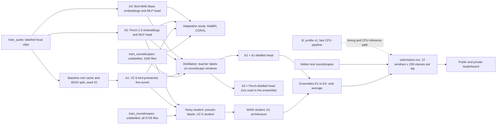
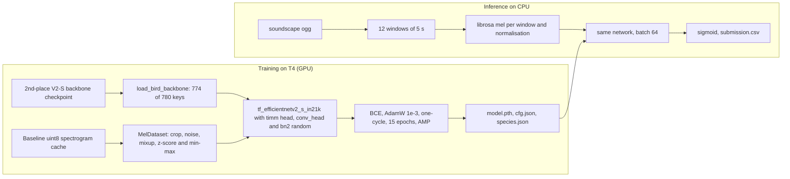
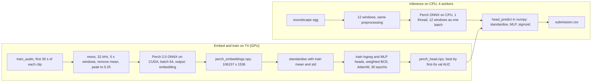
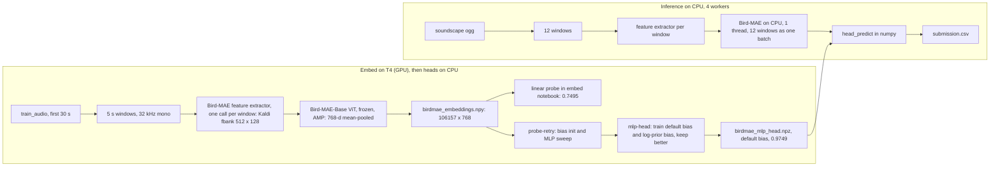
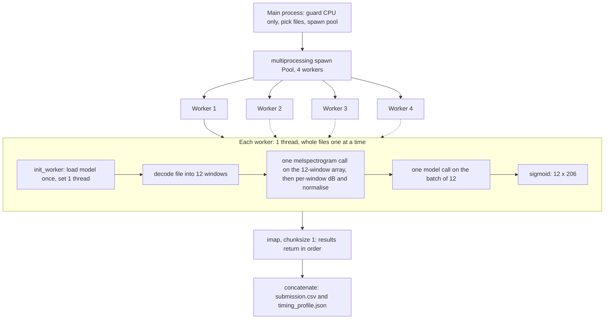
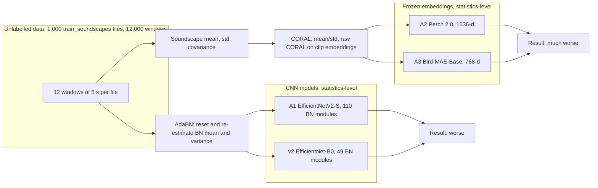
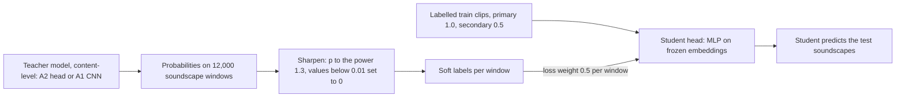
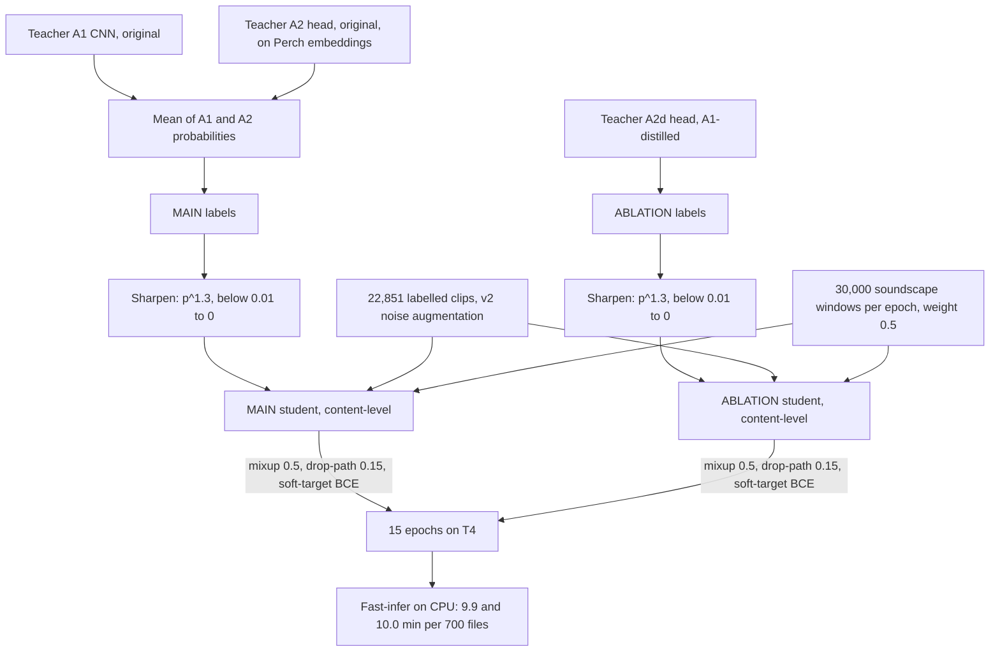
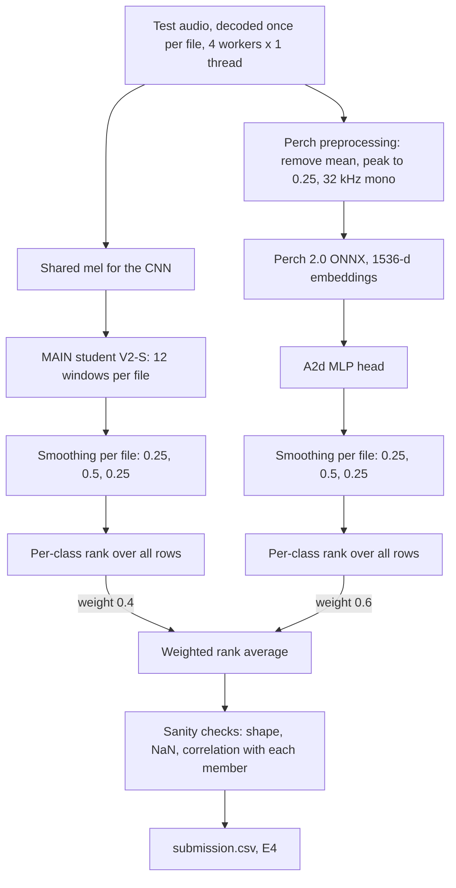

# Technical documentation: BirdCLEF+ 2025, pretrained models, inference speed and final ensemble

This document explains the pretrained-model, inference-speed and final-ensemble work we did for the NTU SC4000 BirdCLEF+ 2025 course project. It covers every experiment we ran between 8 and 10 November 2026: three pretrained-model experiments (A1, A2, A3), the profiling and fast-inference work (B), the adaptation study, distillation, one round of noisy student training, and the final ensemble.

**Where the numbers come from.** Every number is taken from `STATE.md`, `report/member3-4_pretrained_ensemble/LOG.md`, `report/member3-4_pretrained_ensemble/NOTEBOOKS.md`, `report/member3-4_pretrained_ensemble/results/results_table.md`, `report/member3-4_pretrained_ensemble/results/timing_table.md`, `notes/*.md`, the notebooks in `notebooks/`, or the Kaggle logs and result files downloaded to `report/member3-4_pretrained_ensemble/_kaggle_logs/`. Where a value was never logged, the text says "not recorded". Code excerpts are copied from the notebook source, with the notebook named above each excerpt.

**Conventions for timings**, as in `report/member3-4_pretrained_ensemble/results/timing_table.md`:
- **Measured**: read from a log or JSON file of a run on the full 700 `train_soundscapes` files, or from a log or the Kaggle CLI directly.
- **Projected**: scaled up from a 20-file dry run of a notebook. The scored (leaderboard) runtime is not available through the Kaggle CLI, so no submitted notebook has a scored-run time. All submitted notebooks finished without a timeout.
- **Estimated**: an approximate figure recorded by hand (for example some GPU hours), not read from a log.

**Conventions for scores.** **Val AUC** is the macro ROC-AUC on the first 5 s of each validation clip, with the primary label as target, on the fixed stratified 80/20 split (seed 42, 22,851 training and 5,713 validation clips). We record it for every model but never use it to choose between models. Models are chosen by the **public leaderboard**; differences in public score below 0.01 are treated as noise, and we always report both public and private scores. The **transfer gap** is val AUC minus leaderboard AUC, and it measures how much a model's focal-recording score overstates its soundscape score. Δ versus v2 uses v2's rounded scores, 0.763 public and 0.789 private.

## Table of contents

1. Glossary
2. Overall pipeline
3. v2 recap (our team's baseline)
4. A1: bird-pretrained EfficientNetV2-S
5. A2: Perch 2.0 frozen embeddings + MLP head
6. A3: Bird-MAE-Base frozen + head
7. The bias-initialisation finding
8. Profiling v2 (B0)
9. Fast inference pipeline (B)
10. Infrastructure (GPU guard, private datasets, smoke tests)
11. Adaptation study: AdaBN and CORAL
12. Distillation
13. Seed repeats
14. Noisy student
15. Final ensemble
16. All submissions
17. Compute summary and limitations

---

## 1. Glossary

Terms are grouped by topic. Each entry says what the term means and, where it helps, gives a tiny example.

### 1.1 Metric and competition

**ROC-AUC.** A score for how well a model ranks positives above negatives for one yes/no question. Take every pair of (one window that contains the species, one that does not) and ask whether the model gave the first a higher probability. The fraction of pairs ordered correctly is the AUC. 1.0 is perfect, 0.5 is chance. Example: if 3 of 4 such pairs are ordered correctly, AUC = 0.75. It depends only on the ranking, not on whether the probabilities are well calibrated.

**Macro ROC-AUC.** The competition metric. Compute the ROC-AUC separately for each of the 206 classes and average with equal weight, so a rare frog counts as much as a common bird. Classes with no positive example in the evaluated data are skipped, because AUC is undefined without positives. In the validation code this is `keep = y_true.sum(axis=0) > 0`; 191 of the 206 classes have positives in our validation split.

**Public vs private leaderboard.** Kaggle scores each submission on two disjoint parts of the hidden test set. The public part is visible during the competition; the private part decides the final ranking. A model tuned on the public score can look better than it is, so both are reported and public gaps below 0.01 are treated as noise.

**Late submission.** A submission made after the competition closed. It is scored on the same public/private split, so it is comparable with the real leaderboard, but it does not count for prizes. All our scores are late submissions.

**Focal recording vs soundscape.** A focal recording (the `train_audio` clips) is a short clip where a person aimed a microphone at one species; the primary label names that species and secondary labels name others heard. A soundscape (the test data, and `train_soundscapes`) is a one-minute passive recording with many species at different times, plus wind, rain and insects. Test soundscapes are scored per 5 s window.

**Domain shift.** The training data and the test data come from different distributions. Here: clean focal clips versus noisy soundscapes. A model can score 0.98 on held-out focal clips and much less on soundscapes.

**Transfer gap.** Val AUC minus leaderboard AUC. Example: v2 has val 0.9766 and public 0.763, so its public transfer gap is 0.9766 - 0.763 = 0.214. A smaller gap means the model keeps more of its focal-clip skill on soundscapes. The gaps of the unadapted models are v2 0.214 / 0.188, A1 0.155 / 0.167, A2 0.144 / 0.139, A3 0.199 / 0.195 (public / private).

**Window (5 s).** A 5-second slice of audio, 160,000 samples at 32,000 samples per second. A one-minute soundscape gives 12 windows. The submission has one row per window, with `row_id = <file stem>_<end second>`, for example `soundscape_8358733_5`.

### 1.2 Audio and models

**Log-mel spectrogram.** A picture of sound: time on one axis, frequency on the other, brightness is loudness. Steps: (1) cut the waveform into short overlapping frames and take the Fourier transform of each (the STFT); (2) square the magnitudes to get power; (3) group the frequency bins into 128 "mel" bands, spaced the way human hearing spaces pitch; (4) convert power to decibels (dB). The logarithm makes quiet calls visible next to loud ones. `n_fft` is the frame length (2048 samples = 64 ms at 32 kHz) and `hop` is the step between frames (512 samples = 16 ms).

**Backbone.** The main feature-extracting part of a network, before the final classifier. For an image-style network such as EfficientNet it is the stack of convolution blocks that turns a spectrogram into a feature vector.

**Pretrained.** Starting a network from weights that were already trained on some other task, instead of random weights.

**ImageNet vs bird-pretrained vs self-supervised pretraining.** ImageNet pretraining: trained to label photographs; the network knows edges and textures but nothing about sound. Bird-pretrained: trained on bird sound with species labels (A1's backbone, A2's Perch). Self-supervised: trained without labels, by hiding part of the input and learning to rebuild it (Bird-MAE, a masked autoencoder).

**Embedding.** A fixed-length vector of numbers that a network produces for an input; here one per 5 s window. Similar sounds get nearby vectors. Perch 2.0 gives 1536 numbers, Bird-MAE-Base gives 768.

**Frozen backbone.** A pretrained network whose weights are never updated by our training. We run it forward once, store the embeddings, and train only a small model on top. A2 and A3 are frozen; A1 is fine-tuned.

**Head (linear, MLP).** The small model on top of the embeddings. A linear head is one layer, `logit = W x + b`, one output per class. An MLP head adds a hidden layer: linear, ReLU, dropout, linear. In A2 the hidden width is 512 with 30% dropout; in A3, 512 with 20%.

**Logistic regression.** A linear head trained with the logistic (binary cross-entropy) loss. With 206 classes it is 206 logistic regressions sharing the same input.

**Bias initialisation / log-prior bias.** Each output has a bias `b` added to its logit. PyTorch starts it near 0, so every class starts at probability 0.5. Log-prior initialisation sets `b = log(p / (1 - p))`, where `p` is the fraction of training rows that contain the class, so the model starts by predicting each class's base rate. For a class present in 1 row in 500, `b = log(0.002 / 0.998)`, about -6.2. See section 7.

**Fine-tuning.** Continuing to train a pretrained network's weights on our task, rather than freezing them.

**BCE loss (binary cross-entropy).** The multi-label loss: each class is its own yes/no question and confident wrong answers are penalised heavily. `BCEWithLogitsLoss` applies the sigmoid inside the loss for numerical stability.

**Soft target.** A label that is not strictly 0 or 1. Secondary labels are 0.5; pseudo-labels (below) are probabilities. BCE accepts any target in [0, 1].

**Mixup.** A data augmentation that blends two examples: `x = lam * x1 + (1 - lam) * x2`, with `lam` from a Beta distribution. In v2 the blended target is the element-wise maximum of the two label vectors, since both species are present in the mixed sound. Probability 0.5, Beta(0.4, 0.4).

**Drop-path (stochastic depth).** During training, each residual block of the network is randomly skipped with some probability, so the network cannot rely on any one path. The noisy-student students use a rate of 0.15. It acts as the "noise" in noisy student training.

**Batch normalisation (BN).** A layer that rescales its input to zero mean and unit variance using statistics of the current batch during training, and stored running averages of those statistics at test time. The running mean and variance are measured on the training data.

**AdaBN.** Adaptive batch normalisation: keep all weights, but recompute the BN running means and variances on the target data (here unlabelled soundscape windows). No labels and no gradient steps are needed.

**CORAL.** Correlation alignment: a linear transform of the source features so their covariance matches that of the target features. Used here on frozen embeddings. "Standardised CORAL" applies it after per-dimension standardisation.

**Mean/std matching.** The simpler relative of CORAL: shift and scale each embedding dimension so its mean and standard deviation match the target's.

**Standardisation.** Subtract the per-dimension training mean and divide by the training standard deviation, so each input dimension has mean 0 and standard deviation 1. The heads see standardised embeddings.

**Pseudo-label.** A label made by a model, not by a person. A teacher predicts on unlabelled soundscape windows and its probabilities are used as training targets.

**Sharpening (p^1.3) and the 0.01 floor.** Pseudo-label probabilities are raised to the power 1.3 (which lowers all values below 1 and so makes the distribution peakier) and then every value below 0.01 is set to 0. The floor stops thousands of tiny probabilities from acting as a faint "everything is slightly present" signal.

**Knowledge distillation; teacher/student.** Training a student model to imitate a teacher's outputs instead of (or as well as) human labels. The teacher provides the targets; the student is the model being trained.

**Cross-paradigm distillation.** Distillation where teacher and student are different kinds of model, for example a fine-tuned CNN teaching a head on frozen Perch embeddings (A1 teaches A2).

**Noisy student.** Self-training: a teacher pseudo-labels unlabelled data, a student is trained on labelled plus pseudo-labelled data with noise added (augmentation, mixup, drop-path), and the student can become the next teacher.

### 1.3 Experimental method

**Ablation.** Removing or changing one component to measure its effect.

**Control experiment.** A run that changes nothing of interest, to check that the pipeline itself is not the cause of a result. Example: the unadapted A1 scored through the fast-inference notebook gave identical scores to the original, so the later drop from AdaBN is not caused by the inference path.

**Confound.** Two things changed at once, so the effect cannot be attributed to either. Example: the noisy-student ablation differs from the main run in both teacher and label density.

**Pre-registration.** Writing down the variants, rules and selection criteria before seeing any leaderboard result, so the choice cannot be bent to fit the scores. The adaptation variants and the ensemble variants were pre-registered in `STATE.md` with timestamps.

**Seed.** The number that starts a random number generator. The same seed gives the same weight initialisation, data order and dropout draws. The data split uses seed 42 everywhere.

**Spearman rank correlation.** The correlation between the ranks of two lists of numbers. It is 1 if two models order the windows identically and ignores the scale of their probabilities. Used to check that two models' outputs agree on ranking.

**Rank averaging.** Combining models by averaging each window's rank within a class instead of its probability. Because ROC-AUC depends only on ranking, this removes differences in probability scale between models.

**Temporal smoothing.** Replacing each window's prediction by a weighted average with its neighbours in the same file (weights 0.25 / 0.5 / 0.25). A call usually spans several seconds, so a window next to a confident window is more likely to contain it.

**Ensemble.** Combining the predictions of several models, usually better than any one of them when their errors differ.

### 1.4 Tooling and process

**ONNX / ONNX Runtime.** ONNX is an open file format for neural networks that many runtimes can load, independent of the training framework. ONNX Runtime is Microsoft's engine for running such files on CPU or GPU.

**OpenVINO.** Intel's inference toolkit for CPUs. It converts a model (here from ONNX) and can store weights in 16-bit floats (FP16), halving the file. Whether it also speeds things up depends on the CPU; not shown here (section 9).

**AMP (automatic mixed precision).** Running most of the forward pass in 16-bit floats on a GPU: faster, less memory. `torch.autocast` and `GradScaler` are the tools.

**DataLoader workers.** Background processes that load and prepare the next batches while the GPU works on the current one. `num_workers=4` runs four.

**Kaggle kernel / notebook / version.** A "kernel" is Kaggle's older name for a notebook. Each push of a notebook creates a numbered version; its output files can be attached as input to another notebook.

**Dry run.** Running a submission notebook on 20 `train_soundscapes` files (used automatically when `test_soundscapes` is empty) to check that it works and to project its 700-file time before submitting.

**75-minute gate.** Project rule: a notebook is submitted only if its projected 700-file CPU time is 75 minutes or less. The hard Kaggle limit is 90 minutes.

**sha256 pinning.** Recording the SHA-256 hash (a fingerprint of the file's bytes) of a file and checking it on every use, so a changed or corrupted file raises an error instead of silently giving different results.

**GPU guard.** A first notebook cell that stops the run if no GPU is available (or, for timing notebooks, if one is), so a mis-configured session cannot waste quota or give invalid timings. See 10.1.

**Smoke test.** A tiny local run with synthetic data or stub models that checks the code runs end to end before Kaggle quota is spent. See 10.3.

**T4.** The NVIDIA Tesla T4 GPU, used for all training and embedding. Kaggle gives a limited weekly GPU quota (30 hours per week on our account) and allows at most 2 GPU sessions at once.

---

## 2. Overall pipeline

Our work follows one rule: "v2 plus one change". Our team's baseline model, v2 (EfficientNet-B0, ImageNet weights), fixes the recipe, the split and the inference protocol; each experiment changes only the pretrained model. The same `train_test_split(..., stratify=y_idx, random_state=42)` call is used in every notebook, on the baseline's `train_index.csv`.

The work then went in stages. A1, A2 and A3 give three single models. The adaptation study (section 11) asked whether label-free statistics from the unlabelled `train_soundscapes` could close the transfer gap; AdaBN and CORAL lowered the leaderboard scores. Distillation (section 12) and noisy student training (section 14) used the same unlabelled soundscapes differently, as pseudo-labels from a teacher, and raised them. Finally four rank-average ensembles E1 to E4 (section 15) combined the best student with the best Perch head. Only `train_audio` has human labels. `train_soundscapes` has none: 1,000 files (12,000 windows) were used for adaptation and distillation and all 9,726 files (116,712 windows) for the noisy student.



Reading the diagram: arrows are data or model flow; the dotted arrow marks the profiling and fast-inference work (B), which supplies the CPU inference path that keeps the CNN models and their ensembles inside the time limit. The adaptation study has no outgoing arrow to a final model because none of its variants was kept.

---

## 3. v2 recap (our team's baseline)

### Motivation / hypothesis
v2 is the reference point for everything else: public 0.763, private 0.789. We did not retrain it. Its notebooks are copied into `m1/` (`m1/train-v2/sc4000-birdclef-m1-train-v2.ipynb`, `m1/sc4000-birdclef-m1-infer-v2.ipynb`). Our teammate's main lesson from the baseline, which shapes the whole project, is that local validation AUC does not predict the leaderboard, so models are chosen by the public score.

### What was done
**Training input:** the baseline's cached spectrograms from the `make-mels` kernel (`train_mels.npy`, one uint8 array of all clips up to 30 s; `train_index.csv`; `mels_cfg.json`; `noise_mels.npy` for the noise augmentation). Output: `model.pth`, `cfg.json`, `species.json`, `history.csv`.

**Inference input:** `.ogg` soundscapes. Output: `submission.csv` with 206 probability columns.

| Setting | Value | Why |
|---|---|---|
| Model | `efficientnet_b0`, ImageNet weights, `in_chans=1` | Our teammate's choice; reason not recorded |
| Mel | sr 32,000; n_fft 2048; hop 512; 128 mels; 50 to 14,000 Hz | Reason not recorded |
| Window normalisation | dB relative to window max, 80 dB range, scaled to [0, 1] | The same function is used in training and inference, so inputs match |
| Crop | random 5 s crop | In our teammate's switch tests on the baseline, "crop" gave +0.035 public when tested alone |
| Noise | p 0.5, -20 to -3 dB, plus mixup p 0.5, Beta(0.4, 0.4) | "noise" gave +0.016 public alone |
| Secondary labels | weight 0.5 | "seclabel" gave +0.012 public alone |
| Focal loss | off | "focal" gave -0.012, so it was left out |
| Optimiser | AdamW, lr 1e-3, weight decay 1e-2, one-cycle `pct_start=0.1` | Reason not recorded |
| Batch / epochs | 64 / 15 | Reason not recorded |
| Split | stratified 80/20, seed 42 | Fixed so all experiments are comparable |

One-cycle learning rate: the rate starts low, climbs to its maximum over the first `pct_start` of the steps (10%), then decays smoothly to near zero.

### Code
`m1/train-v2/sc4000-birdclef-m1-train-v2.ipynb`, the cache conversion and the per-window normalisation:

```python
def to_db(u8):
    """uint8 from make_mels -> dB relative to the clip's loudest point."""
    return u8.T.astype(np.float32) / 255.0 * STORE_DB - STORE_DB

def to_input(db):
    """Same as inference: 0 dB = this window's loudest point, keep 80 dB below it, scale to [0, 1]."""
    return ((np.maximum(db - db.max(), -TOP_DB) + TOP_DB) / TOP_DB).astype(np.float32)
```

`to_db` divides the uint8 values (0 to 255) by 255 to get 0 to 1, multiplies by `STORE_DB` (120) and subtracts 120, giving dB values from -120 up to 0 relative to the clip's loudest point; `.T` flips the stored (frames, 128) layout to (128, frames). `to_input` subtracts the window's own maximum so its loudest point is 0 dB, clips everything quieter than -80 dB to -80 (`np.maximum(..., -TOP_DB)`), adds 80 and divides by 80, which maps -80..0 dB to 0..1.

`m1/train-v2/sc4000-birdclef-m1-train-v2.ipynb`, mixup:

```python
def mixup(xb, yb):
    lam = float(np.random.beta(CFG["mixup_alpha"], CFG["mixup_alpha"]))
    perm = torch.randperm(xb.size(0), device=xb.device)
    return lam * xb + (1 - lam) * xb[perm], torch.maximum(yb, yb[perm])
```

`lam` is one number per batch from Beta(0.4, 0.4), which is U-shaped, so most batches are mostly one sound with a little of another. `perm` shuffles the batch to pick each example's partner. The image is the weighted blend; the label is the element-wise maximum of the two label vectors.

`m1/sc4000-birdclef-m1-infer-v2.ipynb`, inference computes the same mel with librosa, one window at a time:

```python
def to_mel(y):
    m = librosa.feature.melspectrogram(
        y=y, sr=CFG["sr"], n_fft=CFG["n_fft"], hop_length=CFG["hop_length"],
        n_mels=CFG["n_mels"], fmin=CFG["fmin"], fmax=CFG["fmax"])
    db = librosa.power_to_db(m, ref=np.max, top_db=80)
    return ((db + 80) / 80).astype(np.float32)
```

`melspectrogram` returns a power mel spectrogram. `power_to_db(..., ref=np.max, top_db=80)` converts to dB relative to the window maximum and floors at 80 dB below it, so training (`to_input`) and inference agree.

### How to rerun
Do not rerun; it is our teammate's baseline work. Kaggle train: https://www.kaggle.com/code/jmemei/sc4000-birdclef-m1-train-v2 (T4, internet on, uses the output of https://www.kaggle.com/code/jmemei/sc4000-birdclef-m1-make-mels). Kaggle infer: https://www.kaggle.com/code/jmemei/sc4000-birdclef-m1-infer-v2. These belong to our teammate's account, not `strippedbanana`.

### Results

| Model | Val AUC | Public | Private | Transfer gap (public / private) | CPU min / 700 files |
|---|---|---|---|---|---|
| v2 (B0, ImageNet) | 0.9766 (from the v2-adabn run; `cfg.json` 0.97664) | 0.763 | 0.789 | 0.214 / 0.188 | about 25 (our teammate's figure, not reproduced); 11.1 measured (profile, the baseline's own pool); 5.5 measured (fast pipeline) |

The reports' results table lists v2's val AUC as "not recorded"; the 0.9766 comes from the clean-validation line of the `v2-adabn` run (section 11).

### What we concluded
v2 is a sensible reference because everything about it is fixed and documented. Its large transfer gap (0.214) is the problem the rest of the project attacks: a model that scores 0.977 on held-out focal clips scores 0.763 on hidden soundscapes.

### Pitfalls, bugs and fixes
- The cache normalises each clip against its own peak with 120 dB of range, then training re-normalises each 5 s window to 80 dB. A model pretrained elsewhere sees inputs prepared differently from its pretraining (section 4).
- v2's CPU time is not settled. Our teammate reports about 25 min; the profile with the baseline's own pool measured 11.1 min for the whole notebook (10.4 min for the pipeline) on 700 `train_soundscapes`. The cause is unknown; our teammate's figure may come from the scored run, or from a slower machine on that day.

---

## 4. A1: bird-pretrained EfficientNetV2-S

### Motivation / hypothesis
Does a backbone already pretrained on bird sound beat v2's ImageNet EfficientNet-B0 when everything else stays the same? The bird-pretrained weights come from the BirdCLEF 2025 2nd-place solution (Sydorskyi and Gonçalves, CEUR-WS Vol-4038 paper 256). The hypothesis: bird-pretrained features need less adaptation to bird sound, so the model transfers better to soundscapes.

**Caveat first: this is a backbone change, not a weights-only swap.** The dataset `vladimirsydor/bird-clef-2025-all-pretrained-models` contains no EfficientNet-B0 (file list checked; `notes/R1_pretrained_backbones.md`). It holds `tf_efficientnetv2_s_in21k` and `eca_nfnet_l0` checkpoints. We used `models_2025/tf_efficientnetv2_s_in21k_pretrain_from_bigXCV2Ext_swa.ckpt`. The architecture therefore changes from B0 to V2-S, about 3.5 times B0's cost per window (a risk noted before inference). Only the pretrained backbones were used, never the finished models in `bird-clef-2025-models`.

### What was done
- **Training inputs:** the competition data; the 2nd-place dataset; the baseline's `make-mels` output (spectrogram cache and index). **Outputs:** `model.pth` (best validation epoch), `cfg.json`, `species.json`, `history.csv`.
- **Inference inputs:** the `a1-v2s-train` kernel output and the competition data. Output: `submission.csv`.



| Setting | Value | Why |
|---|---|---|
| Backbone | `tf_efficientnetv2_s_in21k`, 2025 SWA checkpoint | No B0 exists in the dataset, so we chose this checkpoint |
| `norm` | `zscore_minmax` | Matches the 2nd-place front end where possible |
| Recipe | v2: random crop, noise p 0.5, mixup p 0.5, secondary 0.5 | Project rule: the v2 recipe is fixed |
| Epochs, batch, lr, weight decay | 15, 64, 1e-3, 1e-2 | Same as v2 |
| Scheduler | `OneCycleLR`, `pct_start=0.1` | Same as v2 |
| AMP | on (CUDA only) | Project rule: speed up GPU runs |
| DataLoader | `num_workers=4`, `pin_memory` on CUDA | Project rule: speed up GPU runs |
| Checkpoint load | `weights_only=True` (`M3_CKPT_WEIGHTS_ONLY=1`) | Code comment: refuses to unpickle arbitrary objects from a third-party file |
| Minimum matching keys | 90% (`min_frac=0.9`) | Reason not recorded |
| Model selection | best validation epoch | Same as v2 |

**What is and is not faithful to the pretraining.**
- The model keeps v2's timm head. The V2-S model in timm has a `conv_head` (1x1 convolution) and `bn2` (batch norm) before global pooling and the classifier. The 2nd-place code builds its backbone with `features_only=True`, which does not contain those layers, and puts its own attention head on top. So the checkpoint has no `conv_head` or `bn2` weights; they are randomly initialised and trained in A1. The log reports "loaded 774/780 backbone keys (99.2%)" and names five missing keys (`conv_head.weight`, `bn2.weight`, `bn2.bias`, `bn2.running_mean`, `bn2.running_var`). The log does not name a sixth missing key. The effect on the score was not measured. The description of the 2nd-place code comes from a summarising fetch, not a line-by-line read (`notes/R1b_conv_head.md`).
- Normalisation is only partly faithful: the cache is clip-relative, so A1 applies an 80 dB window floor that the 2nd-place front end does not; fmax is 14 kHz against 16 kHz; fmin is 50 Hz against 20 Hz; the mel scale may differ (Slaney versus HTK, unchecked).
- Step 2 of the plan (re-cache with their mel config) was to run only if step 1 gained less than 0.01 public. It gained 0.065, so it was not run.

### Code
`a1_v2s_train`, loading the backbone. The notebook builds the network with `pretrained=False` and copies matching tensors from the checkpoint, inspecting key names at run time instead of assuming a layout:

```python
    target = model.state_dict()
    backbone = {k for k in target if not k.startswith("classifier.")}

    # choose the prefix under which the most keys match the timm model
    def strip(prefix):
        return {k[len(prefix):]: v for k, v in sd.items() if k.startswith(prefix)}
    def score(prefix):
        return sum(k in backbone and v.shape == target[k].shape for k, v in strip(prefix).items())
    prefixes = ["model.backbone.", "backbone.", "module.model.backbone.", "module.backbone.",
                "model.", "module.", ""]
    prefix = max(prefixes, key=score)
```

`target` is the new model's own tensor dictionary. `backbone` is the set of its keys that are not the final classifier, which are the keys we hope to fill. `strip(prefix)` removes a name prefix from every checkpoint key that starts with it (training frameworks often wrap the model, adding `model.backbone.` or `module.`). `score(prefix)` counts how many stripped keys exist in the new model with the same tensor shape. `prefixes` lists plausible wrappers and `max(..., key=score)` picks the best match. The log shows the empty prefix won with 774 matching keys.

`a1_v2s_train`, building the model:

```python
if CFG["backbone_ckpt"] is None:      # M1's ImageNet B0
    model = timm.create_model(CFG["model"], pretrained=not os.environ.get("M1_NO_PRETRAINED"),
                              in_chans=1, num_classes=len(species))
else:
    model = timm.create_model(CFG["model"], pretrained=False, in_chans=1, num_classes=len(species))
    load_bird_backbone(model, find_ckpt(CFG["backbone_ckpt"]))
model = model.to(DEVICE)
```

With `backbone_ckpt` set (the V2-S case) the else branch runs. `pretrained=False` means no ImageNet or in21k weights are downloaded; `in_chans=1` gives a 1-channel stem, which matches the checkpoint's stem, so no conversion is needed; `num_classes=len(species)` gives a new, randomly initialised 206-way classifier.

`a1_v2s_train`, normalisation. The 2nd-place front end applies a per-window z-score followed by min-max scaling; A1 reproduces that on top of v2's 80 dB floor:

```python
    db = np.maximum(db - db.max(), -TOP_DB)
    if CFG["norm"] == "zscore_minmax":
        x = (db - db.mean()) / (db.std() + 1e-6)
        return ((x - x.min()) / (x.max() - x.min() + 1e-6)).astype(np.float32)
    return ((db + TOP_DB) / TOP_DB).astype(np.float32)
```

The first line is v2's floor (0 dB at the window's loudest point, nothing below -80). The z-score subtracts the window mean and divides by its standard deviation (`1e-6` avoids dividing by zero on silence). The return line stretches the result so its minimum is 0 and its maximum is 1. Training and inference use identical copies of this function.

### How to rerun
Run order: train on GPU, then infer on CPU.
1. Train: https://www.kaggle.com/code/strippedbanana/sc4000-birdclef-m3-a1-v2s-train. T4 (`enable_gpu` true, `machine_shape` NvidiaTeslaT4), internet on. Attached: competition `birdclef-2025`; dataset `vladimirsydor/bird-clef-2025-all-pretrained-models`; kernel `jmemei/sc4000-birdclef-m1-make-mels`. About 0.5 GPU hours. Pushed with `-t 8100` (2.25 h cap) because the CLI has no cancel command.
2. Infer: https://www.kaggle.com/code/strippedbanana/sc4000-birdclef-m3-a1-v2s-infer. CPU only, internet off. Attached: competition `birdclef-2025` and the output of the train kernel (`model.pth`, `cfg.json`). With an empty `test_soundscapes` folder it runs a dry run on 20 `train_soundscapes` files; about 37 min projected for 700 files.

Our rule was: if a step failed twice, we stopped and investigated before retrying, and every Kaggle push or submission needed an explicit approval step first.

### Results

| Model | Val AUC | Public | Private | Δ public / private vs v2 | Transfer gap (public / private) | CPU min / 700 files | GPU h |
|---|---|---|---|---|---|---|---|
| A1 V2-S, bird-pretrained | 0.9832 (epoch 9; 0.9830 at epoch 15) | 0.82822 | 0.81642 | +0.065 / +0.027 | 0.155 / 0.167 | about 37 projected (20-file dry run: about 35 plus about 2 start-up); 8.0 measured through the fast pipeline | about 0.5 (0.45 h epochs, about 109 s per epoch) |

Submission 58120958. The 37 min is likely pessimistic because pool start-up is spread over only 20 files.

### What we concluded
The bird-pretrained backbone gives a large gain over v2 on both splits (+0.065 public, +0.027 private) and clears the 0.810 team goal even though it is not a clean weights swap and its head and normalisation are only partly matched. Because the architecture also changed (B0 to V2-S), the gain cannot be assigned to the pretraining alone. Val AUC 0.9832 is not a prediction of the leaderboard (compare section 5 and 6). The transfer gap of 0.155 is smaller than v2's 0.214 but still large.

### Pitfalls, bugs and fixes
- `M3_BACKBONE=b0` selects the baseline's B0 with ImageNet weights and `M3_NORM=v2` selects v2's scaling. Leave both at their defaults for A1.
- The inference notebook reads `norm` from `cfg.json`. The baseline's `cfg.json` has no `norm`, which is why `CFG.setdefault("norm", "v2")` exists.
- timm warns "Mapping deprecated model name tf_efficientnetv2_s_in21k to current tf_efficientnetv2_s.in21k". It is harmless; `cfg.json` still stores the old name.
- Do not use `bird-clef-2025-models`: those are the 2nd-place finished models, not pretrained backbones.

---

## 5. A2: Perch 2.0 frozen embeddings + MLP head

### Motivation / hypothesis
Perch 2.0 (Google, arXiv 2508.04665) is a large bird-sound model. It turns each 5 s window into a 1536-number embedding. Hypothesis: a strong frozen embedding plus a small head trained on our labels is enough, and cheap to train because the expensive network runs only once per clip.

A few facts matter when interpreting A2:
- Perch 2.0 was released after the 2025 competition closed. This is a late submission, so A2 uses a model that was not available to competitors.
- The ONNX file is a community conversion (Hugging Face `Calotriton/perch-v2-onnx`, pinned by sha256), not an official Kaggle artefact. The notes record that the converter reported agreement with TensorFlow within about 7e-6 and that the licence is Apache-2.0 per the Hugging Face cards.
- Perch was trained on Xeno-canto and iNaturalist recordings. `train_audio` also comes from Xeno-canto, so the model may have seen those clips and A2's val AUC (0.9916) may be inflated. The leaderboard is the fair test.
- Perch's own classification logits were not used. The notebook requests only the `embedding` output. Perch's label space overlaps only partly with our 206 classes, and distilling its logits was ruled out in the plan.

### What was done
- **Embed notebook inputs:** competition data (`train_audio`), the baseline's `train_index.csv` (for the split), the Perch ONNX file (downloaded with internet on, then sha256-checked). **Outputs:** `perch_embeddings.npy` (106,157 windows x 1536), `perch_windows.csv`, `perch_cache_meta.json`, `perch_head.npz`, `species.json`, `head_cfg.json`, and CPU wheels of `onnxruntime` in `ort_cpu_wheels/`.
- **Infer notebook inputs:** the private dataset `strippedbanana/sc4000-birdclef-m3-perch-onnx`, and the embed notebook's output (head and wheels). Output: `submission.csv`.



| Setting | Value | Why |
|---|---|---|
| Audio per clip | first 30 s, 5 s non-overlapping windows; clips under 5 s padded | Project plan: embed at most 30 s per clip |
| Labels | primary 1.0, secondary 0.5 | Same as v2 |
| Split | v2's stratified 80/20, seed 42 | Project rule |
| Embedding batch | 64 | Reason not recorded |
| Head optimiser | AdamW, lr 1e-3, weight decay 1e-2, one-cycle `pct_start=0.1` | Same family as v2; exact choice reason not recorded |
| Head batch / epochs | 1024 / 30 | Reason not recorded |
| MLP | 1536 -> 512 -> ReLU -> dropout 0.3 -> 206 | Reason not recorded |
| Standardisation | train-set mean and std per embedding dimension | Reason not recorded |
| Head chosen | best first-5s val AUC; MLP won | Logistic regression 0.9071 (epoch 28), MLP 0.9916 (epoch 16) |
| ONNX Runtime | 1.31.1; intra-op and inter-op threads 1 at inference | Each of the 4 workers uses one core (project plan) |

### Code
`a2_perch_embed`, preprocessing and the head. These two functions are shared word for word with the infer notebook, so training and inference see identical inputs:

```python
def preprocess_windows(x):
    """Perch preprocessing, per window: remove the mean, scale the peak to 0.25.
    Shared with the other A2 notebook, keep both copies identical."""
    x = x - x.mean(axis=1, keepdims=True)
    peak = np.abs(x).max(axis=1, keepdims=True)
    return (x * (0.25 / np.maximum(peak, 1e-8))).astype(np.float32)

def head_predict(head, emb):
    """Sigmoid probabilities from saved head arrays. Shared with the other A2 notebook."""
    x = (emb - head["mean"]) / head["std"]
    n_layers = int(head["n_layers"])
    for i in range(n_layers):
        x = x @ head[f"W{i}"].T + head[f"b{i}"]
        if i < n_layers - 1:
            x = np.maximum(x, 0.0)       # ReLU
    return 1.0 / (1.0 + np.exp(-x))
```

`x` has shape (windows, 160000). Subtracting each window's mean removes any constant offset (DC). `peak` is the largest absolute sample per window; multiplying by `0.25 / peak` rescales every window so its loudest sample is 0.25, which makes the input independent of recording gain (`1e-8` guards against all-zero audio). `head_predict` standardises the embedding with the training mean and standard deviation stored in the file, then loops over the saved linear layers; between layers it applies ReLU (`np.maximum(x, 0)`), and after the last layer the sigmoid `1 / (1 + e^-x)`. Using numpy means CPU inference does not need torch to run the head. The training notebook asserts that this numpy path matches the torch head to within 1e-4.

`a2_perch_embed`, getting embeddings from the ONNX model:

```python
    def run_batches(x):
        global t_gpu
        for i in range(0, len(x), BATCH):
            t = time.time()
            embs.append(sess.run(["embedding"], {"inputs": x[i:i + BATCH]})[0])
            t_gpu += time.time() - t
```

`sess` is an ONNX Runtime session on the CUDA provider. `sess.run(["embedding"], {"inputs": batch})` asks for only the output called `embedding` and feeds the model's input called `inputs` (shape batch x 160000, float32). `BATCH` is 64. `t_gpu` accumulates model time separately from audio loading, which runs in 4 DataLoader workers.

`a2_perch_embed`, the head loss. It weights each window so that each clip counts once, however many windows it has:

```python
                bce = nn.functional.binary_cross_entropy_with_logits(model(Z_dev[b]).float(), Y_dev[b], reduction="none")
                loss = (bce.mean(1) * W_dev[b]).sum() / W_dev[b].sum()
```

`reduction="none"` keeps the loss per window per class. `.mean(1)` averages over the 206 classes. `W_dev` holds `1 / (windows in that clip)`, so multiplying and then dividing by the sum of weights gives a weighted mean. Without this, long clips (up to six 5 s windows) would count more than short ones. Targets: primary label 1.0, secondary labels 0.5.

**GPU placement check.** `check_gpu_placement` runs the model twice with ONNX Runtime profiling on and sums node time per provider. It raises if less than half the node time is on CUDA, because `get_providers()` can list CUDA while the graph really runs on CPU. The recorded result was "CUDA share of node time: 74.5%" with active providers `['CUDAExecutionProvider', 'CPUExecutionProvider']`; the rest ran on CPU operators.

### How to rerun
Run order: embed on GPU, then infer on CPU.
1. Embed: https://www.kaggle.com/code/strippedbanana/sc4000-birdclef-m3-a2-perch-embed. T4, internet on (it downloads the ONNX file and `onnxruntime-gpu==1.31.1`). Attached: competition `birdclef-2025`; kernel `jmemei/sc4000-birdclef-m1-make-mels` (for `train_index.csv`). Pushed with `-t 8100`. If the cache fingerprint matches, a rerun reuses the saved embeddings. About 0.9 to 1.0 GPU hours (embedding wall 3,024 s).
2. Infer: https://www.kaggle.com/code/strippedbanana/sc4000-birdclef-m3-a2-perch-infer. CPU, internet off. Attached: competition `birdclef-2025`; dataset `strippedbanana/sc4000-birdclef-m3-perch-onnx`; the embed kernel's output. The log showed `onnxruntime image version: None`, so the wheel from the embed output was installed offline. 25.0 min projected for 700 files.

### Results

| Model | Val AUC | Public | Private | Δ public / private vs v2 | Transfer gap (public / private) | CPU min / 700 files | GPU h |
|---|---|---|---|---|---|---|---|
| A2 Perch 2.0 + MLP | 0.9916 (clip-max 0.9921) | 0.84774 | 0.85226 | +0.085 / +0.063 | 0.144 / 0.139 | 25.0 projected | about 0.9 to 1.0 (estimated) |
| Logistic regression head (not submitted) | 0.9071 (clip-max 0.9113) | not submitted | not submitted | n/a | n/a | n/a | n/a |

Submission 58122219. Embedding: 106,157 windows from 28,564 clips in 3,024 s wall (model 2,884 s, 35 windows per s), zero failed decodes (measured). CPU dry run, 20 files, predict wall 46.5 s (2.14 s per file, 3.8 s model load per worker); summed over 4 workers: decode 4.0 s, preprocess 0.4 s, Perch 163.4 s, head 1.44 s. Nearly all the time is the Perch network.

### What we concluded
A2 is the best single unadapted model on both splits, and its CPU time (25 min) is moderate. The gap between val (0.9916) and leaderboard (0.848) is still large, so even a strong embedding does not remove the focal-to-soundscape shift. The MLP clearly beat logistic regression (0.9916 against 0.9071), but the logistic regression result is distorted by a bias-initialisation defect (section 7), so it is not a fair measure of linear skill on Perch features.

### Pitfalls, bugs and fixes
- The logistic regression has the defect in section 7. It was not rerun; the A2 MLP is unaffected.
- `train_index.csv` may lack a `filename` column. The notebook then aligns to `train.csv` row by row, and raises if the rows do not match, so audio and labels cannot be mis-paired.
- `onnxruntime` and `onnxruntime-gpu` conflict; the embed notebook uninstalls the CPU build first.
- Validation uses the first window only, whereas inference sees windows anywhere in a soundscape; the domains differ.
- Val AUC may be inflated by training-data overlap (above).

---

## 6. A3: Bird-MAE-Base frozen + head

### Motivation / hypothesis
Test a self-supervised audio transformer, `DBD-research-group/Bird-MAE-Base` (arXiv 2504.12880), as a frozen feature extractor with a light head. The plan was a linear probe, then a prototypical probe (a head that classifies by distance to learned class prototypes) if time allowed, and fine-tuning only if it beat A2. It did not beat A2, and the prototypical probe was not run.

### What was done
- **Embed notebook:** competition data, the baseline's `train_index.csv`, Bird-MAE files downloaded from Hugging Face at a pinned commit (`6cc416d1a7ae2af29b6b866499b3b047a8f01304`) and sha256-checked. Bird-MAE needs its own Kaldi-style filterbank front end, so the baseline mel cache could not be reused. **Outputs:** `birdmae_embeddings.npy` (106,157 x 768), `birdmae_windows.csv`, `birdmae_cache_meta.json`, `birdmae_head.npz` (linear probe), `head_cfg.json`, `bmae_wheels/` (pinned `transformers`, `tokenizers`, `huggingface_hub` wheels).
- **MLP head notebook (CPU):** reads those embeddings; outputs `birdmae_mlp_head.npz`, `species.json`, `head_cfg.json`.
- **Infer notebook (CPU):** private dataset `strippedbanana/sc4000-birdclef-m3-birdmae-base`, the head, and the wheels. Output: `submission.csv`.



| Setting | Value | Why |
|---|---|---|
| Hugging Face commit | `6cc416d1...` | Pin so the code run with `trust_remote_code` cannot change |
| `transformers`, `tokenizers`, `huggingface_hub` | 4.38.0, 0.15.2, 0.21.4, installed to a private folder | `config.json` records 4.38.0, the only version the repo documents (code comment) |
| Input | 5 s at 32 kHz, 512 x 128 Kaldi fbank | Bird-MAE's native length (notes) |
| Pooling | mean of patch tokens -> 768-d | Model default; the paper's linear probe uses average-pooled patch features (notes) |
| Embedding batch | 128 on GPU, AMP on | Project rule: AMP; batch size reason not recorded |
| Audio per clip | first 30 s | Project plan |
| Linear probe | lr 1e-3, 30 epochs, standardised | Same as A2's logistic regression recipe |
| MLP head | 768 -> 512 -> ReLU -> dropout 0.2 -> 206; AdamW, max lr 3e-3, 30 epochs, batch 1024 | "the sweep's best config, more epochs" (code comment) |
| Log-prior epsilon | 1e-6 clip on the prior | No class needed clipping (`prior_classes_clipped` 0) |
| Workers at inference | 4 x 1 thread | Project plan |

### Code
`a3_birdmae_embed`, one feature-extractor call per window, never a batched call:

```python
def windows_to_specs(w):
    """One feature-extractor call per window, never a batched call: the repo pads the ~14 missing frames
    with the minimum of whatever batch it is given, so a batched call would make a window's input depend
    on its neighbours and differ between training and inference."""
    return torch.cat([fe(x) for x in w]).float()      # [n, 1, 512, 128]
```

`fe` is Bird-MAE's own feature extractor (`trust_remote_code`), which computes a Kaldi-style filterbank with 128 mel bins and 512 frames. A 5 s window yields about 14 fewer frames than 512, and the repo pads them with the minimum value of whatever is passed in. If several windows were passed together, the padding value would come from the quietest of them, so a window's input would depend on its neighbours and would differ between training and inference. Calling per window removes that dependence. `torch.cat` stacks the per-window tensors into `[n, 1, 512, 128]`.

`a3_birdmae_embed`, loading the model and freezing it:

```python
    fe = AutoFeatureExtractor.from_pretrained(str(model_dir), trust_remote_code=True)
    bird_mae, info = AutoModel.from_pretrained(str(model_dir), trust_remote_code=True, output_loading_info=True)
    if info["missing_keys"] or info["unexpected_keys"]:
        raise RuntimeError(f"Weights did not load cleanly: {info['missing_keys'][:5]} {info['unexpected_keys'][:5]}")
    assert bird_mae.config.global_pool == "mean", bird_mae.config.global_pool
    bird_mae.eval().requires_grad_(False).to(DEVICE)     # frozen: never trained here
```

`from_pretrained` on a local folder loads weights and model code from the folder (`trust_remote_code=True` runs the repo's Python files, which is why the commit is pinned and file hashes are checked). `output_loading_info=True` returns the lists of missing and unexpected weight names; any mismatch raises, so a partly loaded model cannot slip through. The assert confirms the output is the mean over patch tokens (768 numbers per window). `.eval()` turns off dropout, `.requires_grad_(False)` stops gradient tracking, and `.to(DEVICE)` moves the model to the GPU.

The head is stored as plain arrays, so CPU inference reuses the same `head_predict` as A2 (section 5). The inference notebook also checks inside each worker that a torch rebuild of the head matches the numpy path on random input (the log shows a maximum absolute difference of 3.58e-07).

### The head story (the mechanism is in section 7)
1. The first linear probe on standardised features reached 0.7495 first-5s (clip-max 0.716). Not submitted.
2. A sweep on the cached features (probe-retry v1, CPU; MLP runs 12 epochs, linear 30):

| Head | lr | Dropout | First-5s val AUC |
|---|---|---|---|
| MLP | 3e-3 | 0.2 | 0.9700 |
| MLP | 3e-3 | 0.5 | 0.9697 |
| Linear | 1e-2 | n/a | 0.9370 |
| MLP | 1e-3 | 0.2 | 0.9305 |
| MLP | 1e-3 | 0.5 | 0.9263 |
| Linear | 3e-3 | n/a | 0.8513 |
| Linear, raw (unstandardised) features | 1e-3 | n/a | 0.8158 |
| Linear, standardised features | 1e-3 | n/a | 0.7498 |

3. Probe-retry v2 tested bias initialisation on the linear head (section 7): default bias 0.7498, log-prior bias 0.9626.
4. `a3-mlp-head` trained the MLP twice from the same seed, once with default bias and once with log-prior bias, and saved the better. Default: first-5s 0.9749, clip-max 0.9748, best epoch 26. Log-prior: 0.9707, 0.9708, best epoch 10. `head_cfg.json` records `winning_bias: default`. So the submitted head is the default-bias MLP; log-prior did not help the MLP though it was essential for the linear head. Why is not recorded.

### How to rerun
Run order: embed (GPU), then probe-retry and mlp-head (CPU, independent of each other), then infer (CPU).
1. Embed: https://www.kaggle.com/code/strippedbanana/sc4000-birdclef-m3-a3-birdmae-embed. T4, internet on. Attached: competition `birdclef-2025`; kernel `jmemei/sc4000-birdclef-m1-make-mels`. About 0.3 GPU hours (estimated; log: embedding wall 691 s, model 363 s, 154 windows per s; log wall 0.24 h).
2. Probe retry: https://www.kaggle.com/code/strippedbanana/sc4000-birdclef-m3-a3-probe-retry. CPU, internet off; attached: the embed kernel and the make-mels kernel. Version 1 is the sweep, version 2 the bias test.
3. MLP head: https://www.kaggle.com/code/strippedbanana/sc4000-birdclef-m3-a3-mlp-head. CPU, internet off; same attachments. Run time 270 s (4.5 min).
4. Infer: https://www.kaggle.com/code/strippedbanana/sc4000-birdclef-m3-a3-birdmae-infer. CPU, internet off. Attached: dataset `strippedbanana/sc4000-birdclef-m3-birdmae-base`; the output of `a3-mlp-head` and `a3-birdmae-embed`. 61.6 min projected for 700 files.

### Results

| Model | Val AUC | Public | Private | Δ public / private vs v2 | Transfer gap (public / private) | CPU min / 700 files | GPU h |
|---|---|---|---|---|---|---|---|
| A3 Bird-MAE-Base + MLP (default bias) | 0.9749 (clip-max 0.9748) | 0.77640 | 0.78016 | +0.013 / -0.009 | 0.199 / 0.195 | 61.6 projected | about 0.3 (estimated) |

Submission 58127656. CPU dry run, 20 files: predict wall 122.7 s, 5.25 s per file, 17.6 s model load per worker; mel 100.9 s and model 313.6 s summed over workers.

### What we concluded
A3 sits above the 0.776 public cut-off by only 0.0004 (within noise) and below v2 on private. Its val AUC (0.9749) is close to A2's (0.9916), yet its leaderboard scores are far lower: another case of local validation not predicting the leaderboard. It is also the most expensive on CPU (61.6 min, inside the 75 min gate but with little room). The paper reports the prototypical probe as much stronger than a linear probe; it was not run, so A3's score is a lower bound for what Bird-MAE could give with the best head.

### Pitfalls, bugs and fixes
- Bird-MAE's weights have no declared licence (Hugging Face card, GitHub, arXiv listing), so the dataset stays private. Report it as a limitation.
- The head file is named `birdmae_mlp_head.npz`, deliberately not `birdmae_head.npz`, because the embed notebook's linear probe already uses that name and inference attaches both kernels.
- The pinned wheels have no `tokenizers` build for Python 3.13; the notebook raises if the image's Python has none.
- `trust_remote_code` executes Python files from the model folder; they were not run locally.
- The first linear probe (0.7495) looked like a feature failure but was a bias-initialisation effect (section 7).

---

## 7. The bias-initialisation finding

### Motivation / hypothesis
The first Bird-MAE linear probe scored 0.7495, far below what the same features gave an MLP. Hypothesis tested in `a3-probe-retry` v2: the features are fine, and the linear head is stuck because its output biases start at about 0 when they need to be near -6.

### What was done
- **Input:** cached Bird-MAE embeddings (106,157 windows x 768) and labels. **Output:** the table below. No model from this experiment was submitted, except that the default-bias MLP of the comparison became the A3 head.
- The two runs share the same seed, so the initial weights, the batches and the dropout draws are identical. Only the bias initialisation differs.

| Head on Bird-MAE features | Bias init | First-5s val AUC | Clip-max val AUC |
|---|---|---|---|
| Linear, lr 1e-3 | default (about 0) | 0.7498 | 0.7183 |
| Linear, lr 1e-3 | log-prior | 0.9626 | 0.9636 |
| Linear, lr 3e-3 | log-prior | 0.9618 | 0.9631 |
| MLP, lr 3e-3 | default (saved, submitted) | 0.9749 | 0.9748 |
| MLP, lr 3e-3 | log-prior | 0.9707 | 0.9708 |

| Setting | Value | Why |
|---|---|---|
| Learning rates compared (linear) | 1e-3 and 3e-3 | From the sweep; reason for these exact values not recorded |
| Epochs | 30 | Reason not recorded |
| Seed | reset before each run | Both runs share initial weights, batches and dropout draws (code comment) |
| Epsilon on the prior | 1e-6 | Keeps the log finite; reason for this value not recorded |

**The explanation.** The output layer computes `logit_c = w_c . x + b_c` for class `c`. Most classes are absent from most windows, so the correct prediction for most classes is a very small probability, which means a very negative logit. The average log-prior (log-odds of a class being present in the training rows) is -6.2008 on these features (`init_bias_mean` in `head_cfg.json`). A freshly initialised layer starts with bias near 0 (measured mean -0.0021), so every class begins at probability 0.5.

The optimiser then has to bring about 206 logits down by about 6. Adam changes each parameter by at most about the learning rate per step, so the total distance a bias can travel is bounded by the sum of the learning rates over all steps. With maximum lr 1e-3 under a one-cycle schedule and about 2,340 steps, a code check recorded in `STATE.md` estimated that a bias could move only about 1.3 in total. That estimate was computed during review, not measured from a run. The weights `w` can partly compensate by pushing logits down through the standardised inputs, but a linear head has no other free offset, so the loss plateaus. The plateau was visible: predicted loss about 0.25 to 0.28 against observed 0.277 and 0.278 for the A2 logistic regression and the A3 probe. The first-epoch loss makes it vivid: 0.6941 with default bias against 0.0285 with log-prior (the first is close to ln 2 = 0.693, the loss of predicting 0.5 everywhere).

An MLP escapes the problem because its hidden layer can produce a large negative contribution to every logit, so its final bias does not need to travel as far.

### Code
`a3_mlp_head` (the same lines are in `a3_probe_retry`), computing the log-prior:

```python
w_tr = W_row[in_train].astype(np.float64)
prior = (Y[in_train].astype(np.float64) * w_tr[:, None]).sum(axis=0) / w_tr.sum()
n_clipped = int(((prior < PRIOR_EPS) | (prior > 1 - PRIOR_EPS)).sum())
prior_clipped = np.clip(prior, PRIOR_EPS, 1 - PRIOR_EPS)
PRIOR_BIAS = torch.from_numpy(np.log(prior_clipped / (1 - prior_clipped)).astype(np.float32))
```

`w_tr` is the per-window weight (1 / windows per clip) for training rows. `prior` is, per class, the weighted mean of the label columns, which is the class's base rate under the same weights as the loss. `n_clipped` counts classes whose prior is outside the epsilon band (0 here). `np.clip` keeps the prior away from exactly 0 and 1 so the log is finite. The last line is the logit function `log(p / (1 - p))`, stored as a 206-vector.

`a3_mlp_head`, applying it:

```python
    model = make_head()
    if prior_bias:
        with torch.no_grad():
            model[-1].bias.copy_(PRIOR_BIAS)     # no random draw, so the weights and batches match the default run's
```

`model[-1]` is the final linear layer. `copy_` overwrites its bias in place under `no_grad`, without touching the random number generator, so the default and log-prior runs start from the same weights and see the same batches.

### How to rerun
Linear test: https://www.kaggle.com/code/strippedbanana/sc4000-birdclef-m3-a3-probe-retry (version 2), CPU, internet off; attached: the A3 embed kernel and the make-mels kernel. MLP comparison: https://www.kaggle.com/code/strippedbanana/sc4000-birdclef-m3-a3-mlp-head, CPU (4.5 min). Both need the A3 embed notebook to have run first.

### Results
See the table above. The retry reproduced the earlier probe within 0.0003 (0.7498 against 0.7495).

### What we concluded
The low linear-probe score reflected optimisation, not the features: a one-line change to the initial bias lifted the same features from 0.7498 to 0.9626. The A2 logistic regression (0.9071) has the same defect and was not rerun, so neither linear AUC should be quoted as the limit of its features. Log-prior did not help the MLP (0.9707 against 0.9749), so "log-prior is better" should not be generalised.

### Pitfalls, bugs and fixes
- The A2 logistic regression is still affected (not rerun). The A2 MLP is not.
- Do not compare the linear and MLP numbers as if the head type were the only difference; the linear heads here also ran at a low learning rate.
- This is an example of a result that looks like a scientific finding about the model ("Bird-MAE features are weak") but is an optimisation artefact. It was caught because the MLP on the same features was far better.

---

## 8. Profiling v2 (B0)

### Motivation / hypothesis
Find where v2's CPU inference time goes (decode, mel, model) before changing anything. Hypothesis: the mel computation, done window by window in Python, dominates.

### What was done
**Input:** 700 `train_soundscapes` files and our team's trained baseline model (v2). **Output:** `timing_profile.json`.

The notebook reproduces the baseline's own setup: `Pool(os.cpu_count())` = 4 workers, torch threads `os.cpu_count()`, model batch 64 (our decision, to mimic the real setup). Each worker times decoding and mel separately; the model stage runs in the main process.

### Code
`b0_profile_infer_v2` (the same function exists in `a1_v2s_infer`): each worker times its two preprocessing stages and returns them.

```python
def soundscape_windows(path):
    t0 = time.perf_counter()
    y, _ = sf.read(path, dtype="float32")
    if y.ndim > 1:
        y = y.mean(axis=1)
    t1 = time.perf_counter()
    n_win = max(1, int(np.ceil(len(y) / WIN)))
    y = np.pad(y, (0, n_win * WIN - len(y)))
    mels = np.stack([to_mel(y[i * WIN:(i + 1) * WIN]) for i in range(n_win)])
    t2 = time.perf_counter()
```

`t0..t1` is decoding the `.ogg` and averaging channels to mono. `t1..t2` pads the audio to whole windows and computes one mel per 5 s window in a Python loop. The function returns `t1 - t0` and `t2 - t1`, and the main process sums them over files. Because 4 workers run in parallel, these sums are CPU time, not elapsed time, so they do not add up to wall time. The model stage then runs in the main process in batches of 64, with `MODEL_FORWARD_S` accumulated around each forward call.

### How to rerun
https://www.kaggle.com/code/strippedbanana/sc4000-birdclef-m3-profile-infer-v2. CPU only, internet off. Attached: competition `birdclef-2025`; the output of `jmemei/sc4000-birdclef-m1-train-v2` (for `model.pth` and `cfg.json`). Whole notebook 11.1 min.

### Results (measured, 700 files, 4 CPUs)

| Stage | Total | Per file |
|---|---|---|
| Decode (summed over workers) | 224.1 s | 0.320 s |
| Mel (summed over workers) | 1,078.3 s | 1.540 s |
| Preprocess elapsed (decode + mel over workers) | 333.9 s | 0.477 s |
| Model forward (main process, 4 threads) | 288.2 s | 0.412 s |
| Pipeline wall (excludes setup and model load) | 622.2 s = 10.4 min | 0.889 s |
| Whole notebook | 665.0 s = 11.1 min | |

Δ vs v2 score: not applicable (no submission). GPU hours: none.

### What we concluded
Mel computation is the largest CPU cost: 1,078 of 1,590 summed seconds across decode, mel and model. The hypothesis holds. This pointed the speed work at the mel step and at how the work is split between processes (section 9).

### Pitfalls, bugs and fixes
- The notebook has no device print and no CUDA references, so its log does not say "CPU". The metadata has `enable_gpu` false. We chose not to rerun just to add a print.
- With the baseline's own pool this gave 10.4 min for the pipeline, not our teammate's figure of about 25 min. The difference is unexplained.
- Summed stage times must not be added up to compare with wall time.

---

## 9. Fast inference pipeline (B)

### Motivation / hypothesis
Cut CPU time for the CNN models so that ensembles fit the 75 min budget (hard limit 90 min). Planned steps, in order: file-level multiprocessing (4 workers, 1 thread each), one shared mel for all CNNs, batching the 12 windows per file, then ONNX Runtime, then OpenVINO FP16. Hypothesis: the first three remove most of the cost found in section 8.

### What was done
The notebook has a model switch (`b0` for v2, `a1_v2s`) and a backend switch (`torch`, `onnx`, `openvino_fp16`).

- **Input:** 700 `train_soundscapes` files (timing run) or the test soundscapes (auto-detected), plus the chosen model's `model.pth` and `cfg.json`. **Outputs:** `timing_profile.json`, `submission.csv` (for a timing run it covers training soundscapes and cannot be submitted), and for non-torch backends the exported model plus a verification line.



| Setting | Value | Why |
|---|---|---|
| Workers x threads | 4 x 1 | Project plan: file-level multiprocessing, 4 workers, 1 thread each |
| Batch | all windows of one file (12) | Project plan: batch the 12 windows per file |
| Mel | one call per file | Project plan: one shared mel |
| Budget | 75 min | Project rule (not 90) |
| ONNX tolerance | 1e-3 on logits | Code comment: float32 round-off between runtimes only |
| OpenVINO FP16 tolerance | 0.25 | Code comment: weights are rounded to half precision; unvalidated |
| OpenVINO | latency hint, 1 thread, 1 stream, CPU pinning off | Code comment: pinning off because several single-thread processes would compete for one core |

### Code
`b_fast_infer`, the shared mel. One `melspectrogram` call receives the whole file as a 2-D array of windows; librosa computes an independent STFT for every row:

```python
def windows_to_inputs(batch):
    # One melspectrogram call for the file. Each row gets its own STFT, as in the per-window loop.
    power = librosa.feature.melspectrogram(
        y=batch, sr=CFG["sr"], n_fft=CFG["n_fft"], hop_length=CFG["hop_length"],
        n_mels=CFG["n_mels"], fmin=CFG["fmin"], fmax=CFG["fmax"])
    # ref=np.max and the normalisation stay per window.
    return np.stack([to_input(librosa.power_to_db(m, ref=np.max, top_db=TOP_DB)) for m in power])
```

"Shared mel" does not mean one whole-file spectrogram cut into windows. A 5 s window is 312.5 hops, so cutting at hop boundaries would shift the window edges and change the inputs. Here `batch` has shape (12, 160000); the call handles all rows at once, replacing 12 separate Python calls with one. The decibel conversion and normalisation stay per window (`ref=np.max` is taken per row of `power`), so the output equals the old per-window code.

`b_fast_infer`, worker setup and the pool:

```python
    ctx = mp.get_context("spawn")
    with ctx.Pool(NUM_WORKERS, initializer=lib.init_worker, initargs=initargs) as pool:
        results = list(pool.imap(lib.predict_file, files, chunksize=1))
```

`spawn` starts clean worker processes (no inherited threads or state). `initializer=lib.init_worker` runs once per worker and loads the model, so loading is paid 4 times, not once per file. `imap` with `chunksize=1` hands out one file at a time, so a worker that finishes early takes the next file and the load stays balanced. The file-level split replaces v2's approach of parallelising only the mel step.

One thread per process is set before numpy loads (`OMP_NUM_THREADS`, `OPENBLAS_NUM_THREADS`, `MKL_NUM_THREADS`, `NUMEXPR_NUM_THREADS` = 1) and again inside the torch backend (`torch.set_num_threads(1)`), so 4 workers use 4 cores without competing. The library code is written to a file from a string (`LIB_SRC`) so that `spawn` workers can import it.

`b_fast_infer`, ONNX export and verification (written and smoke-tested, but not run on Kaggle):

```python
    torch.onnx.export(net, (dummy,), str(onnx_path), input_names=["mel"], output_names=["logits"],
                      dynamic_axes={"mel": {0: "batch"}, "logits": {0: "batch"}}, opset_version=17,
                      do_constant_folding=True, **kw)
```

`dummy` is a 2-window example input; `dynamic_axes` marks the first axis (batch) as variable so a 12-window file works; `opset_version=17` fixes the ONNX operator set. The notebook then runs the exported model and the torch model on the same windows and raises if the largest logit difference exceeds a tolerance (1e-3 for ONNX, 0.25 for OpenVINO FP16; the FP16 tolerance is unvalidated).

### How to rerun
https://www.kaggle.com/code/strippedbanana/sc4000-birdclef-m3-fast-infer. CPU, internet off. Version 1 = v2 B0, version 2 = A1. Attached: competition `birdclef-2025`; the outputs of `jmemei/sc4000-birdclef-m1-train-v2` and `strippedbanana/sc4000-birdclef-m3-a1-v2s-train`. Choose the model and backend with `M3_MODEL` and `M3_BACKEND` (defaults `a1_v2s` and `torch`). Whole notebook 5.5 min (v2) or 8.0 min (A1) on 700 files.

### Results (measured, 700 `train_soundscapes`, CPU)

| Run | Whole notebook (pipeline only) min | s per file | Summed decode / mel / model (s) | Notes |
|---|---|---|---|---|
| Profile v2 B0 (baseline's pool) | 11.1 (10.4) | 0.89 | 224 / 1,078 / 288 (model is main-process wall) | torch, 4 threads for the model |
| Fast v1, v2 B0, torch | 5.5 (4.0) | 0.34 | 91.6 / 314.4 / 542.2 | setup 70.9 s |
| Fast v2, A1 V2-S, torch | 8.0 (7.2) | 0.61 | 73.5 / 240.0 / 1,402.7 | setup 27.7 s, worker start-up 23.8 s |

The fast v1 numbers come from `report/member3-4_pretrained_ensemble/_kaggle_logs/fast-infer-v1/timing_profile.json`. The 5.5 min is the notebook's projection field computed from a 700-file run (setup, start-up and per-file time); the timing table lists it as measured. Scoring the unadapted A1 through this notebook (submission 58159079) gave 0.82822 / 0.81642, identical to the original A1 notebook, so the fast path does not change predictions. Later CNN inference notebooks use the same pipeline (for example the noisy-student students at 9.9 and 10.0 min measured; section 14). Δ vs v2 score: none (speed only). GPU hours: none.

### What we concluded
The three planned CPU changes cut v2 from 11.1 to 5.5 min (whole notebook) and from 10.4 to 4.0 min (pipeline), and ran the larger V2-S model in 8.0 min. Summed mel seconds fell from 1,078 to 314, but the cause was not isolated by an ablation: the single mel call per file, one thread per process and per-file batching changed together, so which mattered most is not known. For the model stage the fast pipeline's 542 s is summed over four single-thread workers (about 136 s each), whereas the profile's 288 s is main-process wall time on four threads; the two numbers are not directly comparable.

### What was not done
- **ONNX Runtime and OpenVINO were not run on Kaggle for the CNNs.** Only the torch backend has Kaggle timings. Those runs were not approved, and the packages may need a private wheels dataset.
- **OpenVINO FP16 ran as float32 in the local smoke test.** The FP16 setting compresses the stored weights (half the file size); it showed no speedup. Do not claim OpenVINO FP16 speeds anything up.
- The deliverable "best model exported (ONNX/OpenVINO) in a private Kaggle dataset" is not done for any CNN. Perch (A2) does run through ONNX Runtime on CPU, but that is a community conversion, not our export. The hand-off lists the Kaggle sources the final ensemble needs instead of an export.
- The fast pipeline's own output was only timed on `train_soundscapes` in this section; the ensembles later scored through the same pipeline (section 15).

### Pitfalls, bugs and fixes
- A GPU-visible session raises an error on purpose: the timings are only valid on CPU.
- `find_model_dir` matches on the kernel name, because both model kernels are attached and both contain a `model.pth`.
- Summed stage times are CPU time across workers; use `per_file_elapsed_s` and `projected_700_files_min`.
- The kernel version used for the submitted control (58159079) was not recorded.

---

## 10. Infrastructure

### 10.1 GPU guard

**Motivation.** A run on the wrong accelerator wastes limited quota and time. Every GPU notebook starts with a guard that stops immediately if there is no GPU, instead of silently falling back to CPU.

**What was done.** `a1_v2s_train`, first cell:

```python
print("torch.cuda.is_available():", torch.cuda.is_available())
if torch.cuda.is_available():
    print("torch.cuda.get_device_name(0):", torch.cuda.get_device_name(0))
elif os.environ.get("SMOKE_TEST") == "1":
    print("SMOKE_TEST=1: no GPU, continuing on CPU for a local smoke test")
else:
    raise RuntimeError("No GPU found. Enable the GPU accelerator (NvidiaTeslaT4); "
                       "this notebook does not fall back to CPU.")
```

The first line prints whether CUDA is usable. If it is, the second prints the device name; the Kaggle log shows `Tesla T4`. If not, and the environment variable `SMOKE_TEST` is `1` (set only for local laptop tests, never on Kaggle), the notebook continues on CPU. Otherwise it raises, so a mis-configured Kaggle session fails in the first seconds. The same idea appears in other forms: the A2 embed notebook also profiles ONNX Runtime and raises if less than half of node time is on CUDA, and `b_fast_infer` does the reverse, raising if a GPU is visible because its timings are only valid on CPU.

| Setting | Value | Why |
|---|---|---|
| Accelerator | T4: `enable_gpu` true, `machine_shape` `NvidiaTeslaT4` | P100 is retired on Kaggle (it runs on a replacement); T4 chosen (`notes/R4_kaggle_cli.md`) |
| Time cap | `-t 8100` (2.25 h) on the first GPU pushes | The CLI has no cancel command, so the cap is the only stop; our rule was to stop if epoch 1 projected over 2 GPU hours |
| Concurrency | at most 2 GPU sessions | Kaggle limit; two pushes of the A3 embed failed with "Maximum batch GPU session count of 2 reached" |
| Weekly quota | 30 h, plan at most about 25 | Our account's quota |

**GPU hours for A1 to A3:** about 0.5 (A1), about 0.9 to 1.0 (A2), about 0.3 estimated (A3), about 1.8 h in total of the 30 h weekly quota. Later phases are in section 17.

**How to rerun.** No separate rerun: the guard is the first cell of the A1 train, A2 embed and A3 embed notebooks (and of the later GPU notebooks). Exempt: CPU inference, profiling and the CPU head notebooks. `a3-mlp-head` sets `DEVICE = "cpu"` by design.

**Pitfalls.**
- The profile notebook was written before the rule and has no device print.
- The A3 embed push went through after a background job retried when a GPU slot freed. That stayed within our two-failure rule, and we noted it.
- A guard that passes does not guarantee the work is on the GPU (the ONNX Runtime case above), hence the placement check in A2.

### 10.2 Private datasets

**Motivation.** Kaggle's submission notebook has no internet, so every file a model needs must come from an attached input. Two private datasets hold the third-party models that cannot be fetched at inference time.

| Dataset | Contents | Verified by |
|---|---|---|
| `strippedbanana/sc4000-birdclef-m3-perch-onnx` | `perch_v2.onnx` (409 MB), `LICENSE` | sha256 `bf0c8467a924cb074663970ca4a0ab1e143602121930209657d0dff5d5cefa1f` |
| `strippedbanana/sc4000-birdclef-m3-birdmae-base` | `model.safetensors` (342 MB), `config.json`, `preprocessor_config.json`, `configuration_bird_mae.py`, `feature_extractor.py`, `modeling_bird_mae.py`, all at commit `6cc416d1a7ae2af29b6b866499b3b047a8f01304` | sha256 of `model.safetensors` `402103ecc81787ca6317ad78377fb38a912b3548f23a18f424d7a0dc31f754c5`; the other files' hashes are stored in `head_cfg.json` |

- **Perch ONNX.** A community conversion (Hugging Face `Calotriton/perch-v2-onnx`). The dataset includes the `LICENSE` file; the notes record the licence as Apache-2.0 per the Hugging Face cards (the Kaggle page licence was not verified). It was kept private anyway. The dataset does not prove the file matches Google's official model beyond the converter's reported agreement with TensorFlow within about 7e-6.
- **Bird-MAE.** The licence is undeclared (no licence on the Hugging Face card or at the commit, GitHub licence null, nothing on the arXiv listing). The dataset is private, created without the `-u` flag, with licence field `other`, and the missing licence is reported as a limitation.
- Other inputs are kernel outputs, not datasets: A1 weights (`a1-v2s-train` v1), the A2 head and `onnxruntime` wheels (`a2-perch-embed` v1), the A3 MLP head (`a3-mlp-head` v1) and the Bird-MAE wheels (`a3-birdmae-embed` v1). The 2nd-place backbone dataset `vladimirsydor/bird-clef-2025-all-pretrained-models` is a public third-party dataset, attached only to the A1 training kernel.

**Code.** `a2_perch_infer`: every consumer re-hashes the files before use, so a wrong or tampered upload fails loudly.

```python
    h = hashlib.sha256()
    with open(ONNX_PATH, "rb") as f:
        for block in iter(lambda: f.read(1 << 24), b""):
            h.update(block)
    if h.hexdigest() != "bf0c8467a924cb074663970ca4a0ab1e143602121930209657d0dff5d5cefa1f":
        raise RuntimeError(f"perch_v2.onnx checksum mismatch: {h.hexdigest()}")
```

The loop reads the file in 16 MB blocks (`1 << 24`), so a 409 MB file never has to be in memory at once, feeds each block into a SHA-256 hash, and compares the final digest with the expected value. The Bird-MAE inference notebook does the same for all six files, using the hashes the embed run stored in `head_cfg.json`, so the weights at inference are byte-identical to those that produced the training embeddings.

**How to rerun (create).** Creating a dataset needs an explicit approval step first. From inside the dataset folder (`datasets/perch-onnx/` or `datasets/birdmae-base/`), which contains `dataset-metadata.json`: `kaggle datasets create -p .`, then wait until the status is ready. Do not pass `-u` (that would make it public). Teammates cannot attach private items until they are added as collaborators in the Kaggle web interface; this is a manual step on our side (see the hand-off).

**The path bug and the failed pseudo-label dataset.**
- `kaggle datasets create -p D:/...` failed once with Errno 2 for the Bird-MAE dataset: the CLI builds a temporary upload filename from the full path, so a drive letter breaks it. Nothing was created. Running with `-p .` from inside the folder worked, as it had for the Perch upload.
- The same bug appeared again for the noisy-student pseudo-labels dataset (`datasets/ns-pseudo-labels/`, 187 MB). Both `-p D:/...` and `-p /d/...` failed with "No such file ... .kaggle-uploads\D_/..." and the attempt was stopped under our two-failure rule. The untried `-p .` fix was not used. Instead we decided on 10 Nov to skip the dataset: the students read the output of the `ns-pseudo-labels` **kernel** directly, pinned to version 1 by sha256 (`pseudo_main` `0e4fbd0d...`, `pseudo_ablation` `63ddec4f...`, the windows csv `43d1fbc5...`, `species` `6c7d6346...`). The students' logs show all sha256 pins matched. The pinned kernel output gives the same guarantee as a dataset without a second upload.

**Pitfalls.**
- Do not run the downloaded Bird-MAE Python files locally; they execute only on Kaggle via `trust_remote_code`.
- Members cannot attach private items until they are shared.

### 10.3 Smoke tests

**Motivation.** Catch coding mistakes on the laptop in minutes, before spending Kaggle GPU quota or a submission. The laptop is used for smoke tests only, a few minutes each; anything longer than about 5 min needs a deliberate decision first (a standing project rule).

**What was done.** The switch is an environment variable read at the top of each notebook (`a2_perch_embed`):

```python
SMOKE_TEST = os.environ.get("SMOKE_TEST") == "1"     # local CPU test only, never set on Kaggle
```

When set, notebooks shorten epochs (for example `epochs=5 if SMOKE_TEST else 30`), use 0 data-loader workers, skip GPU-only installs (`if not SMOKE_TEST:`), skip checksum checks, and use `CPUExecutionProvider`. Paths can be redirected with `M3_*` environment variables (for example `M3_DATA_DIR`, `M3_MODEL_DIR`, `M3_PERCH_ONNX`), and the baseline code has `M1_EPOCHS`, `M1_MAX_STEPS` and `M1_WORKERS` for the same purpose. Inputs are tiny synthetic audio, random weights, a dummy ONNX file or a stub model; no smoke test used real competition data or real checkpoints.

What each covered:
- A1 train and infer: synthetic data only, not the real checkpoint, cache or GPU.
- A2 embed and infer: a dummy ONNX file and synthetic data.
- A3 embed and infer: a stub `transformers` and model plus synthetic audio. The real repo code, real weights, `transformers` 4.38.0, GPU with AMP and the 4-worker DataLoader were untested.
- Profile and fast-infer: synthetic audio with stubs or random weights. OpenVINO FP16 ran as float32 there.

**How to rerun.** Set `SMOKE_TEST=1` and the relevant `M3_*` paths in a local shell, then run the notebook's cells or its code export. Never set `SMOKE_TEST` on Kaggle: with it set, the GPU guard would let a CPU run through. Approval to push a notebook is asked per notebook, after its smoke test passes, with a GPU-hour estimate.

**Pitfalls.**
- A passing smoke test means the plumbing works, not that the numbers are right. Failure modes it could not catch: checkpoint layout (`weights_only=True` may fail on a real checkpoint), `train_index.csv` columns, wheel availability for the image's Python version, the real model's key names.
- Because stubs replace the real model, smoke-test speed says nothing about Kaggle timings.

---

## 11. Adaptation study: AdaBN and CORAL (label-free statistics alignment)

This section covers the first of two ways we tried to close the "transfer gap". The second way (distillation, section 12) works on content instead of statistics. Everything here uses only the unlabelled `train_soundscapes` audio. No labels from the soundscapes are used anywhere.

Link base used below: `https://www.kaggle.com/code/strippedbanana/sc4000-birdclef-m3-<name>` (all notebooks are private, account `strippedbanana`).

### 11.1 Phase setup

**Motivation.** Every model we trained on `train_audio` (clean, focal recordings of one species) had a validation AUC between 0.97 and 0.99, but scored far lower on the leaderboard, which is made of noisy 1-minute field soundscapes. We define the **transfer gap** as focal validation AUC minus leaderboard score. For A1 it is 0.9832 - 0.82822 = 0.155 (public). The hypothesis was that part of this gap is a plain change in feature statistics between the two kinds of audio (a "domain shift"), so matching statistics to the soundscapes without labels might help.

**Two families of methods.**
- **AdaBN** (adaptive batch normalisation): re-estimate the batch-norm running mean and variance of a CNN on the unlabelled soundscape windows. No weights are trained.
- **CORAL** (correlation alignment) and its simpler cousin **mean/std matching**: transform the frozen embeddings of the labelled clips so that their mean (and covariance) match the soundscape embeddings, then train the head on the transformed features. Applied to A2 (Perch) and A3 (Bird-MAE).

**Rules fixed in advance (STATE.md, "CURRENT PHASE (9 Nov)").**
- MAIN variant per encoder = full CORAL (lambda = 1) on standardised features. SECONDARY = mean/std matching. Both submitted. Raw lambda = 1 CORAL was trained and recorded but not submitted. This was pre-registered before any leaderboard score of this phase.
- Focal validation AUC is recorded but not used to pick a variant.
- Every submission needed a dry run on 700 files with a projected or measured CPU time of 75 min or less (the 90 min Kaggle limit minus a safety margin).
- Submission cap: raised in steps by us to 11 (own discipline rule). The phase used 10 (section 17).
- The original A1/A2/A3 heads and weights stay untouched as fallbacks. GPU budget for the phase: 1.5 h.
- The two "queued extensions" (AdaBN on v2, and A1-to-A2 distillation) were planned before any of their own results existed, and also before the A1 + AdaBN score came back. The A1 control was added after the A1 + AdaBN score was seen (11.3).



### 11.2 Soundscape embeddings (`soundscape-embed`)

**What was done.** CORAL needs embeddings of the soundscapes. One notebook ran both frozen encoders on 1,000 `train_soundscapes` files, 12 windows of 5 s each, giving 12,000 windows (no failed files). Perch used the same ONNX file and preprocessing as A2; Bird-MAE used the same pinned transformers 4.38.0 setup as A3. Outputs: `perch_soundscape_embeddings.npy`, `birdmae_soundscape_embeddings.npy`, `soundscape_windows.csv`, a meta JSON.

**Measured.** Notebook wall 531 s (8.9 min): Perch 339 s, Bird-MAE 82 s. About 0.15 T4 GPU hours. The summed per-dimension variance (trace of the covariance) is 15.03 for Perch and 14.68 for Bird-MAE. This matters in 11.5: spread over 1536 and 768 dimensions, the average variance per dimension is only about 0.01 and 0.02.

**Run history.** Version 1 sat in the queue (no free GPU slot) and was re-pushed once. Version 2 ran on a T4.

**How to rerun.** https://www.kaggle.com/code/strippedbanana/sc4000-birdclef-m3-soundscape-embed (T4, internet on). Inputs: the private datasets `sc4000-birdclef-m3-perch-onnx` and `sc4000-birdclef-m3-birdmae-base`, plus the baseline's `make-mels` kernel output.

### 11.3 AdaBN on A1, and the control

**Motivation / hypothesis.** Batch norm layers store a running mean and variance of their inputs, estimated on clean clips. If soundscape activations have different statistics, replacing those numbers with soundscape ones might help. No label, no gradient.

**What was done.** Input: the trained A1 weights (`a1-v2s-train` output) and 12,000 soundscape windows built live from audio with the fast-infer functions. Output: a new `model.pth` with the same weights but new BN statistics. Steps: reset all BN running statistics, set `momentum = None` (a plain average over all batches, not an exponential average), run 187 batches of 64 windows forward in float32 (no AMP) with BN in training mode, and keep dropout and drop-path off.

**Code** (notebook `a1_adabn`, cell 10 and the forward loop):

```python
BN_TYPE = torch.nn.modules.batchnorm._BatchNorm
model.eval()
bn_modules = [(n, m) for n, m in model.named_modules() if isinstance(m, BN_TYPE)]
for _, m in bn_modules:
    m.reset_running_stats()
    m.momentum = None
    m.train()
    for child in m.children():
        child.eval()

assert len(bn_modules) >= 1, "no BatchNorm modules found"
bn_names = {n for n, _ in bn_modules}
active = {n for n, m in model.named_modules() if m.training}
assert active == bn_names, f"modules in train mode differ from the BN set: {sorted(active ^ bn_names)[:5]}"
...
with torch.no_grad():
    for b in range(n_batches):
        idx = order[b * BATCH_SIZE:(b + 1) * BATCH_SIZE]
        model(torch.from_numpy(WINDOWS[idx])[:, None].to(DEVICE))   # float32, no AMP
```

Explanation. The whole model is first put in eval mode. Then only the BN modules are switched to train mode, which makes a forward pass update their running statistics. `reset_running_stats()` forgets the clean-clip numbers. `momentum = None` makes the new numbers the exact average over all 187 batches. The `for child` loop puts any layers inside a BN wrapper back to eval, and the assertion checks that the only modules in training mode are the BN ones, so dropout and drop-path cannot be active by accident. `torch.no_grad()` means no weight changes. The notebook counted 110 BN modules.

**How to rerun.** `a1-adabn` https://www.kaggle.com/code/strippedbanana/sc4000-birdclef-m3-a1-adabn (T4), then CPU inference `a1-adabn-fast-infer` https://www.kaggle.com/code/strippedbanana/sc4000-birdclef-m3-a1-adabn-fast-infer . The adaptation took 40 s; the notebook 349.8 s (5.8 min), about 0.1 T4 hours (measured).

**Results.**

| Item | Value |
|---|---|
| Val AUC before / after | 0.9832 / 0.9713 |
| Public / private (ref 58158788) | 0.77210 / 0.76573 |
| Δ vs A1 (0.82822 / 0.81642) | -0.0561 / -0.0507 |
| Transfer gap public | 0.155 -> 0.199 |
| Transfer gap private | 0.167 -> 0.206 |
| CPU min / 700 files | 10.7 (measured) |

**The control (ref 58159079).** AdaBN changes the model, and the AdaBN submission also used the fast-infer notebook instead of the original A1 inference notebook. To be sure the drop came from AdaBN and not from the pipeline, the unadapted A1 was scored through the same fast-infer notebook. It gave 0.82822 / 0.81642, identical to the original A1 submission (identical per window), so the drop is attributable to AdaBN. Honesty note: the control was requested after the A1 + AdaBN score was seen, but before its own score. Its kernel version was not recorded.

**What we concluded.** AdaBN hurt A1 on both splits and widened the gap. Re-estimating BN statistics on 12,000 soundscape windows (mostly noise, silence and no target singing) does not match the distribution of the wanted signal.

**Pitfalls and fixes.** `a1-adabn` v1 was pushed on CPU and ended in ERROR at its own guard (projected 55.9 min against a 30 min limit). Version 2 was run on a T4 after approval.

### 11.4 AdaBN on v2 (ImageNet EfficientNet-B0)

**Purpose.** To test whether the AdaBN effect differs between an ImageNet-pretrained backbone (v2) and a bird-pretrained one (A1). Same procedure, same 12,000 windows, same 187 batches.

**Results** (`v2-adabn`: T4, 304 s total, about 0.09 GPU h; `v2-adabn-fast-infer`: 4.7 CPU min, measured).

| Item | Value |
|---|---|
| BN modules | 49 |
| Val AUC before / after | 0.9766 / 0.9405 |
| Public / private (ref 58162933) | 0.73889 / 0.76383 |
| Δ vs v2 (0.763 / 0.789, 3 decimals only) | -0.0241 / -0.0252 |
| Transfer gap public / private | 0.214 -> 0.202; 0.188 -> 0.177 |

**Conclusion.** AdaBN also hurt the ImageNet model, by a smaller amount than for A1 (A1: -0.0561 / -0.0507). The transfer gap appears to narrow, but only because the focal validation AUC fell (0.9766 to 0.9405) by more than the leaderboard score did. A smaller gap here is not an improvement. We do not claim that the pretraining explains the difference in size: it is one model of each kind.

**How to rerun.** https://www.kaggle.com/code/strippedbanana/sc4000-birdclef-m3-v2-adabn (T4), then https://www.kaggle.com/code/strippedbanana/sc4000-birdclef-m3-v2-adabn-fast-infer (CPU).

### 11.5 CORAL and mean/std matching on A2 and A3

**Motivation.** The same idea for frozen encoders: map the labelled clip embeddings (source S) towards the soundscape embeddings (target T), train the head on the mapped data, and apply the head to raw soundscape embeddings at test time.

**Variants.**
- **Mean/std matching (SECONDARY):** per dimension, $x' = (x-\mu_s)/\sigma_s \cdot \sigma_t + \mu_t$.
- **Standardised CORAL (MAIN):** standardise each dimension, whiten with the inverse square root of the source correlation matrix, re-colour with the square root of the target correlation matrix, then rescale and shift to the target.
- **Raw CORAL, lambda = 1:** the same without standardising. Trained and recorded, not submitted.

**Code** (notebook `coral_heads`, cell 5; the ridge is 1.0 from `CFG`):

```python
def matrix_roots(C, name):
    w, V = np.linalg.eigh(sym(C))
    ...
    return sym((V * np.sqrt(w)) @ V.T), sym((V / np.sqrt(w)) @ V.T), stats

def fit_transforms(S, T):
    d = S.shape[1]; I = np.eye(d); r = CFG["ridge"]
    mu_s, mu_t = S.mean(axis=0), T.mean(axis=0)
    sig_s = floor_sigma(S.std(axis=0), "source"); sig_t = floor_sigma(T.std(axis=0), "target")
    cov_s, cov_t = cov_of(S), cov_of(T)
    _, inv_s, eig_rs = matrix_roots(sym(cov_s) + r * I, "raw source")
    root_t, _, eig_rt = matrix_roots(sym(cov_t) + r * I, "raw target")
    A_raw = inv_s @ root_t
    Csz = cov_s / np.outer(sig_s, sig_s); Ctz = cov_t / np.outer(sig_t, sig_t)
    _, inv_sz, eig_zs = matrix_roots(sym(Csz) + r * I, "standardised source")
    root_tz, _, eig_zt = matrix_roots(sym(Ctz) + r * I, "standardised target")
    A_std = inv_sz @ root_tz
    ...
def transform(fit, variant, x):
    if variant == "meanstd":
        return (x - fit["mu_s"]) / fit["sig_s"] * fit["sig_t"] + fit["mu_t"]
    if variant == "coral_raw":
        return (x - fit["mu_s"]) @ fit["A_raw"] + fit["mu_t"]
    if variant == "coral_std":
        return (((x - fit["mu_s"]) / fit["sig_s"]) @ fit["A_std"]) * fit["sig_t"] + fit["mu_t"]
```

Explanation. `matrix_roots` uses an eigen-decomposition to get $C^{1/2}$ and $C^{-1/2}$. A ridge of $rI$ is added to each covariance so the inverse root is stable. `A_raw` is "whiten with the source, re-colour with the target", i.e. $C_s^{-1/2} C_t^{1/2}$. `A_std` does the same on correlation matrices (covariance divided by $\sigma\sigma^T$). Consequence for the raw version: the ridge of 1.0 is large compared with the real variances (the summed variance is about 15 to 21 over 1536 or 768 dimensions; median per-dimension variance 0.0107 for Perch and 0.0201 for Bird-MAE). Both matrices are therefore close to the identity and `coral_raw` is close to a pure mean shift. The `coral-diag` numbers agree: for Perch, the head's standardiser std moved by 0.09 (L2) for raw CORAL against 0.89 (mean/std) and 0.98 (standardised CORAL), while the mean shift is the same 1.75 for all three. The same conclusion was recorded in STATE.md before the runs ("C = cov + 1*I is close to I: raw lambda=1 CORAL is nearly a mean shift only"); no separate experiment isolates it.

**Validation AUC (focal, first 5 s; recorded only).** Original saved heads: Perch 0.99157, Bird-MAE 0.97488.

| Encoder | Variant | Val AUC | Δ vs original | Submitted? |
|---|---|---|---|---|
| Perch | control | 0.99149 | -0.0001 | no |
| Perch | mean/std (secondary) | 0.99150 | -0.0001 | yes |
| Perch | raw CORAL | 0.99167 | +0.0001 | no |
| Perch | standardised CORAL (main) | 0.99010 | -0.0015 | yes |
| Bird-MAE | control | 0.97488 | 0.0000 | no |
| Bird-MAE | mean/std (secondary) | 0.97479 | -0.0001 | yes |
| Bird-MAE | raw CORAL | 0.97425 | -0.0006 | no |
| Bird-MAE | standardised CORAL (main) | 0.97283 | -0.0021 | yes |

Mean/std matches the control by construction: the head's own standardiser undoes the per-dimension affine map. It differs only at inference, through the saved mean and std.

**Dry runs (Kaggle CPU, 20 files, projected to 700; gate 75 min).**

| Notebook | Predict wall | Projected min | Gate |
|---|---|---|---|
| A2 standardised CORAL | 46.4 s | 25.0 | pass |
| A2 mean/std | 39.4 s | 21.1 | pass |
| A3 standardised CORAL | 141.6 s | 73.4 | pass, 1.6 min margin |
| A3 mean/std | 125.8 s | 65.2 | pass |

**Leaderboard.**

| Model | Variant | Ref | Public | Private | Δ public / private vs original | Gap public / private |
|---|---|---|---|---|---|---|
| A2 (0.84774 / 0.85226) | std-CORAL (MAIN) | 58160573 | 0.68790 | 0.70854 | -0.1598 / -0.1437 | 0.302 / 0.282 |
| A2 | mean/std | 58160577 | 0.68728 | 0.70632 | -0.1605 / -0.1459 | 0.304 / 0.285 |
| A3 (0.77640 / 0.78016) | std-CORAL (MAIN) | 58160580 | 0.64281 | 0.64682 | -0.1336 / -0.1333 | 0.330 / 0.326 |
| A3 | mean/std | 58160584 | 0.66971 | 0.68033 | -0.1067 / -0.0998 | 0.305 / 0.295 |

Neither A3 run timed out. The original gaps were 0.144 / 0.139 (A2) and 0.199 / 0.195 (A3).

**What we concluded.** All four were far worse than the unadapted heads, although validation AUC barely moved. This is the clearest sign in the project that focal validation does not predict the leaderboard. CORAL was excluded from the ensemble (our decision, 9 Nov) before the cause was understood.

**How to rerun.** Order: `soundscape-embed` (T4) -> https://www.kaggle.com/code/strippedbanana/sc4000-birdclef-m3-coral-heads (CPU, 20.7 min measured) -> the four CPU inference notebooks: https://www.kaggle.com/code/strippedbanana/sc4000-birdclef-m3-a2-coral-std-infer , https://www.kaggle.com/code/strippedbanana/sc4000-birdclef-m3-a2-meanstd-infer , https://www.kaggle.com/code/strippedbanana/sc4000-birdclef-m3-a3-coral-std-infer , https://www.kaggle.com/code/strippedbanana/sc4000-birdclef-m3-a3-meanstd-infer .

**Pitfalls.** The A3 standardised CORAL notebook has only a 1.6 min margin under the gate, so the dry run had to be checked before submitting.

### 11.6 Bug check and soundscape diagnostic (`coral-diag`)

Scores this low made a pipeline bug the first suspect, so we ran a check before any interpretation.

**Pre-registered hypotheses (9 Nov, written before the diagnostics were built or run; the A2 CORAL scores were already known).**
- **H1 (CORAL drop):** adapted heads give much higher probabilities on background windows, because the mean shift maps "typical soundscape" onto "typical call clip".
- **H2 (distillation):** distill_coral may partly recover from the CORAL drop (section 12), because the pseudo-labelled soundscape windows teach the head that background windows are negatives.

**Bug check results (Kaggle CPU, 3.3 min, measured).**
- Identity path: 20 files, 240 rows. The CORAL inference path with the original A2 head against the original A2 notebook: max abs difference **3.0e-8**, threshold 1e-5, PASS. No transform is applied at inference, so the path is the identity.
- The retrained CPU control head against the original: max abs 0.115, mean abs 0.00046, per-class Spearman 0.986 (informational; it is a retrained head).
- Saved head mean against the soundscape mean: gap / target std of 1.5e-6 (Perch) and 5.4e-6 (Bird-MAE) for mean/std and std-CORAL; the control gaps are 0.35 and 0.59. The statistics are wired as intended.

**Diagnostic on 12,000 soundscape windows.**

| Encoder | Head | Mean prob | Frac max > 0.5 | Frac max > 0.9 | Median window max | Spearman vs original (mean / p5) |
|---|---|---|---|---|---|---|
| Perch | original | 0.00351 | 0.161 | 0.034 | 0.188 | 1 |
| Perch | control | 0.00365 | 0.161 | 0.034 | 0.194 | 0.987 / 0.977 |
| Perch | mean/std | 0.00440 | 0.115 | 0.036 | 0.136 | 0.368 / 0.074 |
| Perch | std-CORAL | 0.00264 | 0.131 | 0.058 | 0.090 | 0.293 / -0.015 |
| Bird-MAE | original | 0.00321 | 0.154 | 0.015 | 0.176 | 1 |
| Bird-MAE | mean/std | 0.00234 | 0.057 | 0.013 | 0.096 | 0.724 / 0.531 |
| Bird-MAE | std-CORAL | 0.00236 | 0.067 | 0.016 | 0.098 | 0.568 / 0.379 |

"Spearman vs original" is, for each class, the rank correlation between the adapted head's scores and the original head's scores across the 12,000 windows, averaged over classes (p5 = the fifth-percentile class). A value of 1 means identical ordering.

**Verdicts.**
- **No pipeline bug found.**
- **H1 is NOT supported.** The mean probability rose only for Perch mean/std (about 25%) and fell elsewhere. The fraction of windows with a maximum above 0.5 fell in every case.
- What did change is the ranking inside each class: per-class Spearman against the original head is 0.29 to 0.37 for Perch and 0.57 to 0.72 for Bird-MAE. A ranking metric such as ROC-AUC is sensitive to exactly this.
- On A3, the lower-Spearman variant (std-CORAL, 0.57) also scored about 0.03 lower than mean/std (0.72). For Perch both agree poorly (0.29 and 0.37) and score alike. This is an association across four points, not proof of cause.

**How to rerun.** https://www.kaggle.com/code/strippedbanana/sc4000-birdclef-m3-coral-diag (CPU). It needs the `coral-heads`, `a2-perch-embed`, `a2-perch-infer`, `a3-mlp-head` and `soundscape-embed` outputs plus the Perch ONNX dataset.

**Pitfall noted.** The original Perch head was trained on a T4 and the control on CPU, hence the control's Spearman of 0.987 and not 1. The Bird-MAE control (CPU against CPU) gave 1.000.

---

## 12. Distillation (content-level adaptation)

Statistics-level methods failed, so the next idea changed the content the head learns from. A **teacher** model labels soundscape windows, and a **student** head is trained on the real clip labels plus these **pseudo-labels** (soft labels produced by a model, not by people). The student then sees what soundscape background looks like, including that most windows contain no target species.



### 12.1 Perch to Bird-MAE (A3 distill, MAIN) and distill_coral (SECONDARY)

**Motivation / hypothesis.** A3 (Bird-MAE) had the largest transfer gap (0.199). Perch (A2) scores much higher on soundscapes. Let A2's head label soundscape windows and teach the Bird-MAE head from those labels.

**What was done.** Notebook `a3-distill` (CPU, 8.0 min measured). Teacher: the original A2 head (`perch_head.npz`) applied to the 12,000 soundscape Perch embeddings. Labels: $p^{1.3}$, then values below 0.01 set to 0. The student is the A3 MLP head on Bird-MAE features, trained on the real-labelled train-fold clip windows (labels primary 1.0, secondary 0.5) plus the 12,000 untransformed soundscape windows, soundscape weight 0.5 per window, 30 epochs. The soundscape share of the loss weight was 0.208. Teacher label statistics: 1.9% of label entries non-zero (0.0188), 1,431 of 12,000 windows with a label of at least 0.5. Perch and Bird-MAE embeddings come from the same 5 s windows of the same files, so labels transfer row by row.

Two variants:
- `distill` (MAIN): source features untransformed.
- `distill_coral` (SECONDARY): train-clip features first mapped by standardised CORAL; soundscape and test features are not transformed.

**Pre-registration timing.** The variant definitions were first written on 9 Nov at 18:38 local, after both notebooks had been built and pushed, and before any distillation result or score was viewed. The four CORAL scores were still pending then. The earlier plan only said "distillation 1, plus 1 more only if the first runs cleanly". Written rules:
- MAIN = `distill` (the base method); SECONDARY = `distill_coral`.
- Submit `distill_coral` if and only if `distill` ran cleanly: `a3-distill` COMPLETE, the `a3-distill-infer` dry run COMPLETE and at most 75 min projected, and its submission scored without error. The rule ignores score and val AUC. `distill_coral` also needs its own passing dry run.

**Results.**

| Submission | Ref | Val AUC | Public | Private | Δ vs A3 (0.77640 / 0.78016) | CPU min | Gap pub / priv |
|---|---|---|---|---|---|---|---|
| A3 + Perch-distilled (MAIN) | 58161782 | 0.97504 | 0.81238 | 0.80208 | +0.0360 / +0.0219 | 67.5 (projected) | 0.163 / 0.173 (A3 0.199 / 0.195) |
| A3 + Perch-distilled + CORAL (SECONDARY) | 58162938 | 0.97243 | 0.69343 | 0.68854 | -0.0830 / -0.0916 | 61.9 (projected) | 0.279 / 0.284 |

`distill_coral` compared with A3 std-CORAL (0.64281 / 0.64682): +0.0506 / +0.0417. Compared with `distill`: -0.1190 / -0.1135.

**H2 verdict.** Supported in direction only: distill_coral recovers +0.051 public / +0.042 private over A3 std-CORAL, but stays 0.083 / 0.092 below the original A3. The suggested mechanism (background windows learned as negatives) was not tested.

**What we concluded.** Distilling soundscape pseudo-labels into the head is the first adaptation that worked (+0.0360 public, above the 0.01 noise rule), while the same features with CORAL on top remain damaged. The A3 distilled head still needs the slow Bird-MAE encoder (67.5 min projected, close to the budget).

**How to rerun.** `a3-distill` https://www.kaggle.com/code/strippedbanana/sc4000-birdclef-m3-a3-distill (CPU) -> https://www.kaggle.com/code/strippedbanana/sc4000-birdclef-m3-a3-distill-infer and https://www.kaggle.com/code/strippedbanana/sc4000-birdclef-m3-a3-distill-coral-infer (CPU). Inputs: `a2-perch-embed`, `a3-birdmae-embed`, `soundscape-embed` outputs.

**Pitfalls.** The `distill-infer` dry run (67.5 min) left only 7.5 min under the gate; its submission was held until `coral-diag` had been read and we had approved it.

### 12.2 A1 to A2 (A2 + A1-distilled, "A2d")

**Motivation.** Reverse the direction: the bird-pretrained CNN A1 (which sees a spectrogram) labels the soundscape windows, and the Perch head (which sees a different representation) learns from it. The two models make different errors (per-class Spearman between A1 and A2 on soundscape windows is only 0.31, section 14.3), so a student could absorb A1's different view.

**Pre-registered spec (9 Nov ~19:40, before any result).** Teacher = original, unadapted A1 on the same 12,000 windows, $p^{1.3}$, below 0.01 set to 0. Student = A2 MLP head (hidden 512, dropout 0.3, lr 1e-3 one-cycle, weight decay 1e-2, 30 epochs) on untransformed Perch embeddings, soundscape weight 0.5, seed 42. Submit if the notebook completes and the dry run passes the gate. No selection on val AUC.

**Results.** Notebook `a2-a1distill` (T4, 4.5 min, about 0.08 GPU h, measured). Teacher labels: 3.7% non-zero, 1,378 windows with a label of at least 0.5. Val AUC 0.99182 (recorded only).

| Item | Value |
|---|---|
| Ref | 58164973 |
| Public / private | 0.86651 / 0.85737 |
| Δ vs A2 (0.84774 / 0.85226) | +0.0188 / +0.0051 |
| Transfer gap public / private | 0.125 / 0.134 (A2: 0.144 / 0.139) |
| CPU min / 700 files | 26.5 (projected) |

The private gain (+0.0051) is within the 0.01 noise rule we apply to public differences. This is the best single model of the project.

**How to rerun.** https://www.kaggle.com/code/strippedbanana/sc4000-birdclef-m3-a2-a1distill (T4, internet off) -> https://www.kaggle.com/code/strippedbanana/sc4000-birdclef-m3-a2-a1distill-infer (CPU).

**Conclusion.** A CNN teacher that scores lower (A1: 0.828 public) improved a stronger student (A2: 0.848), which fits the "different errors" reading. We did not test that reading directly.

---

## 13. Seed repeats

**Motivation.** Differences of 0.0001 to 0.003 in validation AUC appeared throughout. Before reading anything into them, we measured how much a re-run of the same head varies.

**What was done.** Two CPU notebooks, no submissions, seeds 42, 43 and 44. The 80/20 split is fixed (stratified, seed 42) for every run. The seed varies only the head initialisation, the batch order and the dropout draws. Only the heads are repeated; the backbones were trained or embedded once. Std is the sample std (ddof = 1) over the three CPU runs only.

**Results (first 5 s focal val AUC).**

| Head | Mean ± std (3 seeds) | Clip-max mean ± std | CPU seed 42 vs saved head |
|---|---|---|---|
| A2 original (Perch) | 0.99163 ± 0.00029 | 0.99262 ± 0.00058 | 0.99149 vs 0.99157 (saved was on T4) |
| A3 original (Bird-MAE) | 0.97451 ± 0.00076 | 0.97389 ± 0.00108 | 0.97493 vs 0.97488 (saved also CPU) |
| A2 + A1-distilled | 0.99133 ± 0.00047 | 0.99259 ± 0.00052 | 0.99160 vs 0.99182 (diff -0.00023; saved on T4) |
| A3 Perch-distilled | 0.97506 ± 0.00012 | 0.97489 ± 0.00039 | 0.97504 vs 0.97504 (identical) |

Notebooks: `head-seed-repeats` https://www.kaggle.com/code/strippedbanana/sc4000-birdclef-m3-head-seed-repeats (1,211.9 s, measured) for the original heads, and `ns-head-seeds` https://www.kaggle.com/code/strippedbanana/sc4000-birdclef-m3-ns-head-seeds (about 22.4 min, measured) for the distilled heads. Both CPU, internet off.

**Conclusion.** Seed noise on validation AUC is at most about 0.0005 (std), far below the leaderboard noise of about 0.01. So the tiny val differences between variants (for example the CORAL control against the original) are consistent with chance, and the large leaderboard changes are not. The seed-42 CPU rerun reproduces the saved value to within 0.00023 in all four cases; the two T4-trained heads differ slightly, which is expected across devices.

**Limitation.** The leaderboard noise of about 0.01 is the rule we inherited from our team's baseline work, not something we measured with repeated submissions. Seeds were not repeated for the CNN students.

---

## 14. Noisy student round 1

A **noisy student** is a student model trained on its teacher's pseudo-labels with extra noise (augmentation, mixup, stochastic depth), so that it can end up better than its teacher. Here the teachers are A1 (CNN) and A2 (Perch head) and the student is a new CNN.

### 14.1 Pre-registration and amendments, in order

All entries are in STATE.md.
1. **Pre-registration (9 Nov, 21:0x SGT; before any noisy-student data or result existed).** Teacher inputs: all `train_soundscapes`, never test. MAIN teacher = mean of original A1 and original A2 head probabilities. ABLATION teacher = A2 only. Both: $p^{1.3}$ after averaging, then below 0.01 set to 0. Student: V2-S from the same bird-pretrained checkpoint as A1, not initialised from A1's trained weights; v2's recipe plus the soundscape windows; MAIN and ABLATION chosen by this registration, not by val AUC.
2. **Amendment 1 (9 Nov, 21:11, written while the 58164973 "A2 + A1-distilled" score was still pending, status checked by CLI just before).** "A2" = whichever of {A2 original, A2d} has the higher public score (tie: original). MAIN = mean(A1, that A2). ABLATION = that A2 alone. Also fixed: soundscape weight 0.5, about 30k soundscape windows per epoch, mels computed on the fly on the GPU and checked against A1's librosa path before training. The note itself warned that if A2d won, MAIN would count A1 twice.
3. **Amendment 2 (sent 9 Nov), not recorded as pre-score.** MAIN = mean(A1, A2 original) always; ABLATION = the better of {A2, A2d}. But at 21:23 the 58164973 score was already COMPLETE (0.86651 / 0.85737), so Amendment 2 was not counted as written before the score, and Amendment 1 stayed in force until we decided.
4. **TEACHER DECISION (10 Nov), made AFTER the 58164973 score was known.** MAIN teacher = mean(A1 original, A2 original `perch_head.npz`). ABLATION teacher = A2 + A1-distilled (`perch_head_a1distill.npz`) alone. Reason given: avoid counting A1 twice (A2d already contains A1's labels). Both: $p^{1.3}$ after combining, below 0.01 set to 0, no temporal smoothing. This replaced the open choice and both amendments.

**Explicit label.** The MAIN-teacher choice is therefore post-score. Under Amendment 1, A2d would have won, so MAIN would have been mean(A1, A2d) and ABLATION the same A2d. The final design differs from that. No student score existed when we decided, but we did know that A2d was the best single model, so this is a researcher degree of freedom. The results are reported with that label.

Phase rules: 4 T4-hour budget, submission cap 6, select by public score, report private too.

### 14.2 Teacher inputs (`ns-perch-all`, `ns-a1-all`)

Both notebooks processed every `train_soundscapes` file in sorted filename order: **9,726 files, 116,712 windows (12 per file), 0 failed**.

| Notebook | Teacher input | GPU h (measured) | Wall | Sanity check |
|---|---|---|---|---|
| `ns-perch-all` (T4, internet on) | Perch 2.0 embeddings via ONNX, sha256 checked | 0.91 | 3,277 s | max abs diff against `soundscape-embed` on its 12,000 rows: 3.4e-7 (limit 1e-3) |
| `ns-a1-all` (T4) | original A1 sigmoid probabilities, float32 | 0.27 | 990 s | max abs diff against the `a2-a1distill` teacher probabilities on 12,000 rows: 5.4e-7 (limit 1e-3) |

The pseudo-label notebook checks that both outputs list the same windows (windows csv sha256 `43d1fbc5...`). Links: https://www.kaggle.com/code/strippedbanana/sc4000-birdclef-m3-ns-perch-all and https://www.kaggle.com/code/strippedbanana/sc4000-birdclef-m3-ns-a1-all .

### 14.3 Pseudo-labels (`ns-pseudo-labels`)

**Code** (notebook `ns_pseudo_labels`, cell 7 and the lines that build the labels):

```python
def sharpen(p):
    q = np.power(p, POWER).astype(np.float32)
    q[q < FLOOR] = 0
    return q
...
main = sharpen((p_A1 + p_A2) / 2)
ablation = sharpen(p_A2d)
```

with `POWER, FLOOR = 1.3, 0.01`. Explanation: raising a probability in [0, 1] to the power 1.3 lowers every value, and lowers small ones proportionally more (0.5 becomes about 0.41, 0.1 becomes about 0.05), which makes the labels more conservative. Values below 0.01 after that become exactly 0, which removes the tail of tiny probabilities. For MAIN, the averaging happens before sharpening.

**Statistics after sharpening (116,712 windows x 206 classes, measured).**

| Label set | % entries non-zero | Windows with any label >= 0.5 | Mean prob |
|---|---|---|---|
| MAIN: mean(A1, A2) | 2.50 | 11,430 | 0.00135 |
| ABLATION: A2d | 0.74 | 7,952 | 0.00056 |
| A1 alone (for comparison) | 3.60 | 16,925 | 0.00166 |
| A2 alone (for comparison) | 1.85 | 14,152 | 0.00151 |

Raw (unsharpened) mean probabilities: A1 0.00651, A2 0.00351, A2d 0.00147. Per-class Spearman between A1 and A2 probabilities on 20,000 random windows (seed 42): mean 0.31, median 0.32, range -0.01 to 0.69. The two teachers often order the windows of a class differently. The records do not state this as the reason for averaging them; the stated reason for the final MAIN teacher is in 14.1.

**Pitfall: the failed dataset and the workaround.** Creating a private dataset for the labels (187 MB) failed twice with "No such file ... .kaggle-uploads\D_/sc4000-kaggle/..._pseudo_ablation.npy.json": the Kaggle CLI builds its upload-cache filename from the full local path. The attempt stopped after two failures, as the project rule requires. We decided to skip the dataset: the student notebooks attach the `ns-pseudo-labels` kernel output (v1) directly and verify four sha256 pins (`pseudo_main` `0e4fbd0d...`, `pseudo_ablation` `63ddec4f...`, csv `43d1fbc5...`, species `6c7d6346...`). All pins matched in both training logs.

Notebook: https://www.kaggle.com/code/strippedbanana/sc4000-birdclef-m3-ns-pseudo-labels (CPU, 2.1 min).

### 14.4 Mel check (`ns-mel-check`)

To avoid caching 9 GB of soundscape spectrograms, the student computes mels on the GPU (torchaudio). A1 was trained on a librosa-based pipeline, so the two had to match. Check on 50 train clips and 50 soundscape windows (T4, 2.0 min, about 0.05 GPU h), compared through A1:
- model-input max abs difference **1.3e-4** (tolerance 1e-3);
- probability max abs difference **6e-6** (5.5e-6 on soundscape windows);
- argmax changed in **0** cases.

The verdict in the JSON is NEAR_IDENTICAL, so no librosa fallback on CPU workers was needed. Notebook: https://www.kaggle.com/code/strippedbanana/sc4000-birdclef-m3-ns-mel-check .

### 14.5 Student training

**Spec (as run; `ns_student_main`, ABLATION identical except the label file).**
- Backbone: V2-S initialised from the 2nd-place bird-pretrained checkpoint `tf_efficientnetv2_s_in21k_pretrain_from_bigXCV2Ext_swa.ckpt` (774 of 780 keys loaded, as for A1). A1's trained weights were not used (`teacher_weights_used = False`).
- Data per epoch: the 22,851 train-fold clips (focal) plus 30,000 soundscape windows from 2,500 whole files (12 windows each), sampled without replacement within an epoch; 825 steps of 64 (about 22,830 focal and 29,970 soundscape rows per epoch).
- Loss weight 0.5 for soundscape rows and 1.0 for focal rows; v2 mixup (p = 0.5, Beta(0.4, 0.4), target = max of the two label vectors) over the combined batch; drop-path 0.15; soft-target binary cross-entropy; AdamW 1e-3 one-cycle, 15 epochs, seed 42, A1's split; AMP on. Focal rows keep v2's soundscape-noise augmentation; soundscape rows get none apart from mixup.
- Why: the soundscape windows show the student what real background looks like, soft labels carry the teachers' knowledge, and mixup and drop-path are the "noise".

**Code** (notebook `ns_student_main`, mixup, weighted loss and batch assembly):

```python
def mixup(xb, yb, wb):
    lam = float(np.random.beta(CFG["mixup_alpha"], CFG["mixup_alpha"]))
    perm = torch.randperm(xb.size(0), device=xb.device)
    return lam * xb + (1 - lam) * xb[perm], torch.maximum(yb, yb[perm]), lam * wb + (1 - lam) * wb[perm]

def weighted_bce(logits, target, w):
    row = F.binary_cross_entropy_with_logits(logits, target, reduction="none").mean(dim=1)
    return (row * w).sum() / w.sum()
...
            ws_parts.append(torch.full((len(xf),), NS["focal_weight"], device=DEVICE))
...
            ws_parts.append(torch.full((need,), NS["sound_weight"], device=DEVICE))
        xb, yb, wb = torch.cat(xs_parts), torch.cat(ys_parts), torch.cat(ws_parts)
        assert len(xb) == BS, (len(xb), BS)
        rows_f += BS - need; rows_s += need
        if CFG["mixup"] and np.random.rand() < CFG["mixup_prob"]:
            xb, yb, wb = mixup(xb, yb, wb)
...
        loss = weighted_bce(logits.float(), yb, wb)
```

Explanation. Each batch of 64 mixes real clips (weight 1.0) and soundscape windows (weight 0.5) with their targets. In half of the batches, mixup blends two rows with weight $\lambda$ and takes the element-wise maximum of the two label vectors, and the row weight is blended with the same $\lambda$. The loss is the per-row mean BCE over the 206 classes, then a weighted average over the batch, so a soundscape row counts half as much as a clip row.

**Timing and cost (measured from `history.csv`).** MAIN 282 s per epoch (4.7 min), 1.18 T4 hours; ABLATION 262 s per epoch (4.4 min), 1.10 T4 hours. Both ran in parallel on two T4s. For comparison, A1 took about 109 s per epoch on clips only.

**Validation AUC (clean focal val, first 5 s; recorded, not used for selection).**

| Epoch | MAIN | ABLATION |
|---|---|---|
| 1 | 0.9200 | 0.9166 |
| 2 | 0.9642 | 0.9519 |
| 3 | 0.9694 | 0.9713 |
| 5 | 0.9739 | 0.9756 |
| 8 | 0.9819 | 0.9826 |
| 10 | 0.9852 | 0.9845 |
| 12 | 0.9849 | 0.9851 |
| 14 | 0.9865 (best) | 0.9854 (best) |
| 15 | 0.9857 | 0.9848 |

A1 reference: 0.9832. The gaps (+0.0033 MAIN, +0.0022 ABLATION) are small and, as with every model here, validation does not decide; the choice waited for the leaderboard.

**How to rerun.** Order: `a1-v2s-train` -> `ns-perch-all` and `ns-a1-all` (T4) -> `ns-pseudo-labels` (CPU) -> `ns-mel-check` (T4) -> students https://www.kaggle.com/code/strippedbanana/sc4000-birdclef-m3-ns-student-main and https://www.kaggle.com/code/strippedbanana/sc4000-birdclef-m3-ns-student-ablation (T4, internet off) -> CPU inference https://www.kaggle.com/code/strippedbanana/sc4000-birdclef-m3-ns-student-main-infer and https://www.kaggle.com/code/strippedbanana/sc4000-birdclef-m3-ns-student-ablation-infer (9.9 and 10.0 CPU min per 700 files, measured; fast-infer pipeline). The student inputs are the 2nd-place pretrained-models dataset `vladimirsydor/bird-clef-2025-all-pretrained-models`, the baseline's `make-mels` output and the pseudo-label kernel output.

### 14.6 Results, MAIN against ABLATION

| | MAIN | ABLATION |
|---|---|---|
| Teacher | mean(A1, A2) | A2d |
| Ref | 58181262 | 58181267 |
| Best val AUC | 0.98650 (epoch 14) | 0.98541 (epoch 14) |
| Public / private | 0.85985 / 0.85185 | 0.84003 / 0.83794 |
| Δ vs A1 (0.82822 / 0.81642) | +0.0316 / +0.0354 | +0.0118 / +0.0215 |
| Gap val - public | 0.127 (A1: 0.155) | 0.145 |
| CPU min / 700 files | 9.9 (measured) | 10.0 (measured) |

MAIN - ABLATION: +0.0198 public / +0.0139 private, above the 0.01 noise level. MAIN was selected by public score. Neither student beats A2d (0.86651 / 0.85737); MAIN is within 0.0067 public / 0.0055 private of it. MAIN is the best single CNN.

**Caveat (confound).** The two students differ in teacher and in label density (2.50% against 0.74% non-zero entries; 11,430 against 7,952 windows with a label of at least 0.5). A score difference cannot be attributed to the teacher alone. A fair test of "the mean of two teachers beats one teacher" would need labels matched in density, which we did not run.

**What we concluded.** A student trained on pseudo-labelled soundscapes gains +0.03 over its teacher A1 at about the same inference cost (9.9 CPU min against 8.0 for A1 in the fast pipeline). The CNN student also became the complementary member for the ensemble (section 15).



**Pitfalls.** The failed private dataset (14.3). Pinning the pseudo-label files by sha256 made sure both students read the same label version.

---

## 15. Final ensemble

**Motivation.** The best single models are different in kind: a CNN on spectrograms (MAIN student, 0.85985 public) and an MLP on frozen Perch embeddings (A2d, 0.86651). Their errors should be only partly correlated, so combining them should help. The ensemble was designed after all single-model scores were known, but its variants were fixed before any ensemble score.

**Pre-registration (written 10 Nov ~09:55 SGT, before any ensemble result existed; STATE.md "ENSEMBLE PRE-REGISTRATION").**
- Phase cap 6 submissions; select by public score; report private too.
- Members: MAIN student (kernel output `ns-student-main`), A2d head (`perch_head_a1distill.npz`), optional third: ABLATION student. One CPU notebook, audio decoded once and shared.
- Smoothing within each file, on each model's probabilities before ranking:

$$p'_t = 0.25\,p_{t-1} + 0.5\,p_t + 0.25\,p_{t+1}$$

and at the first and last window the available neighbour only, with renormalised weights:

$$p'_t = \frac{0.5\,p_t + 0.25\,p_{nb}}{0.75}$$

- Combination: per-class rank average over all test rows, $\text{score}_{r,c} = \sum_m w_m \,\text{rank}_c(p^{(m)}_{r,c}) \big/ \sum_m w_m$, with ranks scaled to [0, 1].
- Variants: E1 = MAIN + A2d, equal weights, no smoothing. E2 = E1 + smoothing. E3 = E2 + ABLATION, 1/3 each. E4 = E2 with weights 0.4 CNN / 0.6 Perch.
- Gate: dry run on 700 files at most 75 min CPU. Sanity checks before submitting: rows and columns match `sample_submission`, no NaN, the ensemble correlates with each single model.

**Why these choices (our reading).** AUC depends only on the ordering within a class, so a rank average removes the different probability scales of a sigmoid CNN and an MLP head. Calls often last longer than 5 s, so neighbouring windows carry information about each other, and the smoothing uses that. The 0.25/0.5/0.25 kernel and the weights were fixed in advance, not tuned.

**Code** (notebook `ens_e4`, smoothing and rank average):

```python
def smooth_file(p):
    """p: (windows, classes) of ONE file, windows in time order.
    Interior: 0.25 p[t-1] + 0.5 p[t] + 0.25 p[t+1]; first/last: (0.5 p[t] + 0.25 p[nb]) / 0.75."""
    p = np.asarray(p, dtype=np.float64)
    n = len(p)
    if n == 1:
        return p.copy()
    out = 0.5 * p
    out[1:] += 0.25 * p[:-1]
    out[:-1] += 0.25 * p[1:]
    out[0] /= 0.75
    out[-1] /= 0.75
    return out

def rank01(P):
    P = np.asarray(P, dtype=np.float64)
    n = P.shape[0]
    if n == 1:
        return np.full(P.shape, 0.5)
    return (rankdata(P, axis=0, method="average") - 1.0) / (n - 1.0)

def rank_average(probs, weights):
    total = float(sum(weights.values()))
    return sum(w * rank01(probs[m]) for m, w in weights.items()) / total
```

Explanation. `smooth_file` works on one file's 12 windows in time order. `out = 0.5 * p` gives each window half its own value, then a quarter of the previous and of the next window is added. The first window has no previous one, so it only receives 0.5 p + 0.25 p_next, which is divided by 0.75 to keep the weights summing to 1 (same for the last window). `rank01` ranks each class column over all rows (ties averaged) and rescales to [0, 1], and `rank_average` takes the weighted mean of the models' ranks. In the notebook the smoothing is applied per file, per model, before the ranks are taken.

**Sanity checks (`ens_checks.json`; all four variants passed; 8,400 rows = 700 files x 12, columns match, all finite and in [0, 1]).** "Spearman" is, per class, the rank correlation between the ensemble's scores and one member's scores over all 8,400 rows, averaged over the 206 classes. 1 would mean the ensemble orders the rows exactly like that member; 0 would mean unrelated. The required minimum (`min_corr`) was 0.5.

| Variant | Weights | Spearman vs MAIN | Spearman vs ABLATION | Spearman vs A2d | Pearson vs ranks (MAIN / ABL / A2d) |
|---|---|---|---|---|---|
| E1 | 0.5 / 0.5 | 0.813 | - | 0.812 | 0.819 / - / 0.819 |
| E2 | 0.5 / 0.5, smoothed | 0.824 | - | 0.823 | 0.830 / - / 0.830 |
| E3 | 1/3 each, smoothed | 0.884 | 0.857 | 0.677 | 0.884 / 0.857 / 0.694 |
| E4 | 0.4 / 0.6, smoothed | 0.733 | - | 0.898 | 0.748 / - / 0.897 |

Reading: with equal weights the ensemble sits at about 0.81 from each member, a genuine blend. E4 leans to Perch (0.898) as designed. E3 shows why a second CNN does not simply add diversity: two of its three weights are CNNs, so the ensemble is close to them (0.884, 0.857) and far from A2d (0.677). Pearson against the probabilities (information only) is 0.11 to 0.15 for all, because probabilities are heavily skewed towards zero.

**Results (measured on 700-file dry runs; STATE.md calls the times "projected", but the runs used 700 files).**

| Variant | Ref | Public | Private | Δ vs A2d (0.86651 / 0.85737) | CPU min / 700 files |
|---|---|---|---|---|---|
| E1: MAIN 0.5 + A2d 0.5, no smoothing | 58196484 | 0.88352 | 0.87203 | +0.0170 / +0.0147 | 28.3 |
| E2: E1 + smoothing | 58196486 | 0.88662 | 0.88008 | +0.0201 / +0.0227 | 30.4 |
| E3: E2 + ABLATION, 1/3 each | 58198886 | 0.88058 | 0.87522 | +0.0141 / +0.0179 | 39.9 |
| **E4: MAIN 0.4 + A2d 0.6, smoothed** | 58198889 | **0.88749** | **0.88029** | **+0.0210 / +0.0229** | 32.3 |

- E1 beats A2d by more than 0.01 on both splits: the CNN and the Perch head are complementary.
- Smoothing (E2 against E1): +0.0031 public (below noise), +0.0081 private.
- E3 is below E2 on both splits (-0.0060 / -0.0049): adding a second CNN shifted weight from Perch to CNNs and did not help.
- E4 against E2: +0.0009 / +0.0002, well below the 0.01 noise level.

**Final pick: E4**, by the pre-registered rule (highest public score; it also has the best private score). E2 is within noise of E4 and is an equally good fallback. E4 timing profile (stage seconds summed over 4 workers): decode 87.8 s, CNN mel 268.7 s, MAIN model 1,628.1 s, Perch branch 5,265.7 s, pipeline wall 1,848 s, whole notebook 1,939 s = 32.3 min. The Perch encoder dominates the cost.

**How to rerun.** The four notebooks are identical except for the line `VARIANT = "E4"`: https://www.kaggle.com/code/strippedbanana/sc4000-birdclef-m3-ens-e1 , https://www.kaggle.com/code/strippedbanana/sc4000-birdclef-m3-ens-e2 , https://www.kaggle.com/code/strippedbanana/sc4000-birdclef-m3-ens-e3 , https://www.kaggle.com/code/strippedbanana/sc4000-birdclef-m3-ens-e4 (all CPU, internet off). Inputs: the Perch ONNX dataset and the kernel outputs `ns-student-main`, `ns-student-ablation`, `a2-a1distill`, `a2-perch-embed`. Details in `report/member3-4_pretrained_ensemble/results/ensemble_handoff.md`. Besides `submission.csv` they write `ens_checks.json`, `timing_profile.json` and the smoothed per-model probabilities.

**Pitfalls.** The ABLATION student is attached to all four notebooks (E3 needs it), so sharing the E4 notebook means sharing that kernel output too, or removing it from the copy's inputs (safe for E1, E2 and E4). The Bird-MAE weights dataset is not needed for E4 and should stay private.



---

## 16. All submissions

All 19 late submissions in time order. Source: `report/member3-4_pretrained_ensemble/_kaggle_logs/_writeup/submissions.csv` (authoritative, from the Kaggle CLI). Dates are UTC (add 8 h for SGT). Δ values use the v2 reference 0.763 / 0.789 (known to 3 decimals only) and the best single model, A2 + A1-distilled (A2d), 0.86651 / 0.85737. "Measured" = a full 700-file dry run or profile; "projected" = scaled up from a 20-file dry run. The scored runtime on Kaggle is not available through the CLI, so every CPU figure comes from a dry run, not from the graded run. Row 5 is identical to row 1 by design (the control).

| # | Ref | Date (UTC) | Experiment | Public | Private | Delta v2 pub / priv | Delta A2d pub / priv | CPU min / 700 files |
|---|---|---|---|---|---|---|---|---|
| 1 | 58120958 | 2026-11-08 08:30 | A1 EfficientNetV2-S, bird-pretrained backbone | 0.82822 | 0.81642 | +0.0652 / +0.0274 | -0.0383 / -0.0409 | about 37 (projected, 35 + 2 start-up) |
| 2 | 58122219 | 2026-11-08 09:17 | A2 Perch 2.0 + MLP head | 0.84774 | 0.85226 | +0.0847 / +0.0633 | -0.0188 / -0.0051 | 25.0 (projected) |
| 3 | 58127656 | 2026-11-08 12:31 | A3 Bird-MAE-Base + MLP head | 0.77640 | 0.78016 | +0.0134 / -0.0088 | -0.0901 / -0.0772 | 61.6 (projected) |
| 4 | 58158788 | 2026-11-09 09:16 | A1 + AdaBN | 0.77210 | 0.76573 | +0.0091 / -0.0233 | -0.0944 / -0.0916 | 10.7 (measured) |
| 5 | 58159079 | 2026-11-09 09:28 | A1 control (fast-infer, no AdaBN) | 0.82822 | 0.81642 | +0.0652 / +0.0274 | -0.0383 / -0.0409 | 8.0 (measured, fast pipeline) |
| 6 | 58160573 | 2026-11-09 10:23 | A2 + standardised CORAL (MAIN) | 0.68790 | 0.70854 | -0.0751 / -0.0805 | -0.1786 / -0.1488 | 25.0 (projected) |
| 7 | 58160577 | 2026-11-09 10:23 | A2 + mean/std matching | 0.68728 | 0.70632 | -0.0757 / -0.0827 | -0.1792 / -0.1511 | 21.1 (projected) |
| 8 | 58160580 | 2026-11-09 10:23 | A3 + standardised CORAL (MAIN) | 0.64281 | 0.64682 | -0.1202 / -0.1422 | -0.2237 / -0.2106 | 73.4 (projected) |
| 9 | 58160584 | 2026-11-09 10:23 | A3 + mean/std matching | 0.66971 | 0.68033 | -0.0933 / -0.1087 | -0.1968 / -0.1770 | 65.2 (projected) |
| 10 | 58161782 | 2026-11-09 11:07 | A3 + Perch-distilled (MAIN) | 0.81238 | 0.80208 | +0.0494 / +0.0131 | -0.0541 / -0.0553 | 67.5 (projected) |
| 11 | 58162933 | 2026-11-09 11:53 | v2 + AdaBN | 0.73889 | 0.76383 | -0.0241 / -0.0252 | -0.1276 / -0.0935 | 4.7 (measured) |
| 12 | 58162938 | 2026-11-09 11:53 | A3 + Perch-distilled + CORAL | 0.69343 | 0.68854 | -0.0696 / -0.1005 | -0.1731 / -0.1688 | 61.9 (projected) |
| 13 | 58164973 | 2026-11-09 13:02 | A2 + A1-distilled (A2d) | 0.86651 | 0.85737 | +0.1035 / +0.0684 | +0.0000 / +0.0000 | 26.5 (projected) |
| 14 | 58181262 | 2026-11-10 01:21 | Noisy student MAIN | 0.85985 | 0.85185 | +0.0968 / +0.0628 | -0.0067 / -0.0055 | 9.9 (measured) |
| 15 | 58181267 | 2026-11-10 01:21 | Noisy student ABLATION | 0.84003 | 0.83794 | +0.0770 / +0.0489 | -0.0265 / -0.0194 | 10.0 (measured) |
| 16 | 58196484 | 2026-11-10 10:08 | E1 MAIN + A2d, rank avg, no smoothing | 0.88352 | 0.87203 | +0.1205 / +0.0830 | +0.0170 / +0.0147 | 28.3 (measured) |
| 17 | 58196486 | 2026-11-10 10:08 | E2 = E1 + smoothing | 0.88662 | 0.88008 | +0.1236 / +0.0911 | +0.0201 / +0.0227 | 30.4 (measured) |
| 18 | 58198886 | 2026-11-10 11:27 | E3 = E2 + ABLATION, 1/3 each | 0.88058 | 0.87522 | +0.1176 / +0.0862 | +0.0141 / +0.0179 | 39.9 (measured) |
| 19 | 58198889 | 2026-11-10 11:27 | E4 = E2 at 0.4 CNN / 0.6 Perch | 0.88749 | 0.88029 | +0.1245 / +0.0913 | +0.0210 / +0.0229 | 32.3 (measured) |

Reading the table: the largest steps are the move from v2 to the bird-pretrained and Perch models (rows 1 and 2), A2d over A2 (+0.0188 public), the noisy student MAIN over A1 (+0.0316 public) and the ensemble E1 over A2d (+0.0170 public). The CORAL rows (6 to 9) and the AdaBN rows (4 and 11) are all below their unadapted parents. On private, E4 (0.88029) and E2 (0.88008) are effectively tied, then E3 (0.87522) and E1 (0.87203), so the order of E1 and E3 differs between public and private.

---

## 17. Compute summary and limitations

### 17.1 GPU hours

All GPU notebooks ran on a T4. Our weekly quota was 30 h (plan at most about 25). "Recorded" figures come from STATE.md or the notebook JSON; where the log wall time differs, it is shown.

| Notebook | GPU h | Label |
|---|---|---|
| `a1-v2s-train` | 0.5 | recorded (0.45 h epochs plus setup; log wall 0.49 h) |
| `a2-perch-embed` | 0.9 | log wall; STATE records about 0.9 to 1.0 |
| `a3-birdmae-embed` | 0.3 | estimated, not measured exactly (log wall 0.24 h) |
| `a1-adabn` v2 | 0.1 | measured, 5.8 min |
| `soundscape-embed` v2 | 0.15 | measured, 8.9 min |
| `v2-adabn` | 0.09 | measured, 5.1 min |
| `a2-a1distill` | 0.08 | measured, 4.5 min |
| `ns-perch-all` | 0.91 | measured |
| `ns-a1-all` | 0.27 | measured |
| `ns-mel-check` | 0.05 | measured, 2.0 min |
| `ns-student-main` | 1.18 | measured |
| `ns-student-ablation` | 1.10 | measured |
| **Total (sum computed for this document)** | **about 5.6** | of the 30 h weekly quota |

By phase (as STATE.md books it): baseline models about 1.7 h (the first three rows). The 9 Nov adaptation and distillation phase used about 0.43 h for its own runs; the noisy-student teacher inputs `ns-perch-all` and `ns-a1-all` (0.91 + 0.27 = 1.18 h) were launched in that phase by our explicit decision, which brought it to about 1.6 h, over its 1.5 h cap. Noisy student round 1 then had its own 4 h budget and used about 2.3 h (`ns-mel-check` about 0.05 h and the two students about 1.18 + 1.10 h). Everything else (inference, profiling, head training, seeds, ensemble, diagnostics) ran on Kaggle CPU. The queued first attempt of `soundscape-embed` v1 and the CPU-guarded `a1-adabn` v1 used no recorded GPU time.

### 17.2 Submissions per phase

| Phase | Submissions | Cap | Refs |
|---|---|---|---|
| Pretrained models (8 Nov) | 3 | not capped in the record | 58120958, 58122219, 58127656 |
| Adaptation and distillation (9 Nov) | 10 | 11 | 58158788, 58159079, 58160573, 58160577, 58160580, 58160584, 58161782, 58162933, 58162938, 58164973 |
| Noisy student round 1 (10 Nov) | 2 | 6 | 58181262, 58181267 |
| Final ensemble (10 Nov) | 4 | 6 | 58196484, 58196486, 58198886, 58198889 |
| **Total** | **19** | | |

### 17.3 Limitations

1. **Single split.** All validation numbers use one stratified 80/20 split (seed 42), inherited from v2. Local validation was not predictive of the leaderboard anyway.
2. **Seeds only for heads.** Section 13 repeated only the small heads. The CNN backbones, A1 and the students, were trained once.
3. **Public and private noise.** We treat public differences below 0.01 as noise (a rule from our team's baseline work). The public and private sets are both subsets of the same hidden test and the two disagree on some close calls (for example E1 against E3).
4. **Only 1,000 files for AdaBN and CORAL.** The adaptation statistics came from 12,000 windows of 1,000 `train_soundscapes` files (the pseudo-label work later used all 9,726). Whether more files would change the result was not tested. The negative result of 11.3 to 11.6 is therefore specific to this setup.
5. **Ablation confound.** MAIN and ABLATION differ in teacher and in label density (14.6).
6. **MAIN teacher chosen after a score.** The final teacher decision was made after the 58164973 score was known (14.1).
7. **Perch 2.0 was released after BirdCLEF 2025 closed.** A2 and everything built on it (A2d, the ensemble) use a model the 2025 participants could not use. The results are late-submission results, not a reproduction of what was possible during the competition. The ONNX file is a community conversion.
8. **Perch and `train_audio` overlap.** Perch was trained on Xeno-canto and iNaturalist, which `train_audio` also draws from, so A2's validation AUC may be inflated. The leaderboard, which uses unseen soundscapes, is the fairer test.
9. **Bird-MAE licence.** No licence for the weights was found on the Hugging Face card, GitHub or arXiv listing, so the weights stay in a private dataset and are not shared. Bird-MAE is not part of the final ensemble.
10. **No labelled soundscapes.** All soundscape use is unlabelled or pseudo-labelled; nothing measures accuracy on soundscapes except the late leaderboard scores.
11. **Late submissions are unranked.** They appear on the leaderboard with scores but do not enter the official ranking.
12. **v2 reference known to 3 decimals only.** The Δ vs v2 columns therefore carry a rounding uncertainty of up to 0.0005.
13. **A1 control kernel version not recorded.** The control (ref 58159079) came from the `fast-infer` kernel, but which version is not in the records.
14. **Timings.** Rows marked "projected" scale a 20-file dry run, which may be pessimistic because pool start-up is spread over few files. The scored runtime is not available from the Kaggle CLI.
15. **Backbone change in A1.** A1 is a change from EfficientNet-B0 to EfficientNetV2-S, not a weights-only swap, and its front end only partly matches the 2nd-place pretraining.
