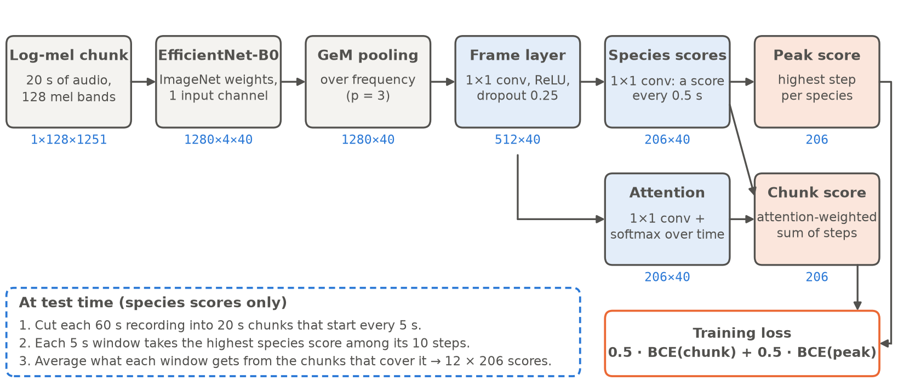

# Methodology

> **For assembly (Arshiya):** written by Sudhishna (Sudhishna). About 1.5 AAAI pages with
> Figure `sudhishna_sed_architecture.png` (full width, `figure*`). Jamie's draft
> (`jamie_AAAI_baseline_ablations_draft.docx`) also describes the spectrogram pipeline and the four
> baseline changes; keep the pipeline paragraph in one place only (here, or in Jamie's section)
> so the page budget is not spent twice. Section numbers below are placeholders.

All our models share one input representation and one training recipe, so a difference in score
can be traced to the model rather than to the data. We first describe the input features, then
the CNN baseline, and then the sound event detection (SED) model, giving the reason for each
choice.

## Input Features

Audio is read at its native 32 kHz and converted to log-mel spectrograms (FFT size 2048, hop 512,
i.e. one frame every 16 ms; 128 mel bands from 50 Hz to 14 kHz). We use spectrograms because
they turn audio into an image-like grid of time × frequency, which lets us reuse CNNs pretrained
on ImageNet, an important help when some species have only two training clips. The mel scale
gives more resolution to the low and middle frequencies where most calls lie. The 50 Hz lower
limit removes wind and handling rumble; the 14 kHz upper limit keeps high-pitched insects and
birds while staying below the 16 kHz Nyquist limit.

Each input is converted to decibels relative to its own loudest point, clipped to an 80 dB range
and scaled to [0, 1]. Normalising every window to its own maximum puts quiet and loud recordings
on the same scale, which matters because calls in the test soundscapes are often distant and
quiet while training clips are close-up (the domain shift in Section 2). Spectrograms of whole training clips (up to 30 s) are computed once and
cached as 8-bit integers (Jamie's pipeline, Section X), so training can cut a window from any
part of a clip without decoding audio again. The same code path normalises windows in training
and at test time, and a check against spectrograms computed directly from audio gave a
99th-percentile error of 0.005.

## CNN Baseline

The baseline treats each 5 s window as an image and classifies it with EfficientNet-B0
(Tan and Le 2019), pretrained on ImageNet and changed to take one input channel. It has 206
sigmoid outputs trained with binary cross-entropy (BCE), because several species can call at
the same time and the metric scores each species separately. We chose B0, the smallest
EfficientNet (about 4 M parameters), because the test set must be scored on a CPU within
90 minutes; a small model leaves time to run several models in an ensemble. Training uses AdamW
(Loshchilov and Hutter 2019) with learning rate 10⁻³ and weight decay 10⁻², a one-cycle
schedule (Smith and Topin 2019), batch size 64, 15 epochs and mixed precision on one T4 GPU.
Baseline v2 adds the three changes that improved the leaderboard: random 5 s crops, soundscape
noise with mixup (Zhang et al. 2018), and secondary labels as soft targets of 0.5
(Section X, Jamie's ablations).

The baseline has two limits that the SED model targets. First, labels are *weak*: a clip has one
label, but the animal may call for only a few seconds of it, so a random 5 s crop can be labelled
with a species that is silent in it. Second, each 5 s window is scored on its own, without the
seconds of context around it.

## Sound Event Detection Model

A sound event detection model predicts a score for every short time step instead of one score
per input, and then pools the step scores into one score per input for training (Mesaros et al.
2021). Because the loss only needs the pooled score, the model can be trained with clip-level
labels and still learn *when* in the clip a species calls, which is a direct answer to weak
labels (Kong et al. 2020). We re-implemented the SED approach described in the 1st-place
BirdCLEF+ 2025 write-up (Babych 2025), which trains on 20 s chunks and credits its head to the
4th-place BirdCLEF 2021 solution (tattaka 2021). We worked from the written descriptions only;
all code is our own.

**Architecture (Figure 1).** The input is a 20 s chunk: a 128 × 1251 spectrogram.
(1) *Backbone.* We use the same EfficientNet-B0 as the baseline but remove its global pooling and
classifier, so the time axis survives. The backbone shrinks both axes by 32, giving 1280 feature
channels × 4 frequency steps × 40 time steps; each time step covers 0.5 s. Keeping the backbone
of the baseline means a change in score comes from the head and the chunk length, not from a
larger network.
(2) *Frequency pooling.* Generalised-mean (GeM) pooling (Radenović, Tolias, and Chum 2019) with
p = 3 collapses the frequency axis. GeM lies between average pooling (p = 1) and max pooling
(p → ∞): a call fills only a few frequency bands, so average pooling would dilute it, while
max pooling would follow single noisy peaks.
(3) *Frame layer.* A 1 × 1 convolution (1280 → 512 channels) with ReLU and dropout 0.25 before
and after, shared by all time steps.
(4) *Two heads.* A 1 × 1 convolution gives a score for every species at every time step
(206 × 40), and a second one gives attention weights, normalised with a softmax over time.
The species-score bias starts at −4 (sigmoid ≈ 0.02), because nearly every species is absent
at nearly every step; starting near zero avoids a large, unstable loss in the first updates.
(5) *Pooling.* The *chunk score* is the attention-weighted sum of the step scores (Kong et al.
2020), and the *peak score* is the highest step score. The model has 4.9 M parameters.

**Loss.** We train with L = 0.5 · BCE(chunk score) + 0.5 · BCE(peak score). Attention pooling
lets the model decide which steps matter when a species calls several times, but it can spread a
species' score over many steps. The max term directly trains the step scores, which are what we
use at test time. The 4th-place 2021 write-up also adds a max-over-time term to the chunk loss,
with weights 1 and 0.5 (tattaka 2021); we use equal weights, which we did not tune.

**Training.** Each sample is a 20 s chunk cut at a random position from the cached whole-clip
spectrogram. Twenty seconds is about the median clip length, so a chunk covers four times as much
of a clip as a 5 s crop and is much more likely to contain the labelled call; the 47.9% of clips shorter than 20 s fit entirely in
one chunk and are placed at a random position in an otherwise silent chunk. We apply the full v2 recipe to the chunk (random position, soundscape noise, mixup and
secondary labels) and keep the baseline's optimiser, schedule, 80/20 split and random seed, so
the comparison with v2 changes only the model and the chunk length. Validation reports macro
ROC-AUC of the peak score over the 20 s chunk, and of the first 5 s alone, which is comparable
to the baseline's validation score. Each run takes about 50 minutes on a T4. We keep the weights
of the final epoch; Section X shows why this works better than keeping the epoch with the best
validation score. To measure what the long chunk is worth, we also train the identical model on
5 s chunks (10 time steps), which turned out to work better (Section X).

**Inference.** Each 60 s test recording is converted to a spectrogram once and cut into 20 s
chunks that start every 5 s (the last chunk ends at the end of the recording). Each 5 s window
takes, for every species, the highest step score among its 10 time steps, and the window's
final score is the average over the chunks that cover it (up to four). Overlapping chunks give
every window a second look with different context and average out the variation at chunk edges.
The full test set is estimated to take 34 minutes on Kaggle's 4-core CPU (27 minutes without
overlap), well inside the 90-minute limit. The 5 s model needs one chunk per window and no
overlap, and takes an estimated 16 minutes.

**Spectrogram settings.** The write-up uses finer frequency and coarser time resolution than our
shared spectrograms (224 mel bands, FFT 4096, hop 1252, 0–16 kHz), which gives 16 time steps of
1.25 s per 20 s chunk. We built a second spectrogram cache with these settings to test whether
they matter for our model (Section X).

*Figure 1: The SED model. Blue numbers are tensor shapes for one 20 s chunk (channels ×
frequency × time). The blue boxes are the layers added to EfficientNet-B0; the orange boxes are
the two pooled scores used in the training loss. At test time only the species scores are used.*

## References (Sudhishna)

Babych, N. 2025. 1st Place Solution: Multi-Iterative Noisy Student Is All You Need. BirdCLEF+ 2025
competition write-up, Kaggle.
https://www.kaggle.com/competitions/birdclef-2025/writeups/nikita-babych-1st-place-solution-multi-iterative-n.
Accessed: 2026-11-07.

Kong, Q.; Cao, Y.; Iqbal, T.; Wang, Y.; Wang, W.; and Plumbley, M. D. 2020. PANNs: Large-Scale
Pretrained Audio Neural Networks for Audio Pattern Recognition. *IEEE/ACM Transactions on Audio,
Speech, and Language Processing* 28: 2880–2894.

Loshchilov, I.; and Hutter, F. 2019. Decoupled Weight Decay Regularization. In *International
Conference on Learning Representations*.

Mesaros, A.; Heittola, T.; Virtanen, T.; and Plumbley, M. D. 2021. Sound Event Detection: A
Tutorial. *IEEE Signal Processing Magazine* 38(5): 67–83.

Radenović, F.; Tolias, G.; and Chum, O. 2019. Fine-Tuning CNN Image Retrieval with No Human
Annotation. *IEEE Transactions on Pattern Analysis and Machine Intelligence* 41(7): 1655–1668.

Smith, L. N.; and Topin, N. 2019. Super-Convergence: Very Fast Training of Neural Networks Using
Large Learning Rates. In *Artificial Intelligence and Machine Learning for Multi-Domain
Operations Applications*, volume 11006. SPIE.

Tan, M.; and Le, Q. V. 2019. EfficientNet: Rethinking Model Scaling for Convolutional Neural
Networks. In *Proceedings of the 36th International Conference on Machine Learning*, 6105–6114.
(Also in Jamie's list.)

tattaka. 2021. 4th Place Solution. BirdCLEF 2021 competition write-up, Kaggle.
https://www.kaggle.com/competitions/birdclef-2021/discussion/243293. Accessed: 2026-11-08.

Zhang, H.; Cisse, M.; Dauphin, Y. N.; and Lopez-Paz, D. 2018. mixup: Beyond Empirical Risk
Minimization. In *International Conference on Learning Representations*. (Also in Jamie's list.)
