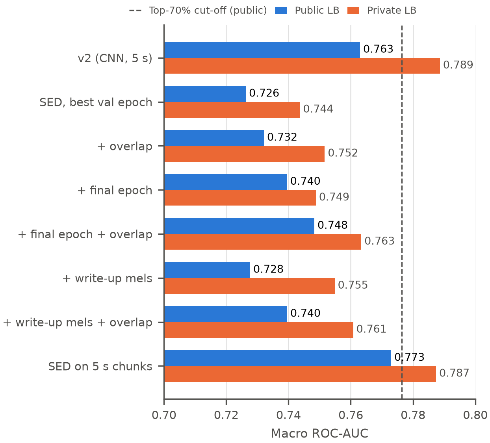
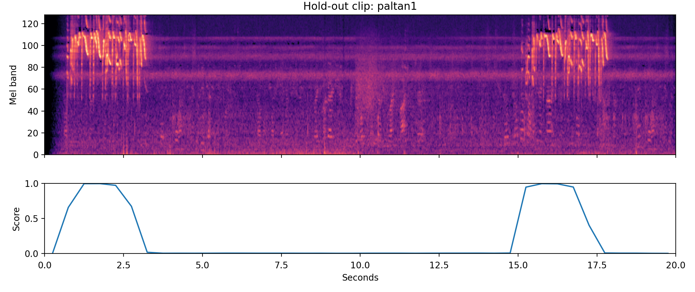

# Experiments: SED Model

> **For assembly (Member 4):** written by Sudhishna (Member 2). Goes in the Experiments section
> after Jamie's baseline ablations. About 0.75 page with Table 3 and Figures 5–6 (single column).
> Table and figure numbers are placeholders.

All SED runs use the setup of baseline v2 (same split, seed, optimiser, schedule and
augmentation) and were each trained once. Like Jamie's ablations, we report public and private
leaderboard scores and treat public differences below about 0.01 as inconclusive. Table 3 and
Figure 5 list every run.

| Run | Weights kept | Spectrogram | Chunks start every | Val AUC (first 5 s) | Public | Private |
|---|---|---|---|---|---|---|
| v2 (CNN, 5 s) | best (epoch 14) | 128 bands | 5 s | 0.977 | 0.763 | **0.789** |
| SED | best (epoch 7) | 128 bands | 20 s | 0.970 | 0.726 | 0.744 |
| + overlap | best (epoch 7) | 128 bands | 5 s | 0.970 | 0.732 | 0.752 |
| + final epoch | final (15) | 128 bands | 20 s | 0.974 | 0.740 | 0.749 |
| + final epoch + overlap | final (15) | 128 bands | 5 s | 0.974 | 0.748 | 0.763 |
| + write-up mels | final (15) | 224 bands | 20 s | 0.972 | 0.728 | 0.755 |
| + write-up mels + overlap | final (15) | 224 bands | 5 s | 0.972 | 0.740 | 0.761 |
| SED on 5 s chunks | final (15) | 128 bands | 5 s | **0.980** | **0.773** | 0.787 |

*Table 3: SED runs. All SED rows except the last use 20 s chunks. "Val AUC (first 5 s)" scores the
first 5 s of each hold-out clip with the primary label, the same as the baseline's validation.*

*Figure 5: Leaderboard scores of the SED runs against baseline v2. The dashed line is the public
top-70% cut-off.*

**On 20 s chunks the SED model stays below v2; on 5 s chunks it draws level.** The best 20 s run
(final epoch with overlapping chunks) scores 0.748 public and 0.763 private, 0.015 and 0.025
below v2. The same model trained on 5 s chunks scores 0.773 public and 0.787 private: 0.010
above v2 on the public set (our best public score) and 0.001 below on the private set, so we
count it as level with v2 rather than better.

**Which weights are kept matters more than expected.** The first run kept epoch 7, where the
validation peak AUC over the 20 s chunk was highest. Validation loss and the 5 s AUC, however,
were still noisy at epoch 7 and reached their best values at epoch 15, and at epoch 7 the one-cycle learning rate was still about 64% of
its peak. Retraining with the same seed reproduced the first run's history to four decimals, so
keeping the final epoch was the only change: it raised the public score by 0.013 (private +0.005)
without overlap and by 0.016 (private +0.012) with overlap. As in Jamie's ablations, our clean
hold-out clips are a poor guide for choosing a model, and a fixed training length is safer.

**Overlapping chunks help a little but consistently.** Starting a chunk every 5 s instead of every
20 s raised both scores for all three trained models (public +0.006 to +0.012, private +0.006 to
+0.015). Each gain alone is below our 0.01 threshold, but all six differences have the same sign.
The cost is about 7 extra CPU minutes on the test set.

**The write-up's spectrogram settings did not help.** With 224 mel bands and 1.25 s time steps,
the scores changed by −0.012 public / +0.006 private without overlap and −0.009 / −0.003 with
overlap. On hold-out clips the 224-band model scored some calls more confidently but placed them
less precisely in time, because each step covers 1.25 s instead of 0.5 s. The write-up chose
these settings for its own pipeline (three input channels, a different loss and schedule), so
they need not transfer to ours.

**Chunk length matters most.** Training on 5 s chunks instead of 20 s, with everything else
fixed and no overlap in either case, raised the scores by 0.033 public and 0.039 private, the
largest effect of any SED change. So the SED head works; the 20 s chunk was what held our model
back. This is the opposite of the write-up, whose supervised SED ensemble scored 0.842 public
with 5 s chunks and 0.872 with 20 s chunks (Babych 2025). The 5 s model is also faster: an
estimated 16 CPU minutes for the test set, against 34 for the 20 s model with overlap.

*Figure 6: A hold-out clip of* paltan1 *(top) and the SED model's score for that species every
0.5 s (bottom). The model was trained only with clip-level labels, but its scores rise exactly
when the species calls.*

**Why 20 s chunks hurt our model but not the write-up's.** We have not tested this directly. The
most likely reason is padding: 47.9% of our training clips are shorter than 20 s, so many of our
20 s training chunks are mostly silence, while a 5 s chunk is almost always filled with sound,
like the test soundscapes. The write-up's pipeline also differs in ways we did not copy: it
averages five models trained on different folds, uses cross-entropy with secondary labels set to
1, a lower learning rate with cosine warm restarts, and smoothing over neighbouring windows at
test time. Its supervised SED reached 0.872 public before any pseudo-labelling, so there is still
a large gap to close. Every configuration here was trained once with one seed, without tuning
the loss weights or learning rate for the new head. Because the 5 s SED model scores level with
v2 but is a different kind of model, it is a natural candidate for the ensemble (Section X).

## Contribution (Member 2)

Sudhishna: SED model re-implemented from the 1st-place write-up, its training and CPU inference
notebooks, seven SED leaderboard runs, the spectrogram cache with the write-up's settings, the
Methodology section and Figures 1, 5 and 6.

> **Suggestion for the team (AI use):** we used Claude (Anthropic) as a coding and writing
> assistant. The course encourages AI use, but a one-line acknowledgement is safer, for example:
> "We used Claude (Anthropic) to help write code and edit text; all experiments, results and
> design decisions were checked by the authors."
